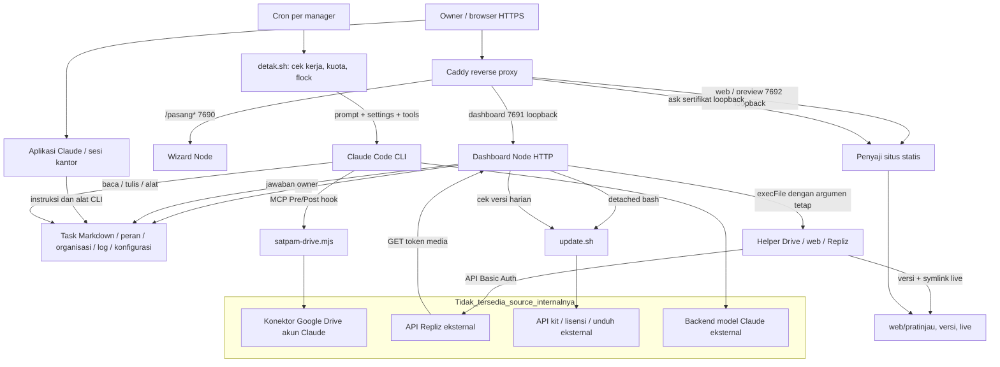

# Arsitektur Lembur.id berdasarkan source yang tersedia

Audit statis, 14 Oktober 2026. Root referensi seluruh path dalam dokumen ini: `C:/Kael AI/lembur-backup-lengkap/kantor/`. Source backup tidak dijalankan atau diubah. Nomor baris merujuk versi dalam arsip, bukan layanan VPS aktif.

Konvensi: referensi source pendek tanpa prefix `kantor/` atau `kit-kantor-ai/` merujuk `kit-kantor-ai/`. Kolom lokasi runtime pada bagian 4 secara khusus relatif folder kantor kerja (`kantor/`), bukan folder kit. Rujukan `:nomor` meneruskan file source yang disebut dalam paragraf yang sama.

`TERBUKTI` berarti implementasi langsung terlihat; `INDIKASI` berarti hubungan beberapa implementasi mendukung kesimpulan, tanpa pengujian runtime; `HIPOTESIS` membutuhkan pembuktian tambahan; `BELUM DAPAT DIPASTIKAN` berarti bukti implementasi tidak tersedia. Keberhasilan source bukan bukti proses tersebut hidup di VPS saat ini.

## 1. Bentuk sistem yang ditemukan

**TERBUKTI:** produk merupakan workspace berbasis file dengan CLI Claude sebagai pekerja AI, dashboard Node sebagai pembaca status dan pintu keputusan owner, cron sebagai pemicu kerja berkala, serta Caddy sebagai pintu HTTPS. Ini bukan server multi-agent dengan chat/model/session tersimpan per karakter pada dashboard.

- `kit-kantor-ai/dashboard/server.mjs:133–155,161–185,188–225`: membaca Markdown task, profil peran, organisasi, log detak, kuota, Drive dan website.
- `kit-kantor-ai/dashboard/server.mjs:846–864,1106–1136`: keputusan owner ditulis sebagai `Jawaban owner:`; status tetap menunggu sampai Claude memprosesnya.
- `kit-kantor-ai/detak.sh:79–111`: membuat prompt dari file terbaru dan menjalankan `claude -p`, model bawaan `sonnet` (`:17`), batas 15 giliran dan timeout 20 menit.
- `kit-kantor-ai/dashboard/server.mjs:725–755,1020–1099`: beberapa aksi dashboard benar-benar menjalankan helper non-AI: update, publish website, pemeriksaan konektor, serta API Repliz.
- `kit-kantor-ai/dashboard/aset/kantor.js:1–4,164–181,332–346`: karakter adalah visualisasi status task memakai sprite, latar gambar dan graf titik jalan. Tidak ada inference AI di animasinya.

### Kesetaraan source kit dengan salinan kantor

SHA-256 file utama dibandingkan; isi `kit-kantor-ai/dashboard/server.mjs` dan `kantor/dashboard/server.mjs` identik (`B0E08B2E4AE4989D1A45DDB1F9EAE4F49DB0DA8A4E88DEA956E31D9A251F5E36`). `situs.mjs` juga identik (`EEA4BCE88965F6166C35D4826C9E3B819848CC4D54B949E1CD65FF776B3FFE8E`).

Kesetaraan hash juga diperiksa untuk `kit-kantor-ai/dashboard/aset/{app.js,kantor.js,gaya.css}` dan `kit-kantor-ai/alat/{password-dashboard.mjs,repliz-inti.mjs,repliz.mjs,web.mjs,satpam-drive.mjs,drive-folder.mjs}`: seluruhnya identik antara kit dan kantor. Karena itu pembacaan penuh source kit berlaku untuk salinan source aktif dalam backup. File runtime, rahasia, sesi, dan data bisnis tidak dibaca untuk pembandingan ini.

## 2. Komponen dan komunikasi

Semua komponen lokal di diagram ditemukan pada source. Kotak eksternal menunjukkan kontrak client yang terlihat; database, pembayaran, scheduler internal Repliz, OAuth dan inference servernya **BELUM DAPAT DIPASTIKAN** dari backup ini. Diagram tidak mengklaim konfigurasi Caddy atau cron hasil instalasi masih berlaku di VPS aktif.

## 3. Entry point, boot dan umur proses

| Bagian | Entry point dan bukti | Perilaku |
|---|---|---|
| Instalasi dasar | `kit-kantor-ai/mulai.sh:46–71,126–138` | User aplikasi, runtime Node dan Claude CLI; detail installer di dokumen 03. |
| Proxy | `kit-kantor-ai/mulai.sh:89–115` | `/pasang*` → 7690; dashboard → 7691; host website → 7692; sertifikat on-demand memakai endpoint izin situs. |
| Dashboard | `kit-kantor-ai/dashboard/server.mjs:18–41,918–1154` | Memuat sesi hash, mengimpor helper Repliz opsional, HTTP loopback 7691, lalu memulai situs pada proses yang sama. |
| Situs | `kit-kantor-ai/dashboard/situs.mjs:24–29,67–92` | HTTP loopback 7692, hanya GET/HEAD, memilih preview atau live berdasarkan host. |
| Kerja otomatis | `kit-kantor-ai/detak.sh:24–75,96–137` | Satu proses per pemicu cron; cek jam, data bisnis, kuota, pekerjaan, batas harian, lock per manager, kemudian inference. |
| Timer Repliz | `kit-kantor-ai/dashboard/server.mjs:724–741` | Interval bawaan 10 menit untuk jadwal belum final; performa setelah jam 06, sekali per tanggal, retry paling cepat sejam. |
| Cek versi | `kit-kantor-ai/dashboard/server.mjs:743–755` | Interval 30 menit, mulai jam 09, penanda harian; menjalankan `update.sh --cek`, tidak mengunci akses dashboard. |
| Update owner | `kit-kantor-ai/dashboard/server.mjs:760–795` | Proses bash detached; PID, kode keluar dan log disimpan agar restart dashboard dapat menampilkan status. |

Dashboard/server utama memakai modul standar Node (`http`, `fs`, `path`, `crypto`, `os`, `child_process`, `url`); tidak memerlukan framework HTTP atau npm package untuk inti route. Helper Repliz juga memakai modul standar dan global `fetch`/`AbortSignal.timeout`. Browser automation/render dokumen/carousel merupakan dependensi terpisah, bukan kebutuhan server dashboard dasar. Runtime minimum dan versi paket instalasi dijabarkan di dokumen 03; kompatibilitas arsip Linux di Windows belum dibuktikan.

Tidak ada daemon/service supervisor baru yang dapat disimpulkan dari dashboard ini. `tmux` dipakai restart dashboard (`kit-kantor-ai/alat/password-dashboard.mjs:25–28`; `kit-kantor-ai/update.sh:96–98`). Rincian startup hasil instalasi dan reboot harus mengikuti installer dan bukti deployment; jangan menyamakan adanya kode dengan service yang sedang berjalan.

## 4. Penyimpanan data dan sumber kebenaran

| Data | Lokasi runtime relatif kantor | Dibaca/ditulis oleh | Jaminan dan batas |
|---|---|---|---|
| Task dan keputusan | `task/T-*.md` | Claude/detak; dashboard `bacaTask`, `tulisJawaban` | Frontmatter sederhana, blok `##`, status whitelist; tulis jawaban temp + rename. Tidak ada transaksi lintas proses atau revision guard. |
| Struktur tim | `ORGANISASI.md`, `peran/PERAN-*.md` | Builder/Claude; dashboard | Urutan meja dari organisasi; nama peran dari heading; state kerja dari task. |
| Memori | `catatan/<manager>.md`, `hasil/`, `brand/`, SOP | Claude/detak | Konteks ulang tiap putaran, bukan server session per agent. Detak membawa potongan file, bukan keseluruhan isi. |
| Aktivitas/kuota | `catatan/detak-*.log`, `.jatah`, `.rem-*`, `.detak-*` | detak; dashboard baca | Kuota bersama file terakhir; lock hanya per manager. |
| Password login | `.rahasia/dashboard.json` | installer/password helper; dashboard verifikasi | Salt+scrypt; nilai rahasia tidak diperiksa dalam audit. |
| Sesi browser | `.rahasia/sesi.json` | dashboard | Hash SHA-256 cookie→timestamp; berlaku 30 hari, memory fallback bila write gagal. |
| Tampilan | `dashboard/tampilan.json` | dashboard POST `/tampilan` | Pilihan whitelist, JSON di disk; tidak memanggil AI. |
| Drive | `.drive/{folder,dikenal,info}.json`, `dashboard/drive-cek.json` | drive helper/hooks/cek CLI | Cache izin folder/file, bukan ACL native Google; connector OAuth tetap di akun Claude. |
| Website | `web/pratinjau/`, `web/versi/<timestamp>/`, `web/live` | Claude buat draft; web helper publish/rollback | Live symlink ditukar via rename; maksimal lima versi. |
| Preview website | `web/pratinjau-token`, `web/host.json`, `web/domain.json` | web helper/installer | Token URL 96 bit, tidak ditemukan expiry/rotasi otomatis. |
| Sosmed | `sosmed/terbit/<id>.json`, `<id>.status.json`, `.akun.json`, `performa/` | Claude rencana; dashboard/helper status | Hash rencana+media diverifikasi saat jadwal; hasil API dicatat. |
| Rahasia Repliz | `.rahasia/repliz.json`, `repliz-setuju.json` | dashboard/helper | Key dan approval 0600 melalui temp + rename; bukan kredensial AI. |
| Update | `catatan/.update-jalan`, `.update-kode`, `update-dashboard.log` | dashboard/update script | PID + file kode keluar; deteksi selesai/putus; bukan rollback transaksi. |

**TERBUKTI:** tidak ditemukan SQL/Redis/queue server pada route dashboard dan helper yang dibaca penuh. Antrean kerja inti adalah status dan folder inbox di filesystem; tidak ada klaim tidak adanya komponen lain di seluruh produk hanya berdasarkan tabel ini.

## 5. Autentikasi, sesi dan otorisasi

`kit-kantor-ai/dashboard/server.mjs:906–912` memverifikasi password dengan scrypt dan timing-safe compare. Pada sukses (`:939–955`) cookie random 24 byte dibuat, hash saja disimpan, `HttpOnly; SameSite=Lax; Max-Age=2592000`; `Secure` tergantung `X-Forwarded-Proto=https`. Percobaan salah dibatasi 10/15 menit per nilai XFF atau alamat socket dalam memori.

Pengecualian tanpa sesi hanya aset whitelist, `/sehat`, `/robots.txt`, token media publik, dan POST login. Seluruh route berikutnya melewati guard sesi `:958–962`. Tidak ada RBAC: siapa memegang cookie dianggap owner penuh. Empat identitas perlu dibedakan: login dashboard, autentikasi Claude, key Repliz/Drive connector, serta kode pembelian untuk install/update. Mereka bukan satu akun.

POST update dan seluruh aksi sosmed wajib origin/referer serta HMAC token form (`:1030–1053`). POST jawaban, tampilan, Drive cek, publish/rollback menolak asal berbeda bila header ada, tetapi menerima header asal kosong (`:1015–1027,1101–1148`). Ini batas kontrol CSRF yang perlu ditingkatkan, bukan bukti otomatis semua route terbuka. `SameSite=Lax`, sesi dan proxy tetap merupakan perlindungan nyata.

## 6. Inventaris lengkap route dashboard

`S` = sesi owner wajib; `O?` = menolak asal berbeda jika Origin/Referer tersedia; `OT` = asal harus ada/cocok + token form timing-safe; `P` = publik. Beberapa route tidak membatasi metode secara eksplisit; kolom mencatat perilaku source, bukan hanya metode yang UI gunakan. Semua route unknown akhirnya 404. Urutan guard di `kit-kantor-ai/dashboard/server.mjs:918–1154` penting.

| Route | Metode source | Auth | Input → output / efek / helper | Bukti server.mjs |
|---|---|---|---|---|
| `/aset/<whitelist>` | Tidak dibatasi | P | Nama/path regex ketat → CSS/JS/WebP/font kit, cache aset | 921–925 |
| `/sehat` | Tidak dibatasi | P | `ok`; bukan status AI | 926 |
| `/robots.txt` | Tidak dibatasi | P | Crawler allow token publik; robots bukan autentikasi | 929 |
| `/publik/sosmed/<36hex>/<n.ext>` | GET, HEAD | P + token | `RZ.mediaPublik`: token, SHA, expiry; stream file terjadwal | 930–935 |
| `/masuk` | POST; lainnya form login sebelum guard | P | Password maksimal 2048 karakter → scrypt, cookie dan file sesi; kegagalan 401/429 | 939–962 |
| `/keluar` | Tidak dibatasi | S | Hapus hash sesi, simpan dan redirect; cookie tidak dihapus eksplisit | 963 |
| `/` | Tidak dibatasi | S | Ringkasan task/keputusan/status | 966 |
| `/kantor` | Tidak dibatasi | S | Latar + kantor.js + panel tim | 967 |
| `/task` | Tidak dibatasi | S | status/pegang whitelist → daftar task | 968;400–421 |
| `/tim` | Tidak dibatasi | S | Profil peran dan tombol salin prompt | 969 |
| `/lainnya` | Tidak dibatasi | S | Tampilan, instruksi, integrasi, akun, update | 970 |
| `/drive` | Selain POST | S | Bila cek >30 menit, `execFile claude mcp list`; render status | 971–975;475–491 |
| `/web` | Selain POST | S | pesan query dipotong+escaped, metadata preview/live | 976–979 |
| `/web/foto/<whitelist>.png` | Tidak dibatasi | S | File screenshot lokal dengan whitelist, cache privat 60 detik | 980–984 |
| `/sidik` | Tidak dibatasi | S | SHA1 fingerprint data untuk refresh UI | 985;229 |
| `/sosmed` | Selain POST | S | Rencana, approval, status, performa; key tidak dikirim | 986–989 |
| `/sosmed/media/<id>/<n>` | Tidak dibatasi | S | ID regex→periksa plan→gambar lokal selain video | 990–995 |
| `/update/status` | Tidak dibatasi | S | JSON tahap; UI memeriksa tiap 3 detik | 996 |
| `/update` | Selain POST | S | Halaman proses/update; log dibatasi 25 baris | 997–1001;760–818 |
| `/data.json` | Tidak dibatasi | S | State karakter dan ringkasan task; tidak mengirim seluruh file | 1002–1004 |
| `/fragmen/task/<filename>` | Tidak dibatasi | S | decode+regex+task yang sudah ada→HTML drawer | 1005–1013 |
| `/task/<filename>` | Tidak dibatasi | S | sama→halaman detail | 1005–1013 |
| `/web/terbitkan`, `/web/balik` | POST | S,O? | `execFile node alat/web.mjs terbitkan|balik`,60 detik; cek web sesudahnya | 1020–1028 |
| `/update` | POST | S,OT | Token maksimal 512 karakter → mulaiUpdate menjalankan bash terpisah → redirect | 1030–1043 |
| `/sosmed/kunci` | POST | S,OT | body maksimal 4096 karakter, Access/Secret→tes daftar akun API→key dengan mode 0600 | 1044–1064 |
| `/sosmed/putus` | POST | S,OT | hapus key/cache akun; jadwal eksternal tetap ada | 1066–1068 |
| `/sosmed/segarkan` | POST | S,OT | `alatRepliz status`,60 detik | 1070–1073 |
| `/sosmed/performa` | POST | S,OT | `alatRepliz performa`,300 detik | 1074–1077 |
| `/sosmed/setuju` | POST | S,OT | ID sesuai regex → periksa → approval SHA mode 0600 → helper jadwal, timeout 180 detik | 1078–1086 |
| `/sosmed/tolak` | POST | S,OT | ID sesuai regex, alasan dinormalisasi maksimal 300 karakter→status ditolak | 1087–1092 |
| `/sosmed/batal` | POST | S,OT | ID sesuai regex→helper batal 60 detik→API DELETE | 1093–1096 |
| `/sosmed/<aksi lain>` | POST jika helper RZ tersedia | S,OT | Tetap memeriksa token; aksi unknown → pesan gagal | 1044–1099 |
| `/drive/cek` | POST | S,O? | Cek konektor CLI, satu pemeriksaan pada satu waktu, lalu redirect | 1101–1105 |
| `/jawab` | POST | S,O? | body maksimal 4096 karakter; file yang ada/status menunggu/opsi valid; normalisasi jawaban bebas maksimal 400 karakter; temp + rename | 1106–1137 |
| `/tampilan` | POST | S,O? | Body maksimal 512 karakter; template/owner whitelist → tulis JSON → redirect | 1138–1151 |

Semua aksi subprocess HTTP memakai executable/helper tetap dan argumen array; tidak ditemukan endpoint HTTP yang menerima perintah shell arbitrer atau eval pada route ini. Bash update memakai program tetap dengan path sebagai positional parameter (`:789`), bukan interpolasi input form. Ini tidak menjamin isi helper/update aman tanpa audit terpisah.

### Route situs terpisah

`kit-kantor-ai/dashboard/situs.mjs:67–92` menolak metode selain GET/HEAD. `/caddy-boleh?domain=...` menerima hanya socket loopback dan nama terdaftar. Host `pratinjau.<dashboard>/<token>/...` menyajikan draft tanpa login dashboard; token salah menghasilkan 404, prefix tanpa slash diarahkan dengan 302. Host `web.<dashboard>` atau domain terdaftar menyajikan `web/live`; host lain menghasilkan 404. Pembatasan file memakai decode, penolakan dot/backslash/NUL, pemeriksaan prefix realpath, jenis file dan symlink terakhir (`:32–50`). Tidak ada upload atau eksekusi server-side untuk file website. HTML/JS website berjalan di browser pengunjung sebagaimana situs statis biasa.

## 7. Perjalanan satu pekerjaan dan keputusan

1. Owner menyalin `baru: ...`/`jadi <nama>` dari dashboard ke sesi Claude. Tombol tersebut hanya clipboard, **tidak dispatch AI** (`kit-kantor-ai/dashboard/server.mjs:247–248,430–433`; `kit-kantor-ai/dashboard/aset/app.js:55–73`).
2. Claude mengikuti peran/SOP dan membuat/memperbarui Markdown task; dashboard membaca file pada request, bukan event dari inference server.
3. Bila butuh keputusan, task berstatus `nunggu-kamu` dan menyertakan blok soal/opsi. Dashboard memparse format tersebut (`kit-kantor-ai/dashboard/server.mjs:98–155`).
4. Klik owner mengirim POST `/jawab`; input diverifikasi berdasarkan task existing, nomor dan pilihan valid. Jawaban ditambahkan via temp + rename, update tanggal diganti. Tidak ada panggilan model atau perubahan status langsung (`:1106–1136,846–864`).
5. UI mengambil ulang drawer dan bagian halaman; fingerprint diperiksa tiap 30 detik dan karakter tiap 20 detik (`kit-kantor-ai/dashboard/aset/app.js:185–212,220–251`; `kit-kantor-ai/dashboard/aset/kantor.js:332–346`). “Live” di sini berarti membaca state berkala, bukan streaming token.
6. Cron/detak berikutnya mendeteksi jawaban, membuat prompt ulang dengan prioritas task terjawab, lalu menjalankan Claude (`kit-kantor-ai/detak.sh:52–54,79–111`). Kalau detak mati, owner harus melanjutkan dari aplikasi Claude; UI menjelaskan kondisi tersebut (`kit-kantor-ai/dashboard/server.mjs:835–839`).
7. Claude mencatat hasil, mengosongkan keputusan dan mengubah task. Poll berikutnya mengubah dashboard/karakter. Tidak ada bukti broker queue durable, transaksi task ownership, jaminan exactly-once, atau konteks chat persisten per karakter.

## 8. Perjalanan publish nyata dan approval

**Website:** Claude menulis `web/pratinjau/`; owner melihat token preview dan screenshot; POST terbitkan menjalankan helper. `kit-kantor-ai/alat/web.mjs:124–142` memeriksa draft, menyalin ke versi dengan timestamp, membuat symlink sementara dan rename ke live, menyisakan lima versi, serta menyediakan balik versi sebelumnya. Pemeriksaan `ukur` adalah heuristik HTML/SEO, bukan browser QA menyeluruh atau audit malware.

**Sosmed:** Claude menulis rencana JSON. `kit-kantor-ai/alat/repliz-inti.mjs:129–162` memeriksa caption/waktu/media/akun dan menghitung hash rencana beserta SHA media pada 160–162. POST owner merekam hash dalam `.rahasia/repliz-setuju.json`; fungsi `jadwal` pada 233–270 membandingkannya ulang di 238 sebelum request API. Media diakses Repliz memakai token acak 144 bit; fungsi `mediaPublik` pada 198–213 memeriksa hash dan membatasi masa akses tiga hari setelah selesai. Pemeriksaan status dan performa tidak memakai AI. Retry posting otomatis sengaja tidak dilakukan karena risiko ganda (274–300). Kontrak client tersedia; keberhasilan remote dan perilaku API paket komersial saat ini tidak diverifikasi.

## 9. Failure, pemulihan dan batas operasi

- Helper subprocess memiliki timeout; konektor Drive single-flight; update memakai PID/file status dan lock script. Guard ini bukan transaksi database.
- Dashboard memakai banyak operasi filesystem sinkron pada request; parse gagal sering kembali ke nilai kosong, tetapi beberapa error tipe/IO belum ditangkap menyeluruh (dokumen 06).
- Sesi gagal disimpan tetap berjalan hanya di memori; restart kemudian dapat menghilangkannya (`kit-kantor-ai/dashboard/server.mjs:30–34`).
- Detak mencatat timeout tetapi keluar dengan kode 0 pada akhir; cron tidak mendapat kegagalan lewat exit code (`kit-kantor-ai/detak.sh:112–137`). Kuota lama/tidak tersedia bukan bukti kuota aktual.
- Risiko task, approval dan jadwal yang berubah bersamaan dijabarkan di dokumen 06. Rename atomik mencegah file setengah tertulis, tetapi tidak mencegah penimpaan perubahan penulis lain.
- Layanan model, OAuth Drive, Repliz, DNS/TLS, server kit, disk VPS, cron dan CLI menjadi titik kegagalan. Backup ini tidak menyertakan status kesehatan produksi yang dapat diaudit tanpa membuka data rahasia.
- Pemeriksaan lisensi harian dashboard hanya mencari versi. Tidak ada middleware yang menolak penggunaan task/dashboard setelah lisensi expired pada code route yang dibaca; backend penjualan/pencabutan tidak tersedia. Sumber `kit-kantor-ai/mulai.sh:49` sendiri menjelaskan kode disimpan untuk update; bukan bukti semua skema bisnis vendor di luar versi ini.

## 10. Implikasi untuk KAEL

Yang layak dipelajari: pemisahan draft/publish, approval yang terkait hash isi, helper deterministik untuk perhitungan/eksekusi, UI ringan membaca state, serta pengurangan biaya dengan mengecek pekerjaan sebelum memanggil model.

Yang perlu dirancang mandiri: database/jobqueue dengan ownership dan revision, runtime adapter per model, audit event, role owner/manager/worker, secret broker terpisah, session memory per agent, Telegram router dan status realtime. Animasi kantor KAEL harus mengikuti pekerjaan nyata dari runtime; dashboard yang memperlihatkan prompt clipboard tidak memenuhi kebutuhan chat/task autonomous per agent dengan sendirinya. Blueprint rinci ada di07; kode/aset/endpoint privat vendor tidak menjadi bahan implementasi KAEL.

## 11. Cakupan dan yang belum dibuktikan

Dibaca penuh: dashboard server 1154 baris, situs 93 baris, app 278 baris, kantor 347 baris, CSS 666 baris; helper password 32, folder Drive 65, satpam Drive 131, web 171, CLI Repliz 71, inti Repliz 404; pagar 154; detak 137. Source utama dan helper dibandingkan hash dengan salinan kantor. Potongan installer/update diperiksa sebagai konfirmasi silang; pembacaan penuh file tersebut dicatat audit installer pada dokumen 03/04.

Tidak menjalankan Node dari backup, CLI Claude, tes vendor, render browser, endpoint lokal/remote, installer, update, cron atau credential. Tidak membuka isi JSON runtime pelanggan, rahasia, SSH atau sesi Claude. Karena itu status VPS aktif, izin efektif akibat settings lokal/CLI, kompatibilitas API aktual, akses akun dan keberhasilan pemulihan backup **BELUM DAPAT DIPASTIKAN**.
