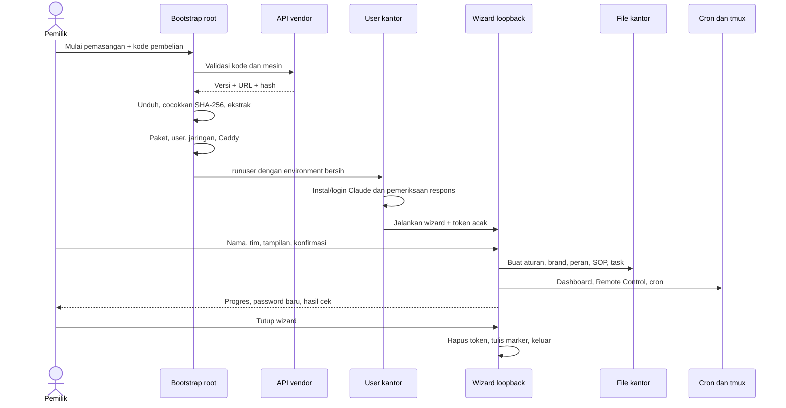

# 03 — Instalasi, pembaruan, dan pemulihan Lembur

Tanggal audit: 14 Oktober 2026. Audit statis; tidak ada installer, tes, layanan, API, atau unduhan yang dijalankan. Akar sumber untuk semua rujukan relatif adalah `C:/Kael AI/lembur-backup-lengkap/kantor/kit-kantor-ai/`. Versi teks `VERSI`: **0.18.7**. Dokumen sumber diperlakukan sebagai bahan audit, bukan instruksi untuk dijalankan.

Label bukti: **TERBUKTI** = terlihat dalam kode; **INDIKASI** = kesimpulan yang didukung struktur tetapi belum diuji; **HIPOTESIS** = kemungkinan yang memerlukan uji; **BELUM DAPAT DIPASTIKAN** = membutuhkan server vendor, lingkungan Linux, atau pengujian langsung yang tidak dilakukan.

## Temuan utama

**TERBUKTI:** ada dua jalur berbeda. Jalur otomatis terdiri atas bootstrap berlisensi → persiapan root → wizard lokal sebagai user → konfigurasi kantor. Jalur manual `pasang.sh` hanya memasang pondasi dan template; bukan alternatif yang menghasilkan semua kemampuan wizard secara otomatis. Rujukan: `installer/pasang-awal.sh:14–69`, `mulai.sh:20–194`, `pasang.sh:12–50`.

**TERBUKTI:** pemisahan root/user benar-benar dilakukan dengan `runuser` dan lingkungan yang dibersihkan, tetapi user kerja juga ditambahkan ke grup sudo. Ini mengurangi pekerjaan rutin sebagai root; belum merupakan isolasi tenant atau sandbox proses AI. Rujukan: `mulai.sh:18`, `mulai.sh:46–53`.

**TERBUKTI:** rerun dan update bukan transaksi atomik. Ada backup beberapa file, pelestarian perubahan, serta penanganan konflik, tetapi tidak ada rollback otomatis seluruh sistem. Pernyataan “aman dijalankan ulang” harus dibaca bersama pengecualian di bawah.

## Urutan pemasangan otomatis

| Tahap | Pelaksana dan tindakan | Input/keluaran | Bukti dan batas | Padanan untuk Kael (REKOMENDASI) |
|---|---|---|---|---|
| 1. Bootstrap | Root; memastikan alat dasar | Kode pembelian dinormalisasi dan divalidasi; fingerprint dari hash machine-id | **TERBUKTI**, `installer/pasang-awal.sh:14–19`; perlu sistem apt dan machine-id | Preflight installer Kael: cek OS, disk, RAM, port. Aktivasi memakai kode sekali pakai + installationId acak, bukan hash machine-id saja (laporan 08 §3). Belum ada. |
| 2. Validasi hak unduh | Root menghubungi API vendor | Kode + fingerprint; respons versi, URL, SHA-256 | **TERBUKTI**, `installer/pasang-awal.sh:32–52`; semantik database backend tidak terlihat | Pusat lisensi Kael minimal (pendekatan B): menerbitkan token lisensi bertanda tangan; tidak menerima data kerja. Belum ada (P5). |
| 3. Unduh dan ekstrak | Root | Arsip sementara, SHA dibandingkan, folder kit dipindah ke `/root/kit-kantor-ai-<versi>` | **TERBUKTI**, `installer/pasang-awal.sh:48–64`; folder versi tujuan yang sudah ada dihapus | Manifest rilis bertanda tangan + SHA-256, tolak traversal/symlink, rilis per versi; versi lama dihapus hanya setelah healthcheck lolos. Belum ada (P4/P5). |
| 4. OS dan jaringan | Root | Paket apt, zona WIB, upgrade, cron, swap, firewall jika ufw tersedia | **TERBUKTI**, `mulai.sh:20–44`; hanya memeriksa VERSION_ID 22.04/24.04, bukan ID distro | Preview perubahan sebelum diterapkan; tidak upgrade OS diam-diam; firewall hanya membuka port proxy. Belum ada (P4). |
| 5. User kerja | Root | User `kantor` default, grup sudo, kode lokal mode 600, salinan authorized_keys bila perlu, password interaktif opsional | **TERBUKTI**, `mulai.sh:46–63`; audit tidak membaca nilai file tersebut | User layanan tanpa sudo; root hanya dipakai saat instalasi (laporan 07 §10). Belum ada (P4). |
| 6. Node dan browser | Root | Node ≥20 diterima; jika tidak ada/terlalu lama memasang melalui kanal Node 22; pustaka Chromium | **TERBUKTI**, `mulai.sh:65–72`; versi eksternal tidak dikunci pada build tertentu | Kael mensyaratkan Node 24+ (`package.json`); versi runtime dikunci per rilis dan diuji. Sebagian: syarat sudah tertulis, belum ada pemasangan otomatis. |
| 7. Alamat dan HTTPS | Root | Nama vendor atau alamat tersimpan; Caddy routing wizard/dashboard/situs | **TERBUKTI**, `mulai.sh:74–124`, `installer/alamat.sh:60–82`; registrasi alamat baru memerlukan vendor | Domain milik pelanggan + reverse proxy HTTPS; server Kael tetap di loopback di belakangnya. Host/Origin guard sudah ada (`server/index.mjs`), login belum (P2). |
| 8. Kit dan Claude | Root menyalin kit; Claude sebagai user | Kit milik user, CLI, setelan sesi, login dan prompt satu kata | **TERBUKTI**, `mulai.sh:126–169`; tahap bootstrap ini memang memanggil AI di baris 167 | Pelanggan login sendiri ke provider AI. Runtime Codex per agent sudah ada (`server/runtime.mjs`, tahap 5); installer tidak perlu memanggil AI saat instalasi. |
| 9. Wizard | Proses tmux user, loopback 7690 default | Token acak 128 bit, link/QR, cookie, isian tersimpan | **TERBUKTI**, `mulai.sh:171–190`, `installer/wizard.mjs:12–31,230–245` | Bootstrap owner sekali pakai: link berumur pendek untuk membuat akun owner, lalu dinonaktifkan. Belum ada (P2/P4). |
| 10. Materialisasi kantor | User | Aturan, organisasi, brand, peran, skill, SOP, task, dashboard, notifikasi, jadwal | **TERBUKTI**, `installer/pasang.mjs:246–442`; beberapa tahap opsional boleh gagal | Divisi, anggota, SOP dan setelan agent sudah dibuat dari UI Kael (tahap 1–4); installer cukup menyiapkan workspace kosong + contoh opsional. |
| 11. Pemeriksaan dan penutupan | User | Hasil cek ditampilkan; password baru ditampilkan; panduan HP dan notifikasi | **TERBUKTI**, `installer/wizard.mjs:152–208,224–228`; hasil cek tidak menjadi gate sukses keras | Healthcheck menjadi syarat keras sebelum layanan aktif, hasil dicatat di step journal. Belum ada (P4). |

Kolom padanan adalah usulan untuk Kael berdasarkan laporan 07–09; hanya bagian yang menyebut file Kael yang sudah ada di kode. Diagram menggambarkan jalur kode normal, bukan bukti bahwa pemasangan pada VPS tertentu berhasil.

## Pemisahan privilege dan jejak permanen

| Lingkup | Perubahan permanen | Catatan audit |
|---|---|---|
| Root OS | Apt update/upgrade, swap dan fstab, timezone, user/group, cron, firewall bila ada | **TERBUKTI** `mulai.sh:27–71`. Tidak ada fungsi uninstall untuk membalik seluruh perubahan. |
| Root reverse proxy | Repositori Caddy, konfigurasi global, reload/restart | **TERBUKTI** `mulai.sh:83–115`. Konfigurasi global ditimpa, tanpa backup/validate seperti jalur ganti alamat. |
| Home user | Kit, penanda alamat/wizard, kode pembelian, setelan global Claude | **TERBUKTI** `mulai.sh:49–50,116–138,166–177`. Setelan biaya sesi diisi hanya bila key belum ada; dua flag onboarding/trust ditetapkan eksplisit. |
| Kantor | Markdown bisnis, tools, skill proyek, dashboard, rahasia lokal | **TERBUKTI** `installer/pasang.mjs:249–345`. Satu UID tetap dapat mengakses semua divisi. |
| Jadwal user | Blok crontab bernama, startup dashboard dan Remote Control, detak tiap divisi, cek update harian | **TERBUKTI** `installer/pasang.mjs:210–234,381–383`. Baris crontab di luar blok dipertahankan. |

**INDIKASI risiko host:** `KANTOR_USER` dan `KANTOR` adalah override operator; beberapa perintah tmux/cron menggunakan string shell dengan path interpolasi. Path default sederhana bekerja secara rancangan, tetapi path yang mengandung spasi atau karakter shell tidak tervalidasi sebagai sebuah konfigurasi yang aman (`mulai.sh:8–9,177`; `installer/pasang.mjs:213–221,342,359`). Tidak dilakukan percobaan injeksi.

**TERBUKTI:** paket firewall tidak dimasukkan ke daftar pemasangan dan konfigurasi ufw hanya berjalan jika perintahnya tersedia (`mulai.sh:29,43`). Karena itu “firewall sudah aktif” tidak dapat diasumsikan untuk semua VPS baru.

## Wizard: alur UX, akses, dan state

**TERBUKTI:** layar utama hanya sambutan, kenalan, tim, tampilan, ringkasan; Builder selalu ada. Data bisnis dilengkapi kemudian sebagai task. Pilihan divisi dipetakan dari konstanta, bukan dibuat AI ketika wizard berjalan (`installer/wizard.mjs:23–26,70–130`; `installer/pasang.mjs:20–73,294–301`). Ini contoh onboarding bertahap yang dapat dipelajari tanpa menyalin template.

**TERBUKTI:** token link ditukar menjadi cookie HttpOnly, SameSite=Strict, umur dua jam; Secure jika produksi memiliki alamat. POST memeriksa Origin ketika alamat tersedia; CSP membatasi resource/form ke origin sendiri. Body dibatasi 65.536 karakter. Aset memakai regex nama sederhana. Rujukan: `installer/wizard.mjs:210–245`.

**TERBUKTI:** isian mentah form digabung ke objek tanpa whitelist tiap layar; `rapihin` memilih opsi enumerasi untuk tampilan/avatar/detak dan menghasilkan slug peran, tetapi teks nama/brand tidak dibatasi di server seperti maxlength HTML. Akses memerlukan token, namun HTML bukan validasi server. Rujukan: `installer/wizard.mjs:81–82,256–260`; `installer/pasang.mjs:86–130`.

**TERBUKTI:** JS hanya melakukan salin, menahan klik ganda, polling progres dua detik, dan redirect selesai. Elemen hasil proses memakai textContent. Form server dan refresh noscript tetap tersedia (`installer/aset/wizard.js:3–47`; `installer/wizard.mjs:59,133–143`).

**TERBUKTI:** CSS memiliki focus-visible, area sentuh besar, sticky action pada HP, safe-area, serta prefers-reduced-motion (`installer/aset/wizard.css:13,46,107–111,160–177`). **BELUM DAPAT DIPASTIKAN:** kontras aktual, pembaca layar, tab order lintas perangkat, serta QR/clipboard pada browser nyata; audit ini tidak merender wizard.

### Kekeliruan state selesai yang penting

**TERBUKTI:** timer dua jam memanggil `selesaiDanMati`, fungsi yang juga menulis marker selesai dan menghapus token (`installer/wizard.mjs:224–228,297`). `mulai.sh` membaca keberadaan marker untuk mencetak kantor sudah jadi (`mulai.sh:190–194`). Jadi timeout dapat ditandai “selesai” meskipun proses belum sukses. Ini salah klasifikasi selesai, bukan bukti kehilangan data yang telah terjadi.

**TERBUKTI:** `jalankanPasang` menghentikan tahap wajib ketika exception, tetapi tahap opsional boleh gagal. Setelah semua tahap, output cek dikumpulkan tanpa memeriksa exit code, lalu status ditetapkan selesai (`installer/wizard.mjs:192–208`). “Wizard selesai” tidak setara dengan “semua fasilitas sehat”.

## Rerun: apa dipertahankan dan apa dapat tertimpa

| Jalur/kondisi | Perilaku nyata | Risiko atau manfaat |
|---|---|---|
| `pasang.sh` manual | Helper salin melewati file yang sudah ada; `.rahasia` dikunci 700 | **TERBUKTI** `pasang.sh:22–40`; tidak membuat wizard/HTTPS/cron/dashboard lengkap |
| Bootstrap versi sama | Folder root tujuan versi sama dihapus lalu diganti | **TERBUKTI** `installer/pasang-awal.sh:63–64`; kit root bukan tempat menyimpan perubahan bisnis |
| `mulai.sh` ulang | User, swap, CLI, dan dependency marker dapat dilewati; kit home diganti; sesi wizard diulang | **TERBUKTI** `mulai.sh:38–50,66–72,127–138,172–177`; bukan instalasi tanpa efek samping |
| Wizard pada kantor lama | Backup CLAUDE.md, ORGANISASI.md, brand/, peran/, agents/ | **TERBUKTI** `installer/pasang.mjs:251–256`; backup tidak mencakup semua file yang kemudian ditulis |
| Tools dan SOP | Alat selalu ditimpa; SOP divisi ditulis kembali | **TERBUKTI** `installer/pasang.mjs:270–271,304`; perubahan lokal di bagian ini tidak dilindungi backup rerun tersebut |
| Task pertama | Penomoran dimulai lagi T-01; path task deterministik ditulis dengan overwrite default | **TERBUKTI** `installer/pasang.mjs:76–81,293–323`; **INDIKASI** task lama pada path sama dapat tertimpa, sementara path lama lain tersisa |
| Dashboard dan password | Salinan dashboard tidak memaksa overwrite file lama; tampilan ditulis; password hanya dibuat jika belum ada | **TERBUKTI** `installer/pasang.mjs:333–344`; password lama dipertahankan |
| Cron | Hanya blok kantor-ai diganti; jadwal pemilik di luar blok tetap | **TERBUKTI** `installer/pasang.mjs:226–234`; jadwal di dalam blok dianggap milik installer |

**INDIKASI:** menggunakan rerun wizard sebagai prosedur upgrade/pemulihan umum lebih berisiko daripada jalur update yang memang membandingkan versi lama. Perlu snapshot penuh dan laporan diff sebelum rerun di sistem berisi data.

## Update: integritas, konflik, restart, dan rollback

**TERBUKTI:** cek harian hanya menghubungi versi, menulis spanduk versi/penting, dan mengirim notifikasi sekali per versi. Gagal cek versi keluar sukses agar tidak merusak kantor (`update.sh:44–66`). Cron 09:17 dan timer dashboard menjadi dua jalur cek; marker harian dashboard ditulis sebelum proses cek, sehingga kegagalan cek tidak langsung diulang oleh timer pada hari sama (`installer/pasang.mjs:216`; `dashboard/server.mjs:743–755`).

**TERBUKTI:** memasang update perlu versi lebih baru, hak unduh valid, arsip dengan hash cocok, struktur dasar ada, lalu `perbarui.mjs`. Lock flock digunakan jika binary tersedia; tanpa flock tidak ada jaminan lock lintas pemanggil shell (`update.sh:69–91`).

| File saat ini dibanding baseline lama | Tindakan | Bukti |
|---|---|---|
| Sudah sama dengan versi baru | Lewati | `installer/perbarui.mjs:58` |
| Belum ada dan syarat folder terpenuhi | Tambah file | `installer/perbarui.mjs:54–59` |
| Sama persis dengan baseline lama | Backup lalu replace, mode lama dipertahankan | `installer/perbarui.mjs:61–64` |
| Markdown berubah dan merge tiga arah bersih | Backup lalu tulis hasil git merge-file | `installer/perbarui.mjs:27–31,65–69` |
| Konflik, non-Markdown berubah, atau git tak tersedia | File saat ini dipertahankan; simpan `.baru-<versi>` di samping | `installer/perbarui.mjs:70–72` |
| Pagar Claude | Gabung setelan baru dengan aturan tambahan lokal | `installer/perbarui.mjs:77–94`; kegagalan hanya warning |
| Peran manager/aturan bisnis | Tidak diubah otomatis; perbedaan template dilaporkan | `installer/perbarui.mjs:96–105` |

**TERBUKTI:** baseline daftar update selektif mencakup tools, runtime detak/notif, dashboard yang sudah terpasang, SOP/skill yang dipakai, dan Builder yang dapat ditransformasi ke brand. File bisnis umum, hasil, task isi bisnis, serta peran manager tidak masuk pemetaan (`installer/perbarui.mjs:34–49`). **Pengecualian:** README task/kotak-masuk termasuk pemetaan; kata “task tidak disentuh” bukan berarti semua path dalam folder task tidak mungkin berubah.

**TERBUKTI:** sesudah write kantor, folder kit lama dipindah ke `.lama`, satu versi sebelumnya dibuang, kit baru dipindah, lalu dashboard restart jika file dashboard diganti/ditambah (`update.sh:91–100`; `installer/perbarui.mjs:106`). File kantor pra-update dicadang di folder berdasarkan versi, bukan snapshot database menyeluruh (`installer/perbarui.mjs:25–26`).

**INDIKASI risiko integritas:** hash dari API yang sama melindungi terhadap unduhan rusak/berbeda dari manifest yang diterima. Tidak terlihat detached signature atau root key rilis independen. Ekstraksi tar tidak didahului pemeriksaan semua path, symlink, ownership, ukuran arsip, atau daftar file yang diizinkan (`installer/pasang-awal.sh:51–64`; `update.sh:77–94`). Jangan menyimpulkan ada eksploit aktif; ini celah kontrol terhadap artefak yang dianggap tepercaya.

**TERBUKTI:** write per-file dilakukan sebelum kit swap; exception di tengah tidak mengembalikan file yang telah ditulis. Pesan “kit lama belum diganti” benar tentang folder kit, tetapi belum menjamin kantor tetap versi lama (`update.sh:91`; `installer/perbarui.mjs:53–94`). Tidak ada health gate setelah restart yang otomatis memilih versi lama. Backup dan `.lama` mendukung pemulihan manual, bukan rollback otomatis.

**TERBUKTI:** route update dashboard mempunyai pemeriksaan asal dan token form, proses detached, log/exit-code tersimpan, serta state terputus jika PID tidak hidup tanpa exit code (`dashboard/server.mjs:757–795,1030–1042`). Ini UX observabilitas yang baik, tetapi PID saja dapat keliru jika PID dipakai ulang setelah reboot; durabilitas job perlu diuji.

## Matriks kegagalan dan pemulihan yang benar-benar tersedia

| Kegagalan | Respons kode | Yang belum dijamin |
|---|---|---|
| API sibuk/5xx/jaringan | Maksimal tiga percobaan dengan jeda | Tidak ada queue distribusi offline; backend tidak diaudit |
| URL kedaluwarsa | Meminta URL baru satu kali pada HTTP 410 | TTL sebenarnya ditentukan backend, bukan klien |
| Hash tidak cocok | Berhenti sebelum ekstrak | Tidak ada verifikasi signature penerbit |
| Login Claude gagal | Tiga percobaan; prompt menutup tab lama; berhenti | Akses provider dan subscription nyata tidak diuji |
| Pustaka browser/fitur opsional gagal | Warning; wizard bisa selesai dengan kegagalan sebagian | Tidak ada jaminan carousel, situs, notifikasi, Remote Control berfungsi |
| Caddy awal bentrok | Reload/restart gagal/berhenti atau warning HTTPS | Konfigurasi host lama tidak dibackup pada pemasangan awal |
| Ubah alamat custom gagal validate | Caddyfile dikembalikan dari backup | HTTPS gagal setelah validasi bukan rollback seluruh DNS/config |
| Update file konflik | Simpan versi kandidat di samping, laporkan | Perlu owner/Builder menyelesaikan; tidak otomatis memilih |
| Update write/disk gagal | Keluar gagal; sebagian file bisa sudah ditulis | Tidak transactional; pemulihan manual diperlukan |
| Timeout wizard | Proses keluar dan marker selesai ditulis | Marker tidak membedakan sukses, gagal, dan kedaluwarsa |

Bukti: `installer/pasang-awal.sh:32–60`, `mulai.sh:139–169`, `installer/wizard.mjs:198–208,297`, `installer/alamat.sh:134–169`, `update.sh:24–41,74–100`, `installer/perbarui.mjs:53–94`.

## Diagnostik dan batas klaim “tanpa rahasia”

**TERBUKTI:** `diagnosa.sh` mengumpulkan versi, OS, resource, proses, jadwal, status dashboard, dan baris error terbatas; menyaring nilai rahasia dikenal dan pola umum, lalu menolak output jika nilai dikenal masih muncul. File hasil dibuat dengan umask 077 (`diagnosa.sh:18–128,140–213`). Audit ini membaca kode penyaring, tidak menjalankannya dan tidak membaca file rahasia target.

**TERBUKTI:** skrip diagnostik tidak murni read-only terhadap disk: ia menulis laporan ke catatan jika folder dapat ditulis (`diagnosa.sh:208–210`). Ia juga melakukan GET health lokal (`diagnosa.sh:174`) dan menjalankan CLI versi/tmux/crontab; tidak sama dengan audit statis ini.

**INDIKASI:** redaksi adalah pertahanan berlapis yang berguna, bukan bukti semua data sensitif selalu disaring. Pembacaan dibatasi 200.000 karakter per file; discovery beberapa folder dibatasi kedalaman; nilai <6 karakter tidak ditambahkan ke set; pola generik tidak mengenali semua identitas, format token baru, atau log bisnis (`diagnosa.sh:23–32,58–65,95–123`). Perlu review laporan oleh pemilik sebelum dibagikan.

## Prinsip yang layak untuk implementasi KAEL mandiri

Ini usulan desain KAEL, bukan instruksi memasang atau menyalin Lembur:

1. Installer terbagi preflight → rencana perubahan → snapshot → apply → health check; root hanya untuk layanan OS dan proxy, runtime agent memakai identitas tanpa sudo.
2. Buat konfigurasi reverse proxy milik KAEL sendiri; jangan menimpa file global host. Validate kandidat sebelum reload.
3. Pisahkan status `configured`, `running`, `healthy`, `failed`, `expired`; wizard kedaluwarsa tidak pernah menandakan sukses.
4. Gunakan rilis bertanda tangan, manifest file dan ukuran, serta ekstraksi aman ke staging; pin dependency dan cek provenance sumber.
5. Pisahkan aset aplikasi dari data bisnis. Migrasi schema dan konfigurasi harus eksplisit, idempotent, dan tercatat; tidak membuat ulang task dengan ID yang bertabrakan.
6. Update harus mempunyai lock wajib, journal langkah, snapshot data, health gate dan rollback yang diuji; konflik personalisasi disampaikan sebagai diff.
7. Jadikan diagnostik fitur opt-in dengan preview dan redaksi lokal; rahasia tidak dimasukkan ke prompt agent atau laporan dukungan.

## Cakupan bacaan

Dibaca penuh statis: `installer/pasang-awal.sh` (69 baris), `mulai.sh` (194), `pasang.sh` (50), `installer/alamat.sh` (169), `installer/wizard.mjs` (297), `installer/pasang.mjs` (442), `installer/perbarui.mjs` (107), `update.sh` (100), `diagnosa.sh` (213), `cek/cek-pasang.sh` (36), `cek/cek-1.sh` (13), `cek/_alat.sh` (8), `installer/aset/wizard.js` (47), `installer/aset/wizard.css` (177), `alat/web.mjs` (171). Output besar yang terpotong dibaca kembali pada bagian hilang sebelum klaim penuh.

Bagian spesifik dibaca: `dashboard/server.mjs:1–65,735–820,1025–1052`; `peran/PERAN-builder.md:85–115`. Blueprint bisnis/SOP/tool lain yang disalin bukan semuanya dibaca oleh pemeriksa installer ini; audit runtime/dashboard terpisah mengisi bidang tersebut. Semua environment produksi, API vendor, token aktual, installer upstream, skrip eksternal unduhan, hasil Linux, dan kondisi layanan nyata **BELUM DAPAT DIPASTIKAN**.
