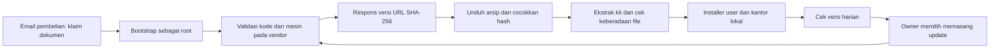

# 04 — Lisensi, distribusi, aktivasi, dan batas bukti

Tanggal audit: 14 Oktober 2026. Sumber dibaca secara statis dari kit `0.18.7` pada `C:/Kael AI/lembur-backup-lengkap/kantor/kit-kantor-ai/`. Rujukan di bawah relatif terhadap akar tersebut. Tidak menghubungi API vendor, menebak kode, mencoba aktivasi, menyalin kredensial, atau memasang produk. Tidak ada penetapan harga aktual atau kesimpulan hukum baru dari audit source.

**TERBUKTI** berarti perilaku klien terlihat dalam kode. **INDIKASI** berarti didukung struktur/komentar tetapi belum terverifikasi ujung-ke-ujung. **HIPOTESIS** berarti perlu pengujian tambahan. **BELUM DAPAT DIPASTIKAN** berarti bukti backend/kontrak/layanan eksternal tidak tersedia.

## Kesimpulan yang dapat diambil dari klien

**TERBUKTI:** distribusi memakai kode pembelian, pengenal mesin, server validasi, URL unduh, hash arsip, dan versi. Kode disimpan lokal mode 600 untuk update. Pemasangan/unduh dan update membutuhkan respons vendor yang diterima klien (`installer/pasang-awal.sh:9–19,32–69`; `mulai.sh:49–50`; `update.sh:12–23,74–90`).

**INDIKASI kuat:** modelnya kit self-hosted dengan akses unduh/update terkendali, bukan SaaS yang menjalankan seluruh kantor di server vendor. Wizard dan kantor dijalankan di VPS pemilik; runtime rutin membaca file lokal. Komentar bootstrap juga menyatakan pengecekan kode hanya saat pasang/update (`installer/pasang-awal.sh:4–6`; `mulai.sh:177`; `installer/pasang.mjs:210–221`). Pencarian simbol lisensi pada runtime yang ditinjau tidak menunjukkan license heartbeat. Ini bukan pembuktian semua versi/komponen tidak pernah menelepon vendor.

**BELUM DAPAT DIPASTIKAN:** database transaksi, pembayaran, penerbitan email kode, pembatasan mesin secara server, pencabutan nyata, masa dukungan, kontrak pembelian, refund, transfer, dan otorisasi redistribusi kode utama. Source klien hanya memperlihatkan protokol yang diharapkan.

## Kontrak aktivasi yang terlihat

| Data/operasi | Perilaku di klien | Tingkat bukti |
|---|---|---|
| Kode | Bootstrap membuang whitespace, membuat huruf besar, membatasi karakter dan panjang | **TERBUKTI**, `installer/pasang-awal.sh:10,16–17` |
| Mesin | Hash machine-id dipotong menjadi 16 karakter heksadesimal; bukan raw machine-id | **TERBUKTI**, `installer/pasang-awal.sh:18–19`, `update.sh:20`, `installer/alamat.sh:29` |
| Pemeriksaan kode | POST JSON membawa kode dan pengenal mesin; respons sukses harus HTTP 200 + ok=true | **TERBUKTI**, `installer/pasang-awal.sh:32–44`; implementasi server tidak tersedia |
| Unduhan | Versi semver numerik, SHA-256 lowercase 64 digit, URL HTTPS default | **TERBUKTI**, `installer/pasang-awal.sh:51–60`; override test API ada |
| Validasi versi | Cek update memakai permintaan terpisah dan perbandingan versi shell | **TERBUKTI**, `update.sh:22–30,44–48` |
| Daftar perubahan | Server dapat mengirim catatan dan flag penting untuk notifikasi/spanduk | **TERBUKTI**, `update.sh:49–64`; tidak membuktikan proses review keamanan vendor |
| Nama alamat | Permintaan membawa kode, mesin, dan nama opsional; hasil alamat dicocokkan pola | **TERBUKTI**, `installer/alamat.sh:24–53` |
| IP publik | Komentar menyebut IP ditentukan server dari koneksi; request badan tidak membawa IP | **TERBUKTI** tentang badan klien; **BELUM DAPAT DIPASTIKAN** implementasi DNS/server, `installer/alamat.sh:7–9,29–41` |
| Pengenal kit | Klien mensyaratkan `.kit-id` ada; diagnosa menampilkan ID kit | **TERBUKTI**, `installer/pasang-awal.sh:62`, `update.sh:90`, `diagnosa.sh:146`; nilai aktual sengaja tidak dibaca |

Fingerprint hash mesin tetap pengenal stabil/pseudonim untuk mengaitkan aktivasi. Tidak cukup menyebutnya “tanpa data pribadi” hanya karena raw ID tidak dikirim. Server juga dapat melihat metadata koneksi, tetapi penyimpanan/log server **BELUM DAPAT DIPASTIKAN**.

### Respons penolakan dan apa yang benar-benar terbukti

| Alasan yang ditangani | UX klien | Batas kesimpulan |
|---|---|---|
| Kode tidak valid | Minta pemilik memeriksa email/kode | Klien mengenali alasan; tidak membuktikan validator backend aman |
| Kode dicabut | Instal/update ditolak, diarahkan ke dukungan | Tidak menunjukkan runtime yang sudah terpasang dihentikan |
| Batas VPS | Pesan menyebut dua VPS dan reset oleh dukungan | Angka dua berasal pesan klien; enforcement/reset backend belum dilihat |
| Kebanyakan coba | Menunggu sepuluh menit | Rate limit backend, cakupan IP/kode, dan implementasi belum dilihat |
| Server sibuk/5xx | Retry terbatas; kesalahan dipisahkan dari kode salah | Bukan jaminan SLA vendor |
| Unduhan 410 | Minta link baru satu kali | Komentar menyebut umur link 15 menit; TTL backend belum diuji |
| Unduhan 403 | Penolakan akses/machine/revocation | Respons nyata dan kemungkinan perubahan aturan server belum diuji |

Bukti: `installer/pasang-awal.sh:23–44,54–58`; `update.sh:24–41,81–85`. Tidak dilakukan pengujian yang mencoba melewati pemeriksaan tersebut.

## Distribusi dan trust chain

Email/pembayaran pada diagram berasal petunjuk klien, bukan bukti implementasi checkout. Tidak ada basis untuk menyatakan bagaimana kode dibuat, dienkripsi, dijual, atau dibatasi masa berlaku.

**TERBUKTI:** SHA-256 dibandingkan sebelum ekstraksi. Respons hash dan URL datang dari API yang sama; tidak terlihat verifikasi tanda tangan rilis menggunakan public key yang tertanam. Bootstrap juga dieksekusi dari kanal unduhan shell menurut dokumen, dan tahap OS/CLI memakai installer eksternal (`installer/pasang-awal.sh:3,51–61`; `mulai.sh:67,71,133`). **INDIKASI risiko supply chain:** apabila kanal penerbit atau respons API menjadi tidak tepercaya, checksum sendiri tidak membuktikan siapa penerbit artefak tersebut. Ini berbeda dari tuduhan bahwa arsip sekarang berbahaya.

**TERBUKTI:** `.kit-id` hanya diperiksa keberadaan filenya oleh jalur install/update yang dibaca, bukan dibandingkan dengan entitlement atau ditandatangani secara lokal (`installer/pasang-awal.sh:62`; `update.sh:90`). **INDIKASI:** pengenal dan penanda referensi yang muncul konsisten dalam source dapat membantu atribusi distribusi. Mekanisme watermark, pemetaan ke pembeli, atau pelacakan pelanggaran server **BELUM DAPAT DIPASTIKAN**. Tidak mendekode atau menerbitkan pengenal tersebut.

**TERBUKTI:** URL awal divalidasi sebagai HTTPS, tetapi curl memakai redirect tanpa pembatasan protokol/host eksplisit pada command yang terlihat (`installer/pasang-awal.sh:52,54`; `update.sh:78,81`). **BELUM DAPAT DIPASTIKAN:** rantai redirect nyata. Implementasi KAEL mandiri sebaiknya menetapkan allowlist host/protokol dan tanda tangan artefak, bukan meniru akses vendor.

## Lisensi komponen versus lisensi kit

| Komponen | Bukti lokal | Yang boleh disimpulkan dalam audit ini |
|---|---|---|
| Karakter asal Claude Office | `dashboard/aset/LISENSI-karakter-MIT.txt:1–26` menyertakan atribusi dan teks MIT | **TERBUKTI:** pemberitahuan MIT disertakan untuk karakter yang disebut. Ini tidak melisensikan otomatis semua file kit. |
| Karakter gaya cozy/modern | Pemberitahuan lokal menyatakan digambar ulang memakai AI dari karakter sumber | **TERBUKTI** sebagai klaim provenance lokal, `LISENSI-karakter-MIT.txt:3`; proses pembuatan dan chain-of-title belum diverifikasi |
| Gambar ruangan | Pemberitahuan menyebut buatan Kit Kantor AI | **TERBUKTI** sebagai atribusi lokal, `LISENSI-karakter-MIT.txt:4`; bukan izin umum reuse seluruh aset |
| Font Plus Jakarta Sans | Copyright dan SIL OFL 1.1 dibundel | **TERBUKTI** `dashboard/aset/LISENSI-font-OFL.txt:1–93`; lisensi font terpisah dari kode bisnis |
| Skill kit | Dokumen rekomendasi menandai anti-slop-indo “punya kit” | **TERBUKTI** sebagai klaim dokumen, `SKILL-REKOMENDASI.md:12–13`; tidak ada grant umum yang dapat disimpulkan dari frasa ini |
| Plugin eksternal | Installer menjalankan marketplace add/install dari sumber eksternal | **TERBUKTI** `installer/pasang.mjs:346–353,397–408`; versi/resolusi upstream dan lisensi terkininya tidak diperiksa |
| Playwright/Chromium | Dipasang melalui npm/npx, bukan bukti semua aset ada izin sama | **TERBUKTI** `installer/pasang.mjs:385–439`; audit lisensi dependency dan binary upstream terpisah diperlukan saat distribusi KAEL |
| Kode installer/dashboard/template utama | Pencarian nama lisensi menemukan notice aset, tidak grant tingkat root | **BELUM DAPAT DIPASTIKAN:** kontrak kit utama. Jangan menganggap source yang dapat dibaca otomatis bebas dijual/disalin ulang. |

Isi lisensi aset cukup dibaca lokal untuk mengetahui notice yang dibundel. Audit ini tidak mengklaim interpretasi hukum definitif, syarat platform terbaru, atau verifikasi lisensi GitHub upstream. Pernyataan lisensi/pricing layanan di dokumen rekomendasi adalah klaim historis sumber, bukan rekomendasi harga atau syarat terkini.

**TERBUKTI:** beberapa skill dipasang dari repository aslinya alih-alih disalin dari kit. Dokumen juga menyebut beberapa repository tidak mencantumkan lisensi (`SKILL-REKOMENDASI.md:30–37,42–74`). Ini keputusan distribusi yang terlihat, tetapi memasang dari upstream saja tidak menyelesaikan semua hak penggunaan, pemberitahuan, dan syarat layanan.

## Model produk yang dapat dipelajari tanpa menyalin

**INDIKASI dari pengalaman klien:** yang dijual bukan sekadar gambar kantor, melainkan paket operasional dengan installer, onboarding, template peran/SOP, jadwal kerja, dashboard, pengaman, update, dan jalur dukungan. Bukti file pemasangan: `MULAI-DI-SINI.md:6–22,33–79`; `installer/pasang.mjs:246–442`; `diagnosa.sh:140–213`.

**BELUM DAPAT DIPASTIKAN:** penjualan satu kali/subscription, pendapatan, jumlah pelanggan, margin, hosting vendor, support SLA, dan biaya platform aktual. Tidak boleh menghitung potensi pendapatan KAEL dari harga historis tutorial atau asumsi conversion.

| Kemampuan produk | Bukti source | Pembelajaran mandiri untuk KAEL |
|---|---|---|
| Hak unduh/update terpisah dari runtime lokal | Kode hanya pada jalur install/update yang ditinjau | Entitlement tidak seharusnya memusnahkan data/karya ketika jaringan gagal |
| Onboarding singkat | Tiga layar isian + ringkasan, business onboarding menjadi task | Pilih satu divisi kerja dahulu, integrasi dan SOP mendalam kemudian |
| Pengiriman per versi | Versi, checksum, catatan, flag penting, kit sebelumnya | Release terukur, changelog jelas, backup dan rollback mandiri |
| Dukungan dengan diagnostik tersaring | Diagnosa lokal + instruksi kirim manual | Dukungan tanpa meminta folder home mentah atau token pelanggan |
| Pelestarian personalisasi | Baseline lama, merge Markdown, kandidat konflik | Pisahkan core aplikasi dari konfigurasi/data pengguna; tampilkan diff sebelum migrasi |
| Biaya sumber daya dijelaskan | Jadwal detak dan fitur AI versus non-AI dibedakan | Tampilkan sumber biaya dan status nyata, jangan menjual animasi sebagai bukti agent bekerja |

## Rancangan distribusi KAEL yang independen

Bagian ini rekomendasi rancangan, bukan pekerjaan implementasi pada sesi audit.

1. **Artefak milik sendiri.** Bangun dari codebase KAEL, SOP dan aset yang haknya jelas. Buat daftar dependency/notice terpisah. Tidak membawa source vendor, nama karakter vendor, watermark, kode, sesi, atau rahasia pelanggan ke release KAEL.
2. **Pemisahan binary, konfigurasi, dan data.** Installer hanya menyebarkan aplikasi. Organisasi, task, workflow binding, approval, media, dan memori memakai schema serta migrasi bernomor. Instal ulang tidak boleh reset bisnis.
3. **Aktivasi transparan.** Apabila perlu entitlement, dokumentasikan data yang dikirim dan hak yang dibatasi. Gunakan identitas instalasi yang dapat direset/disetujui pengguna; jangan menganggap hash mesin anonim. Pilih kebijakan offline dan grace period secara eksplisit.
4. **Rilis bertanda tangan.** Verifikasi signature terhadap kunci penerbit KAEL, checksum/ukuran, daftar file, min runtime, dan schema. Validasi path ekstraksi serta symlink sebelum instal.
5. **Update yang dapat dibatalkan.** Staging, backup, lock wajib, journal, health checks, rollback, dan hasil pekerjaan yang tetap dapat dibaca meski aplikasi gagal upgrade.
6. **Kredensial per instalasi.** Jangan distribusikan folder home, `.env`, OAuth provider, kunci SSH, kode pelanggan, log chat, atau token dashboard. Vault/secret store milik pengguna tersambung setelah pemasangan.
7. **Kompatibilitas provider.** Integrasi Codex/Claude/n8n menjadi adapter resmi sesuai kapabilitas aktual dan syarat masing-masing; autentikasi pemilik tidak disalin sebagai bagian template.
8. **Komersialisasi setelah bukti.** Ukur keberhasilan install, recovery, workflow, dan support cost dari uji milik KAEL; jangan menebak harga, SLA, atau total cost dari kit referensi.

## Pertanyaan yang memerlukan bukti tambahan

| Pertanyaan | Bukti yang diperlukan | Status |
|---|---|---|
| Benarkah maksimum dua VPS diterapkan? | Source/kontrak backend entitlement dan tes authorized | **BELUM DAPAT DIPASTIKAN** |
| Bagaimana refund/revocation memengaruhi hak update? | Syarat pembelian dan kebijakan vendor | **BELUM DAPAT DIPASTIKAN** |
| Bagaimana URL 15 menit ditandatangani? | Implementasi distribusi server, bukan URL aktif pelanggan | **BELUM DAPAT DIPASTIKAN** |
| Apakah fingerprint dihapus/dirotasi saat pindah VPS? | Kebijakan reset, retention, dan endpoint server yang diaudit sah | **BELUM DAPAT DIPASTIKAN** |
| Apakah kit dipersonalisasi setiap pembeli? | Proses build/packaging dengan identifier sintetis | **INDIKASI**, komentar bootstrap dan penanda lokal; belum terbukti backend |
| Bolehkah kode/aset kit utama dipakai dalam produk KAEL? | Grant lisensi atau izin yang jelas dari pemilik hak | **BELUM DAPAT DIPASTIKAN**; analisis konsep saja tidak menetapkan grant |
| Apakah sumber yang dibundel sama dengan upstream berlisensi? | Hash/provenance aset dan versi upstream terkait | **BELUM DAPAT DIPASTIKAN** |

## Cakupan bacaan

Dibaca penuh untuk laporan ini: bootstrap, mulai/manual installer, alamat, wizard, materialisasi kantor, updater, diagnosa; `MULAI-DI-SINI.md`, `checklist-vps.md`, `SKILL-REKOMENDASI.md`, `VERSI`, notice karakter MIT dan font OFL pada `dashboard/aset/`. Notice duplikat di `installer/aset/` terinventarisasi tetapi tidak diklaim dibaca penuh. Bagian update dashboard dan Builder dibaca pada baris yang dirujuk; source backend vendor, email pembelian, kontrak, transaksi, rahasia, sesi pengguna, serta upstream eksternal tidak dibaca.

Tidak ada tindakan aktivasi atau validasi jaringan. Risiko belum teruji adalah keaslian artefak server, enforcement lisensi, pemulihan update nyata, dan hak redistribusi kit utama; semua harus tetap dibedakan dari perilaku klien yang terbukti.
