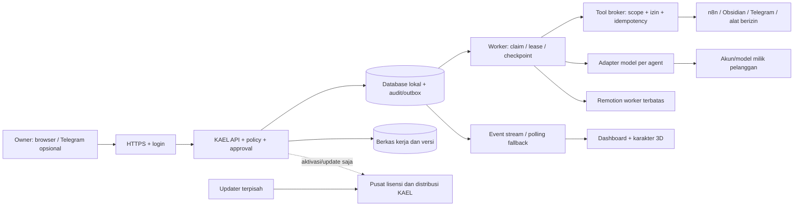
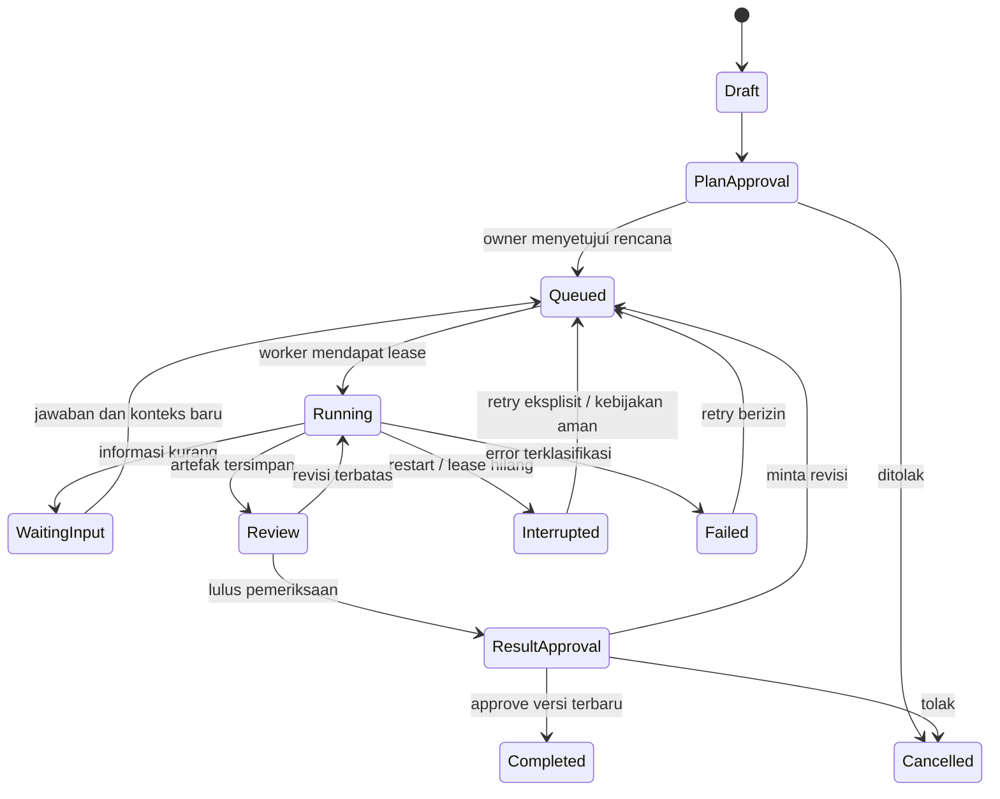

# 07 — Blueprint KAEL AI yang independen

Status: **REKOMENDASI**, belum diimplementasikan dan bukan deskripsi backend Lembur. Dasar observasi ada di laporan 02–06. Tidak ada source, aset proprietary, domain operasional, kode pembelian atau kredensial Lembur yang diadopsi.

Label kepastian: **TERBUKTI** = terlihat langsung di kode/metadata; **INDIKASI** = didukung struktur tetapi belum diuji; **HIPOTESIS** = penalaran yang perlu diuji; **BELUM DAPAT DIPASTIKAN** = butuh server vendor, VPS Linux, atau uji jalan yang tidak dilakukan; **REKOMENDASI** = usulan untuk Kael, bukan fakta tentang Lembur. Di laporan ini: §2 = **HIPOTESIS** (penalaran, belum diukur); §3 = **TERBUKTI** pada kode Kael saat audit; §1 dan §4–§12 = **REKOMENDASI**.

## 1. Tujuan dan batas tetap

Pelanggan mengoperasikan satu kantor/bisnis pada VPS miliknya. KAEL menyediakan aplikasi resmi, cara instalasi, update dan dukungan. Pelanggan mengendalikan data, akun AI, integrasi, persetujuan dan pengeluaran. Infrastruktur pusat hanya diperlukan untuk hak unduh/update/lisensi menurut kontrak yang akhirnya dipilih.

Invarian: tampilan karakter bukan sumber kebenaran pekerjaan; satu tugas punya pelaksana dan versi yang jelas; manager berbeda dari worker; approval terhadap versi lama tidak berlaku; pesan keluar/publikasi memerlukan izin tindakan tersendiri; retry tidak boleh menggandakan efek eksternal; kehilangan jaringan tidak dianggap sukses. Aktivitas santai tidak memanggil model hanya untuk menghidupkan kantor.

## 2. Tiga pendekatan

| Aspek | A: seluruhnya self-hosted/offline | B: self-hosted + pusat lisensi/update minimal | C: hybrid dengan layanan tambahan vendor |
|---|---|---|---|
| Data pekerjaan | VPS pelanggan | VPS pelanggan | Tetap lokal secara default; layanan tambahan perlu persetujuan data |
| Biaya vendor | Distribusi/support; penagihan manual | Ditambah aktivasi, penyimpanan rilis, bandwidth, email transaksi | Ditambah komputasi, uptime, observabilitas dan dukungan layanan |
| Pengalaman beli/update | Sederhana secara teknis, lebih banyak langkah manual | Aktivasi dan update terpandu | Nyaman, tetapi ketergantungan dan konfigurasi lebih banyak |
| Internet | AI/integrasi tetap membutuhkannya; kode inti bisa offline | Aktivasi/update online; pekerjaan lokal tidak bergantung heartbeat lisensi | Layanan tambahan berhenti bila pusat gagal |
| Privasi | Batas lokal paling mudah dijelaskan | Pusat cukup menerima installationId/entitlement, bukan prompt/file | Harus menjelaskan data yang keluar per layanan |
| Migrasi | Salin backup/config, pasang ulang | Tambah transfer slot aktivasi | Pindahkan pula binding layanan tambahan |
| Pembajakan | Tidak ada kontrol pusat | Kontrol unduhan/update; pelanggan root masih dapat memodifikasi software | Pusat dapat membatasi layanan; tidak menjamin kode lokal tak disalin |
| Dukungan pelanggan | Rendah pada server pusat, tinggi variasi instalasi | Sedang; prosedur diagnosis/release lebih seragam | Paling tinggi; SLA dan integrasi silang perlu dipelihara |
| Kompleksitas pengembangan | Rendah di pusat, tetapi paket offline, aktivasi manual dan update manual tetap harus dibuat dan diuji | Sedang: aplikasi lokal + layanan lisensi/rilis kecil + signing dan rollback | Tinggi: aplikasi lokal + layanan tambahan yang harus selalu hidup, termasuk billing pemakaian |
| Risiko keamanan | Tidak ada pusat yang bisa dibobol, tetapi patch bergantung pelanggan sehingga banyak instalasi tertinggal versi | Pusat menjadi target (kunci signing, data lisensi) tanpa menyimpan data kerja; patch tersebar cepat lewat update terverifikasi | Permukaan serangan terbesar; data pelanggan bisa melintas ke layanan vendor |
| Kemudahan update | Manual: unduh paket, verifikasi, jalankan updater sendiri | Terpandu: cek versi, unduh bertanda tangan, backup, rollback | Seperti B, ditambah layanan vendor bisa diperbarui tanpa menyentuh VPS |
| Potensi skalabilitas | Tiap pelanggan dibatasi VPS-nya; jumlah pelanggan hampir tidak membebani vendor | Sama dengan A; beban pusat hanya aktivasi dan unduhan rilis | Beban dan biaya vendor naik seiring pemakaian layanan tambahan |

Semua sel di atas **HIPOTESIS**: belum ada pengukuran biaya, insiden atau beban nyata. Sebelas aspek dari prompt tercakup (biaya operasional = baris biaya vendor).

**Pilihan awal: B**, dengan inti berjalan lokal dan pusat tanpa data pekerjaan. C menjadi add-on setelah kebutuhan nyata terbukti. Ini pilihan arsitektur, bukan klaim bahwa skema bisnis tertentu pasti menguntungkan.

## 3. Pertahankan fondasi proyek sekarang

| Bukti KAEL saat audit | Implikasi |
|---|---|
| `package.json:13–22`: Node >=24, TypeScript/Vite, Three.js, Remotion/React | Pertahankan stack; tidak menulis ulang 3D hanya untuk mengikuti Lembur. Versi yang didukung harus diuji ulang pada setiap rilis. |
| `server/index.mjs:18–27,63–69`: antrean satu proses, revision check, temp-file/rename | Pertahankan kontrak revisi; persistensi JSON belum antrean pekerjaan lintas proses. |
| `server/index.mjs:51–55,74`: Host/Origin guard, loopback | Cocok untuk lokal, belum login/otorisasi hosting publik. Jangan sekadar mengubah bind menjadi 0.0.0.0. |
| `server/codex-stage.mjs:12–24`: login status, env filtering, subprocess ephemeral read-only, timeout | Adapter Codex nyata sudah ada untuk produksi; bukan session/model terpisah yang persisten bagi seluruh agent. |
| `src/domain.ts:7–11,19` dan command decisions: tugas, hasil berversi, keputusan dan revision | Migrasi harus mempertahankan ID, riwayat, approval serta binding n8n. |
| `server/production.mjs` simbol `createProduction`, `stage`, action approve/delete | Pipeline KaelaCH dijadikan jenis pekerjaan khusus, bukan dipaksa menjadi engine semua divisi. |
| Tambahan setelah audit (tahap 3–5): `server/runtime.mjs` (run per agent, hentikan run, run berjalan ditandai interrupted saat restart), SOP berversi dan arsip anggota di `src/domain.ts` | **TERBUKTI** di repo dan tes (`tests/runtime.test.mjs`, `tests/division-setup.test.mjs`). Nomor baris di tabel ini mengacu kondisi saat audit dan bisa sudah bergeser. |
| `server/n8n.mjs` simbol `createN8nClient` dan `src/n8n.ts:newWorkflowFailure` | Monitoring n8n tetap read-only secara default; izin run/retry berbeda dari izin memantau. |

## 4. Komponen



Diagram ini seluruhnya usulan KAEL. Model tidak mendapat root, cookie owner, secret store, private key penandatangan rilis atau akses database langsung. Scene 3D hanya memetakan event kerja yang sudah tersimpan.

## 5. Struktur repository yang disarankan

Pertahankan struktur saat ini pada tahap pertama. Ekstraksi modul dilakukan ketika batasnya terbukti perlu, bukan refactor besar di awal.

```text
src/                    UI, state presentasi, scene 3D yang ada
server/
  api/                  login, tasks, approvals, notifications
  runtime/              queue, leases, checkpoints, policy, adapters
  connectors/           n8n read-only, Obsidian, Telegram
  production/           pipeline KaelaCH/Remotion yang sudah ada
  storage/              migrations, repositories, audit/outbox
packages/contracts/     schema perintah/event/config bersama
deployment/             compose atau systemd, reverse proxy, healthcheck
installer/              preflight dan setup independen
release/                manifest, signing, update/rollback
docs/customer/          pasang, login model, backup, migrasi, diagnosis
tests/                  kontrak, workflow, keamanan, upgrade/restore
```

## 6. Penyimpanan dan model data

Usulan awal: SQLite lokal dengan transaksi, foreign key, WAL dan busy timeout untuk satu kantor pada satu host. Queue berada pada DB yang sama; jangan menambah Redis dahulu. Gunakan PostgreSQL bila hasil pengukuran memerlukan banyak worker/host atau pola akses yang tak cocok SQLite. File besar tetap di disk object/artifact store, bukan BLOB semua video.

Entitas: workspace, users/roles, divisions, agents, agent_model_bindings, conversations, messages, memory_versions, briefs, tasks, task_dependencies, runs, checkpoints, artifacts, artifact_versions, reviews, approvals, incidents, workflow_bindings, connector_accounts, external_actions, outbox, schedules, notifications, releases, installations, backup_runs.

Poin kontrak:

- `agents.id` tetap stabil; ganti nama/model tidak mengganti identitas atau divisi.
- `agent_model_bindings` menyimpan adapter/provider/modelId, secret reference, capability dan batas pemakaian. Daftar model berasal adapter yang benar-benar tersedia; jangan mengarang ID model dari nama marketing.
- Sesi/konteks masing-masing agent dipisah oleh workspace/division/agent/conversation. Memori eksplisit dapat dibaca ulang, bukan mengasumsikan setiap CLI otomatis mengingat sesi lain.
- `runs` memiliki idempotencyKey, lease owner/expiry, attempt, provider request ID, status, checkpoint, token/biaya jika tersedia. Data pemakaian yang tidak tersedia ditandai unknown, bukan nol.
- Approval mengikat jenis tindakan, subject ID, versi/hash artefak, scope, approver, waktu, expiry bila diperlukan dan status consumed. Approval rencana, hasil, publikasi dan pembayaran berbeda.
- `external_actions` mempunyai unique idempotency key dan state prepared/approved/sending/sent/failed/unknown. Timeout setelah kirim menjadi unknown untuk rekonsiliasi, bukan retry buta.
- Log hanya ringkasan operasional, sumber/output yang diizinkan dan alasan kegagalan tersamarkan; tidak menyimpan chain-of-thought atau rahasia.

## 7. State machine dan pemulihan



Pause yang aman memerlukan checkpoint adapter; jika provider tidak mendukung resume, tampilkan bahwa run dihentikan dan retry merupakan panggilan baru yang bisa menambah biaya. Maksimal dua revisi otomatis lalu eskalasi sesuai PRD. Meeting adalah task koordinasi yang menghasilkan ringkasan/keputusan nyata, bukan gerak berkumpul yang mengaku menghasilkan pekerjaan.

## 8. API dan event

Nama endpoint berikut adalah usulan, bukan endpoint yang sudah ada.

| Interface | Tanggung jawab |
|---|---|
| `POST /v1/auth/login`, `/logout` | Login, rate limit, sesi cookie HttpOnly/Secure/SameSite dan rotasi |
| `GET/PATCH /v1/agents/:id` | Identitas, adapter/model dan scope; revision/ETag wajib untuk edit |
| `POST /v1/tasks`, `/tasks/:id/actions` | Draft, submit, pause, cancel, retry dengan state validation |
| `POST /v1/approvals/:id/decision` | Approver berizin + versi/hash + alasan + consume atomik |
| `GET /v1/events` | SSE sesudah login, event ID/cursor, reconnect; polling fallback |
| `GET/POST /v1/conversations` | Pesan user/agent yang diizinkan; pisahkan sistem/model |
| `GET /v1/workflows/:id/executions` | Monitoring scope divisi tanpa payload/kredensial vendor |
| `POST /v1/connectors/:id/actions` | Melalui broker dan izin aksi, bukan proxy URL arbitrer |
| `POST /v1/backups`, `/restore/preview`, `/restore/apply` | Manifest, dry-run, validasi, maintenance lock dan rollback |
| `GET /v1/updates`, `POST /v1/update/prepare` | Preview release, backup, verifikasi, approval admin |

Events: run.started/progress/checkpoint/failed, artifact.created, review.failed, approval.requested/decided, incident.opened/recovered, agent.presence, connector.connection, update.available. Visual kerja dimulai dari run event; status provider tidak diketahui tetap unknown.

## 9. Konfigurasi dan secrets

Konfigurasi nonrahasia: schemaVersion, installationId acak, workspaceId, publicBaseUrl, dataDir, queue concurrency, adapter types, timezone, retention dan approved network targets. Rahasia hanya secret references; backend menyelesaikannya dari file mode terbatas/secret service. Env worker memakai allowlist, bukan mewarisi semua env lalu mencoba menghapus beberapa nama.

Pisahkan user login, lisensi produk, akun AI dan kredensial integrasi. Memiliki lisensi KAEL tidak memberi kuota AI, akses Telegram atau izin menjalankan n8n. Pilihan awal satu owner dan role operator/reviewer, dengan scope divisi yang diverifikasi server.

Tool broker menentukan daftar operasi, root filesystem yang diizinkan, batas ukuran/waktu, egress destinations dan izin owner. Tujuan private-network seperti n8n milik pelanggan boleh dengan allowlist eksplisit; metadata cloud/localhost internal tidak menjadi proxy terbuka. Webhook melakukan autentikasi, deduplikasi, pembatasan payload dan perlindungan replay.

## 10. Instalasi, update, backup

Root hanya untuk paket sistem, user/service, direktori sistem, proxy/firewall dan pengaktifan service. Proses aplikasi/worker/render berjalan tanpa sudo, dengan filesystem dan resource limits. Jangan memberi sudo aplikasi sekadar supaya installer lebih mudah.

Installer: preflight → preview perubahan → cek host/proxy yang sudah ada → unduh rilis → verifikasi manifest bertanda tangan dengan kunci publik tepercaya → validasi isi arsip tanpa traversal/symlink tak diizinkan → setup user/direktori → inisialisasi storage → bootstrap owner → login provider oleh pelanggan → healthcheck → aktifkan service. Simpan step journal agar rerun melanjutkan secara aman. Domain pelanggan dan opsi domain terkelola dipisah.

Release memakai versi tervalidasi, SHA-256 artefak, signature Ed25519/algoritme standar yang dipilih melalui review kripto, schema compatibility dan minimum updater version. Kunci privat signing tidak pernah dikirim ke VPS pelanggan. Trust anchor publik didistribusikan lewat saluran bootstrap tepercaya, bukan hanya key baru yang ikut diunduh dari server paket yang sama.

Update dua tahap: prepare/check disk/backup → stage rilis terverifikasi → migrasi yang sudah diuji → switch release pointer → healthcheck → commit. Gagal: rollback kode dan, bila kompatibilitas schema mengharuskan, restore snapshot DB yang sesuai; jangan rollback kode terhadap DB hasil migrasi yang tidak kompatibel. Konfigurasi dan data pelanggan berada di luar direktori release.

Backup mencakup snapshot DB konsisten, artefak dan manifest checksum. Secrets dipisah dan dienkripsi dengan kunci yang dikendalikan pelanggan. Restore memiliki preview ID/versi/perubahan, menghentikan lease sementara, tidak mengulang external_actions sent, dan diuji pada instalasi baru. Ekspor JSON sekarang tidak sama dengan mekanisme ini.

## 11. Diagnosis, skala dan release gate

Healthcheck membedakan API, DB, disk, queue, provider auth, konektor dan renderer. Paket diagnosis secara default hanya versi, capability, error tersamarkan dan metrik; bukan chat/secret. Owner meninjau sebelum mengirim ke dukungan.

Jangan menjanjikan semua render video dan semua agent berjalan pada VPS 2 GB hanya karena installer referensi menyebutnya. Ukur RAM/CPU/disk/latensi saat render, concurrency dan tugas model; pisahkan worker render atau batasi konkurensi bila perlu. Tetapkan support matrix OS/arsitektur/versi dari pengujian.

Release gate: instalasi bersih, rerun installer, restart di tengah task, login gagal, kuota habis, jaringan putus, concurrent approvals, outbox timeout, kehilangan disk, restore, signature salah, arsip berbahaya, update gagal, schema migration dan rollback harus lolos pada lingkungan dummy. QA desktop/mobile 3D dan aksesibilitas tetap terpisah dari lulus unit test.

## 12. Handoff

Siap untuk breakdown implementasi setelah keputusan pada laporan 10 disepakati. Mulai dari kontrak adapter/session/approval dan migrasi data saat ini; jangan mulai dari toko lisensi atau refactor 3D. Audit tidak mengaktifkan desain ini.
