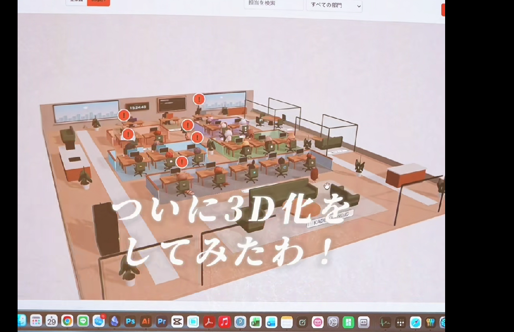

# Product Requirements Document Kael AI Virtual Office

Versi 2.42 — Navigasi kembali dan kontrol dashboard
Revisi UI: preview ruang Kael, navigasi beralamat, riwayat workflow dan keputusan yang mudah dibuka pada 14 Oktober 2026.  
Tanggal: 15 Oktober 2026
Status: arah produk dan desain; kemampuan yang sudah tersedia dibedakan dari target pengembangan.

## Perbaikan v2.42 — navigasi dan filter yang konsisten

Tombol Kembali tersedia pada header semua halaman. Gunakan riwayat internal yang mempertahankan filter/scroll, atau parent workspace saat membuka URL langsung; jangan mengarahkan pengguna ke situs di luar aplikasi. Root Ringkasan tanpa riwayat menampilkan disabled. Filter Divisi di Keputusan memiliki label terpisah, jarak dan kontrol yang sama dengan halaman lainnya. Seluruh select dashboard/dialog berbagi ukuran/padding/chevron/fokus/disabled, minimum 44px dan 16px pada mobile. Tidak mengubah data, otorisasi, workflow atau geometri kantor.

## Perbaikan v2.41 — keputusan kembali ke sesi manager

Konteks peran kini membedakan keputusan menunggu dari 20 keputusan yang sudah dijawab dalam lingkupnya. Tugas lokal menyertakan tahap dan langkah berikutnya yang sama dengan dashboard. Manager membaca ulang setelah keputusan/pindah client: melaksanakan rencana yang disetujui, mereview hasil penuh, mengikuti arahan revisi pada task ID yang sama, atau menghentikan tugas yang ditolak/selesai. Runner memakai tiga arahan terbaru, termasuk catatan persetujuan rencana. Approval tetap manusia dan kelanjutan tetap melalui prompt, belum scheduler.

Uji HTTP kantor terpisah mencakup usulan native Builder → preview editable → penerapan pemilik → rencana → approval → runtime fixture → review → revisi → pindah client/restart → hasil v2 → review → approval final, serta penolakan hasil/rencana. Hasil v1/ID/keputusan lama tetap utuh dan role bridge tetap menolak approval. Ini verifikasi server/read model, bukan klaim uji GUI kedua aplikasi atau pekerjaan bisnis sungguhan.

## Perbaikan v2.40 — peran pada sesi Claude/Codex

Arah interaksi utama diperbaiki: pengguna berdiskusi di sesi aplikasi AI pada folder kantor, menjalankan `jadi builder` atau `jadi <nama agent>`, sementara dashboard menerima rencana, hasil, catatan kerja, preview dan keputusan. Hook Claude mengikat ID sesi native, menyisipkan konteks peran pada setiap prompt/resume, memperbarui aktivitas dan menandai luang setelah giliran. Codex memakai perintah bridge dan sessionId tetap. Peran/memori dinamis mengikuti ID agent, bukan daftar contoh; memori lintasclient memakai version guard, histori privat tetap pada client.

Builder mengirim usulan ke preview web. Manager dapat mengajukan satu rencana dengan tugas per pelaksana, menunggu keputusan manusia, menjalankan runner yang tersedia, membaca hasil penuh dan melakukan review terikat versi. Pelaksana hanya mengirim hasil pada tugasnya sendiri; role bridge menolak approval Founder, penghapusan dan perubahan lintasdivisi. Workflow/produksi khusus tetap menggunakan alurnya sendiri. Sesi terbaru memengaruhi aktivitas karakter tanpa menulis animasi sebagai bukti hasil. Tidak membuat/mem-pin chat aplikasi otomatis, tidak menyediakan manager terjadwal atau installer VPS. Rincian: [Sesi kantor](OFFICE-ROLES.md).

## Perbaikan v2.39 — Builder percakapan

Builder web memakai Claude/Codex lokal untuk berdiskusi adaptif, menyimpan draft dan menyusun usulan manager/pelaksana, SOP, kriteria dan batas tindakan. Pemilik dapat melanjutkan chat, mengedit preview, menyimpan perubahan, membatalkan draft atau menerapkan konfigurasi secara eksplisit. Penyiapan tim/SOP bersifat atomik dengan revision guard dan penanda penerapan untuk mencegah duplikasi. Edit menjaga ID, pekerjaan dan setelan anggota lama; provider/model baru hanya untuk anggota baru. Hasil AI tidak pernah diterapkan otomatis, dan tidak membuat tugas/approval/koneksi eksternal.

Diskusi terpisah per instalasi, dapat dilanjutkan setelah refresh/restart, dan giliran gagal/interrupted tidak diulang otomatis. Preview ruangan berupa kebutuhan preset otomatis, bukan editor 3D bebas. Divisi workflow/produksi khusus tetap memakai konfigurasi masing-masing. Studio mengikuti giliran Builder aktif. Panduan/batas: [Builder percakapan](BUILDER-DIALOGUE.md).

## Perbaikan v2.38 — lupa kata sandi

Pemilik menerbitkan kode pemulihan melalui terminal server dengan `node scripts/owner-access.mjs --reset`, lalu memilih password baru pada halaman **Lupa kata sandi?**. Kode acak disimpan sebagai hash, berlaku sekali selama 15 menit dan terikat pada password sebelumnya. Reset mempertahankan nama/email, tim, riwayat, hasil dan keputusan; semua sesi lama dicabut. Penulisan atomik mempertahankan akun lama saat gagal. Endpoint tidak dapat membuat kode, kunci Builder tidak menggantikan kode, dan percobaan dibatasi terpisah dari login. Ini pemulihan lokal oleh pengelola server, belum reset melalui email atau MFA. Panduan: [Akses pemilik](OWNER-ACCESS.md).

## Perbaikan v2.37 — runtime Claude Code

Tugas teks umum bisa memakai Codex atau CLI Claude Code resmi dengan login pengguna sendiri. Provider/model berasal dari snapshot setelan agent saat run dibuat. Status koneksi per provider ditampilkan pada Pengaturan, onboarding dan detail pekerjaan; Codex tersedia tidak mengaktifkan tugas Claude, dan sebaliknya. Antrean melewati provider yang tidak tersedia tanpa menjalankan run offline atau berpindah provider diam-diam. Pilihan onboarding selain manual memerlukan koneksi provider terkait.

Claude menerima konteks brief/SOP/memori terbatas dan mengembalikan keluaran terstruktur tanpa alat eksternal, MCP, browser atau sesi chat sebelumnya. Proses dibatasi waktu/giliran/output, dapat dihentikan, dan tidak menggunakan bypass permission. Gagal/kuota/model/format tidak sah menjeda pekerjaan dengan instruksi retry; versi lama dipertahankan. Hasil baru selalu berstatus review dan pemeriksaan/persetujuan tetap manual. Tidak otomatis mengganti provider agent lama. Produksi video tetap Codex; Builder adaptif, manager otonom, Hermes dan deployment VPS belum tersedia. Panduan dan sumber resmi: [Claude runtime](CLAUDE-RUNTIME.md).

## Perbaikan v2.36 — paket sumber buyer dan penyiapan awal

Instalasi baru mengikuti penyiapan setelah akun pemilik dibuat: nama/konteks bisnis, tinjauan template atau kantor kosong, lalu pilihan pelaksanaan manual/Codex. Nama divisi, manager, pelaksana dan tugas dapat diubah sebelum template diterapkan. SOP dan batas tindakan ditampilkan untuk ditinjau. Langkah tersimpan secara atomik dengan revision guard; reload/restart melanjutkan langkah tersimpan tanpa menggandakan tim. Penyiapan tidak membuat tugas, menjalankan AI atau menyetujui hasil. Kantor lama tanpa metadata onboarding tetap dibuka normal dan tidak direset.

Ringkasan buyer menampilkan panduan tugas pertama berdasarkan data tersimpan, dari tim sampai hasil diterima. Tombol mengikuti tahap sebenarnya: briefing yang belum diajukan, keputusan yang sudah tersedia atau pekerjaan yang perlu diperiksa. Hasil tersimpan tidak dianggap sudah ditinjau. Sidebar mengikuti nama bisnis buyer. Menyelesaikan setup secara manual tidak dinyatakan sebagai koneksi AI; runtime Codex diperiksa di server, sedangkan Claude/Hermes belum didukung.

`npm run package:buyer` membuat paket sumber lewat allowlist aplikasi dan checksum file, tanpa data, kredensial, lingkungan, backup, catatan proyek privat, dependensi terpasang atau sesi Builder pengembang. Folder tujuan yang sudah ada ditolak. SOP runtime recap dipisahkan dari catatan operasional pemilik. Panduan buyer menjelaskan startup lokal/tunnel SSH privat dan batas implementasi. Ini bukan installer VPS, lisensi, checkout atau email aktivasi. Diskusi Builder adaptif, manager otomatis, white-label lengkap, domain publik dan onboarding Claude belum dibuat. Lihat [Penyiapan buyer](BUYER-SETUP.md).

## Perbaikan v2.35 — akses pemilik dan pemisahan instalasi

Instalasi baru memerlukan penyiapan satu akun pemilik melalui kode sekali pakai yang tersedia di terminal server. Kode penyiapan berbeda dari kode pembelian. Akun disimpan terpisah dari state pekerjaan, dengan password hash scrypt dan salt acak. Setup mempertahankan seluruh data/ID kantor lama. Rekaman akun rusak tidak menyebabkan penggantian akun otomatis.

Dashboard membuka setup/login sebelum memuat kantor 3D. Sesi memakai cookie HttpOnly/SameSite=Strict, masa maksimal 12 jam dan 30 menit tanpa request, serta pencabutan saat logout/restart. API state, status Builder, runtime, produksi dan media preview memerlukan autentikasi; mutasi browser memerlukan CSRF di samping guard Host/Origin. Percobaan setup/login dibatasi. Keputusan Founder hanya dapat dikirim melalui sesi pemilik yang sah dan gate versi/rencana yang sudah ada.

Bridge lokal pengaturan tim memiliki kunci tersendiri dengan allowlist perintah; tidak dapat menjalankan runtime atau memberi approval. Setiap direktori instalasi menyimpan state, akun, bootstrap dan kunci sendiri. Direktori baru tidak menyalin roster, hasil, binding atau sesi kantor internal; tautan chat internal tidak otomatis tampil pada buyer.

Ini fondasi lokal, bukan produk VPS siap dijual. Akun operator/reviewer, recovery password, isolasi proses model, broker tindakan eksternal, onboarding template/Builder buyer, checkout/email lisensi, installer, backup dan HTTPS publik belum lengkap. Rincian: [Akses pemilik](OWNER-ACCESS.md).

## Perbaikan v2.34 — tahap 6: konteks dan antrean

Menjalankan AI menyimpan run berstatus antrean, waktu antre, provider/model, serta salinan konteks sebelum bekerja. Konteks berisi SOP versi briefing, profil, hasil terakhir, arahan revisi/keputusan, dan paling banyak tiga hasil tugas sebelumnya milik pelaksana di divisi yang sama (maksimal 3.000 karakter per hasil rujukan). Riwayat adalah data rujukan, bukan instruksi baru atau bukti approval. Catatan awal tugas tetap terbawa saat mencoba ulang run gagal. Sesi Codex tetap baru per run; ini bukan sinkronisasi riwayat chat Codex/Claude.

Antrean disimpan dalam state lokal dan diproses satu per satu. Tugas antrean tidak ditampilkan sebagai sedang mengetik. Sesudah restart, run yang benar-benar sedang bekerja dijeda sebagai terputus dan tidak diulang otomatis; run yang belum mulai tetap mengantre lalu dilanjutkan bila runtime tersedia. Run antrean bisa dihentikan tanpa memanggil AI. Memulai tugas yang sama secara manual/AI atau mengarsipkan pelaksana saat mengantre ditolak. Saat mulai, persetujuan rencana, identitas pelaksana, error dan fasilitas diperiksa kembali. Hasil yang tiba sesudah penghentian tidak disimpan.

Notifikasi membuka pekerjaan tepat untuk hasil siap diperiksa, permintaan informasi, serta run gagal/terputus. Detail pekerjaan dan karakter membedakan antrean, bekerja, dan pemeriksaan; approval tetap tindakan Founder terpisah. Run dan konteks dibatasi pada divisinya di read model.

Uji Codex sungguhan dengan data sintetis berhasil menghasilkan checklist Indonesia tiga butir sebagai v1 berstatus review, tanpa approval. Bukan pengujian pekerjaan pelanggan atau semua model/provider. Bukti lokal: `evidence/agent-runtime-smoke/run-jBTsp8/check.json`.

## Perbaikan v2.33 — tahap 5: runtime AI per agent

Tugas lokal dapat dijalankan dengan AI dari detail pekerjaan bila agent memakai provider Codex. Runtime memakai Codex CLI dan login yang sudah ada di komputer server, dalam folder kerja kosong dan sandbox baca-saja, dengan model dari Setelan agent bila diisi. Prompt berisi konteks tugas, SOP versi briefing, dan profil agent, serta larangan tindakan eksternal. Claude dan Hermes baru tersimpan sebagai rencana karena belum memiliki runtime yang terverifikasi.

Run hanya dapat dimulai untuk rencana yang disetujui dan tugas yang siap, mengikuti batas satu tugas berjalan per agent, error agent, dan sesi fasilitas. Run diproses satu per satu. Hasil disimpan sebagai versi baru berstatus menunggu pemeriksaan; tidak ada pemeriksaan atau persetujuan otomatis. AI yang meminta informasi membuat tugas berstatus butuh informasi; kegagalan, kuota, batal oleh Founder, atau server dimulai ulang membuat tugas dijeda dengan alasan, tanpa menghapus hasil lama dan tanpa mencoba ulang otomatis. Hasil yang tiba setelah tugas dihentikan dibuang. Selama run berjalan, input hasil manual, jeda, dan pembatalan tugas ditolak sampai run dihentikan. Perintah run tidak dapat dikirim lewat API perintah biasa. Riwayat run tampil di detail pekerjaan.

## Perbaikan v2.32 — tahap 4: SOP, anggota, dan setelan agent

SOP per divisi dapat dibuat dan diedit di SOP & integrasi: langkah kerja, kriteria selesai default, dan batas tindakan opsional. Setiap simpan membuat versi baru; versi lama tetap dapat dibuka dan simpan dari versi usang ditolak. Briefing baru mencatat versi SOP yang berlaku, kriteria awalnya diisi dari SOP terbaru dan dapat diubah, dan konteks salin AI menyertakan SOP versi tersebut.

Anggota dapat diarsipkan dengan alasan. Pekerjaan terbuka wajib diserahkan ke pelaksana lain di divisi yang sama; pekerjaan selesai, hasil, keputusan, dan riwayat tetap atas nama anggota lama dan diberi label diarsipkan. Manager, agent workflow n8n, agent yang sedang bekerja, error, atau sesi fasilitas aktif tidak dapat diarsipkan, dan divisi harus tetap memiliki satu pelaksana. Anggota divisi produksi KaelaCH belum dapat diarsipkan karena alur produksi memakai susunan tim yang ada. Arsip dapat dipulihkan tanpa memindahkan kembali pekerjaan yang sudah diserahkan. Ubah nama/peran dan tambah pelaksana tetap melalui Builder.

Setiap agent memiliki setelan provider (manual, Claude, Codex, Hermes), nama model, dan catatan profil. Setelan dipakai di konteks salin manual; belum ada eksekusi AI otomatis. Tab Percakapan menyimpan catatan diskusi Founder per divisi dengan label belum terhubung ke AI. Runtime AI per agent direncanakan pada tahap berikutnya.

## Perbaikan v2.31 — tahap 3: hasil, preview, dan versi

Tab Hasil setiap divisi memuat daftar hasil dengan pencarian dan halaman. Tugas lokal membuka preview teks dengan pilihan versi; produksi membuka preview video/QC. Versi lama hanya untuk ditinjau, keputusan terikat pada versi terbaru yang diperiksa, dan membuka preview tidak memberi persetujuan.

## Perbaikan v2.30 — tahap 2: pekerjaan umum

Pekerjaan menjadi daftar umum untuk seluruh divisi, mencakup tugas lokal, produksi, dan workflow eksternal yang benar-benar tersedia. Divisi baru memakai struktur yang sama. Daftar tidak hanya memuat aktivitas berjalan: draft rencana, antrean, butuh informasi, revisi, pemeriksaan, approval, selesai dan pembatalan tetap dapat ditemukan melalui pencarian, filter divisi/sumber/status, serta halaman berisi maksimal 20 baris. Filter tersimpan dalam URL pada halaman Pekerjaan dan bagian Pekerjaan divisi.

Status merupakan read model, bukan perubahan status sumber. Task queued dengan briefing draft ditampilkan sebagai rencana belum diajukan; queued dengan rencana approval menunggu approval rencana. Revisi Founder yang masih sesuai versi dan catatan ditampilkan sebagai revisi, sementara status task asli paused tetap ada. Produksi review menunggu approval; blocked ditampilkan sebagai percobaan gagal dengan alasan serta status asli. Status n8n tetap ditampilkan di detail; keberhasilan eksekusi terakhir tidak berubah menjadi gagal ketika koneksi terputus. Monitoring memakai satu baris per workflow, dengan riwayat eksekusi tetap pada sistem monitoring yang ada.

Detail pekerjaan memisahkan status pekerjaan, sumber/mode pelaksanaan, koneksi, dan aktivitas karakter. Menampilkan divisi, manager, pelaksana, tujuan, kriteria, tahap sekarang, hasil/versi, catatan/kendala, serta langkah berikutnya. Progres berupa tahap dan hasil nyata, tanpa persentase buatan. Tugas lokal tetap manual dan memakai perintah/gate lama; produksi membuka preview/QC/keputusan versi lama; workflow membuka monitoring baca-saja. Riwayat tugas lokal memakai event tugas/briefing yang sudah disimpan.

Task pendamping produksi tidak digandakan sebagai tugas lokal. API menyertakan ID task milik produksi sebagai metadata baca-saja, termasuk arsip, supaya task arsip tidak muncul kembali sebagai pekerjaan manual atau dimutasi melalui endpoint tugas manual. Metadata tidak disimpan ke state.json dan tidak membuka kembali media arsip. Tidak ada reset ID, migrasi state pemilik, provider baru, auto-approval, runtime umum atau eksekusi workflow baru pada tahap ini.

## Perbaikan v2.29 — tahap 1: navigasi dan pusat divisi

Navigasi mempertahankan Ringkasan, Kantor virtual, Divisi, Pekerjaan dan Keputusan. Builder serta alat manual dikelompokkan; Pengaturan menjadi tempat profil bisnis, daftar koneksi dan ekspor JSON. Mobile tetap memakai lima tujuan dengan menu Lainnya. Penambahan divisi/agent tidak menambah menu global.

Setiap divisi memiliki Ringkasan, Pekerjaan, Anggota, Percakapan, Hasil dan SOP & integrasi. Data anggota, manager, perusahaan, tugas, keputusan dan binding dibatasi pada divisi terkait. Monitoring n8n membuka riwayat yang sudah ada; produksi recap membuka antarmuka preview/chat/files yang sudah ada. Divisi manual menunjukkan tugas dan hasil lokal, serta keterangan bahwa chat/runtime otomatis dan editor SOP belum tersedia. Routing bagian divisi bertahan setelah refresh/Back. Kemampuan produksi masih mengikuti kontrak KaelaCH yang ada; tahap ini belum menyediakan konfigurasi SOP/runtime untuk jenis produksi baru.

Daftar divisi dapat dicari menurut perusahaan, nama, anggota dan peran. Manager dan jumlah anggota terlihat tanpa membuka detail. Ringkasan mempertahankan preview Founder, menambahkan cuplikan pekerjaan berjalan (maksimal tiga baris), dan memakai sumber notifikasi yang sama dengan lonceng untuk menghindari approval produksi ganda. Daftar divisi Ringkasan dibatasi enam, pemberitahuan lima, dan aktivitas empat; daftar lengkap tetap dapat dibuka. Pekerjaan lintas sumber memiliki filter divisi serta akses ke tugas manual, briefing dan workflow.

Tahap ini tidak mengubah data pemilik, konektor, hak tindakan, approval versi, geometri atau animasi kantor. Ekspor JSON diberi batas yang jelas: tidak mencakup media produksi, kredensial atau restore otomatis. Model per agent, chat umum, Telegram dan Obsidian tetap tahap berikutnya.

## Perbaikan v2.28 — notifikasi header

Bar atas memiliki lonceng yang menunjukkan jumlah hal yang masih perlu ditindaklanjuti: insiden agent aktif, preview produksi menunggu approval, keputusan manual pending, produksi/tugas terkendala dan koneksi workflow tidak lengkap. Satu episode hanya menghasilkan satu pemberitahuan approval. Item error agent membuka ruang medis beserta alasan/pemulihan; produksi membuka preview episode; keputusan manual membuka form keputusan; koneksi membuka workflow/divisi terkait. Klik pemberitahuan tidak menyetujui pekerjaan atau menandai error pulih. Item mengikuti polling data yang sudah ada dan hilang setelah kondisi sumber selesai, bukan setelah sekadar dibaca. Belum ada riwayat notifikasi tersendiri, push browser, email atau Telegram.

Panel dapat ditutup dengan Escape, klik di luar atau tombol tutup; fokus item dipertahankan saat data diperbarui. Dropdown memakai jarak panah yang konsisten. Preview kantor pada Ringkasan dibatasi 180–280 px; ukuran render dan rasio kamera mengikuti bingkai agar tidak ada pita kosong di sisi gambar. Ruang Founder tetap utuh dengan konteks kantor di sekitarnya. Cache diperbarui saat ukuran bingkai berubah. Layout kantor dan gate approval tidak berubah oleh revisi ini.

## Perbaikan v2.27 — dashboard & alur pengguna

Dashboard memakai charcoal/putih/abu dengan aksen status dan identitas yang lembut. Ringkasan memiliki preview ruang kerja Founder dari scene yang sebenarnya, berupa cuplikan statis bertimestamp yang dapat diklik untuk membuka ruangan. Capture menggunakan renderer kantor yang sudah ada dan kamera terpisah; tidak mengubah layout, material atau aktivitas kantor. Kegagalan grafis menampilkan penjelasan dan akses ke kantor.

Pekerjaan aktif menggabungkan produksi, tugas manual dan proses n8n, dengan task produksi dihitung satu kali. Direktori divisi menunjukkan kondisi sebenarnya, bukan hanya jumlah workflow. Perhatian mencakup keputusan, produksi/tugas terkendala, insiden dan koneksi. Item membuka episode, workflow atau agent terkait. Preview/approval tetap terkait versi dan pemeriksaan pemilik; tidak ada publikasi otomatis.

Navigasi mendukung Back/refresh melalui URL halaman, divisi, episode, tab, versi dan workflow. Tab divisi menampilkan alat yang relevan. Navigasi HP memiliki lima tujuan utama dan menu Lainnya. Riwayat workflow mendukung ID/node/error, status, rentang tanggal WIB dan paginasi 10 eksekusi. Filter bekerja pada data snapshot yang tersedia; batas riwayat backend 100 eksekusi tetap dijelaskan. Tidak melakukan retry atau mutasi n8n.

Builder menawarkan diskusi sesi Codex dan konfigurasi manual yang dapat dibuka. Arsip episode menjelaskan penyimpanan bahan/riwayat lokal dan penghentian proses aktif, lalu meminta konfirmasi. Penolakan hasil memakai alasan inline. Tema dan kontrol dashboard konsisten; isi virtual office tetap. 90 tes dan build lulus, data pemilik tetap revision 7/hash sama. QA browser/GPU/interaksi langsung belum tersedia; audit kode bukan pengganti validasi visual.

## Perbaikan v2.26 — UI dashboard

Ringkasan menampilkan hitungan singkat, direktori divisi berisi perusahaan/manager/aktivitas, daftar keputusan dan kendala, serta aktivitas terbaru. Tidak memakai angka berawalan nol, kartu metrik besar atau kartu kosong dengan klaim semua sudah ditinjau. Data n8n yang kedaluwarsa/sebagian tetap ditandai tidak diketahui; keputusan dan error tetap dapat dibuka melalui aksi asli.

Header/sidebar dipadatkan, Builder dapat diakses langsung, halaman Divisi memiliki pencarian dan daftar anggota yang dapat dibuka. Gaya kontrol, form, dialog, tugas, briefing, keputusan, monitoring dan produksi disatukan tanpa mengganti SOP, validasi, persetujuan, konektor atau isi state. Mobile menggunakan navigasi sticky horizontal dan daftar satu kolom. Produksi/monitoring tetap dibuka dari ruang kerja masing-masing divisi.

Skill desain utama terbaru dari Leonxlnx/taste-skill dipasang global. Panduan redesign-existing-projects dari repo yang sama digunakan untuk dashboard; skill utama mengkhususkan diri pada halaman publik. Build dan 86 tes lulus. Web/CSS/API merespons HTTP 200, hash data pemilik tetap. Validasi visual browser dan interaksi desktop/tablet/mobile masih belum tersedia karena pembatasan alat, sehingga hasil belum diklaim lolos QA visual.

## Perbaikan v2.25 — koreksi dari screenshot

Screenshot Founder memperlihatkan foyer sebagai bidang putih polos di antara jalur paving. publicTiles kini mencakup seluruh lantai publik dalam union, termasuk foyer, dengan ruang indoor dikecualikan. Paving luar tetap terpisah. Ubin berukuran nominal 1,2 unit, memakai variasi ivory sangat lembut dan permukaan sejajar dengan finish ruangan. Karpet tetap di atasnya tanpa bidang paving coplanar. Ini menyatukan area tunggu dengan sirkulasi dan menghilangkan kesan platform putih besar.

Kelompok tunggu lobby berisi sofa, satu armchair berbingkai kayu/linen teal, meja bundar, buku dan tanaman yang lebih dekat. Karpet mengikuti seluruh kelompok; ambang pintu serta jalur depan tetap terbuka. Perubahan tidak menambah fasilitas atau tugas AI. Nia tetap sapaan lokal dekoratif.

86 tes dan build lulus. Tes cakupan memeriksa bahwa luas paving publik ditambah ruang sama dengan seluruh lantai, tidak ada overlay pada room finish, dan foyer tertutup ubin. Screenshot dipakai sebagai bukti kondisi sebelum koreksi; hasil render terbaru belum diperiksa langsung karena akses browser masih terblokir.

## Perbaikan v2.24 — penataan menyatu

Bangunan tidak lagi memakai satu persegi panjang sebagai geometri lantai dan facade. Kontur berasal dari union ruang, sirkulasi dan lobby; sudut kosong di sayap yang lebih sempit dipangkas. Slab/floor instanced dan batas dinding memakai union yang sama. Segmen kaca luar yang sudah ditutup partisi ruang tidak digambar dua kali. Paving di sisi Builder/server mencapai tepi dinding; navigasi mengikuti lantai sebenarnya, bukan seluruh bounding box kamera. Identitas dan posisi meja divisi yang telah tersimpan tetap dipertahankan.

Karpet hanya membingkai kelompok furnitur: Founder, meja manager dan sofa divisi, meja meeting, sofa lounge, meja Builder dan tempat tunggu lobby. Karpet penuh area kerja, strip berulang Founder, lapisan ganda dan karpet medis dihapus. Ukuran/pusat karpet menyesuaikan meja, kursi dan sofa; ambang pintu serta koridor utama tetap terbuka.

Lobby dilengkapi backdrop logo/slat, counter dengan ruang kaki, kursi resepsionis, terminal, tray, bel, tanaman, sideboard, buku dan kelompok sofa/meja. **Nia** adalah resepsionis dekoratif yang duduk santai di counter. Sapaan lokal tampil enam detik saat overview dibuka dan tujuh detik setelah karakter/label diklik. Timer mengikuti waktu nyata, termasuk saat gerak dijeda/reduced motion. Nia tidak termasuk roster pekerja, tidak menjalankan tugas dan tidak memanggil model AI.

85 tes dan build lulus. Tes baru memeriksa kontur dinding pada batas lantai, sambungan paving ke ruang pusat, karpet 1–12 pelaksana, bukaan pintu dan area fasilitas. HTTP frontend menyajikan source baru; revision/hash state pemilik tetap. Inspeksi browser langsung ditolak kebijakan URL alat, sehingga hasil GPU dan interaksi sapaan belum terverifikasi visual.

## Arahan terbaru — satu kantor modern

Arahan Founder mengambil **fitur UI** dari video; layout bangunan dirancang sendiri. Implementasi memakai satu alas/lantai bangunan, sayap fasilitas bersama, Founder/Builder/server dan sayap divisi. Partisi kaca memiliki grid berbingkai charcoal; dinding depan/samping ditampilkan lebih rendah untuk keterbacaan kamera. Lobby depan berisi meja resepsionis, area tunggu dan kanopi. Parkiran depan memiliki marka, jalur pejalan kaki dan empat mobil dekoratif. Mobil tetap dekoratif; resepsionis menyediakan sapaan lokal sesuai v2.24.

Taman dan lapangan berada di luar bangunan, dihubungkan jalur pedestrian dan pintu belakang. Sesi fasilitas, kopi, latihan basket dan perjalanan agent tetap memakai sistem sebelumnya, dengan navigasi menghitung ulang rintangan dari geometri. Pintu utama dan belakang memiliki bukaan nyata; panel kaca digambarkan dalam posisi terbuka, belum ada mekanisme buka/tutup otomatis. Lantai room finish sedikit lebih tinggi daripada lantai utama agar tidak bertumpuk pada bidang yang sama. Alas bangunan bersambung tanpa jarak vertikal.

Builder diperkecil dari 8,4×10,4 menjadi 5,8×5,6 unit scene, tetap satu penghuni. Meja, rak dan papan rencana disesuaikan ke batas baru. Divisi tersusun berurutan di satu sayap; menambah divisi mempertahankan posisi divisi sebelumnya, sedangkan batas depan bangunan, lobby dan parkiran menyesuaikan panjang sayap. Ini revisi posisi render; identitas anggota, workflow dan pekerjaan tetap memakai data tersimpan.

Dashboard dan kantor memakai ikon garis yang sama serta ukuran tombol, border, radius, hover, selected dan fokus keyboard yang konsisten. Navigasi agent tetap menyediakan sebelumnya/berikutnya, pemilih agent dan profil. Menu utama tetap ringkas dan alat per divisi berada di ruang kerja masing-masing. Fitur tambahan dari video tetap dalam kajian `docs/references/dilhampm-ui-review.md`, belum menjadi kemampuan baru hanya karena referensinya sudah ditinjau.

Validasi: 83 tes dan build lulus, termasuk bangunan/ruangan tidak bertumpuk, studio kompak, jalur lobby tersambung, fasilitas di luar shell dan navigasi melalui bukaan pintu. Tampilan GPU, kehalusan kaca/bayangan serta interaksi visual browser belum diperiksa langsung.

## Penambahan — Builder studio

- **Ada:** studio Builder kompak dengan tepat satu karakter sistem, meja/monitor, papan rencana, rak dan karpet. Terhubung koridor dan muncul pada daftar ruangan, navigasi agent, klik karakter serta profil.
- **Ada:** chat Codex ini bernama **Builder**, dengan ID sesi yang sama dan riwayat tetap di Codex. Web menyinkronkan status giliran, tanpa panel/endpoint riwayat percakapan.
- **Ada:** saat sesi selesai/dihentikan, Builder dapat berjalan, kopi dan ikut fasilitas seperti agent luang lain. Saat giliran baru aktif, kunjungan berakhir; Builder kembali lewat jalur aman lalu mengetik di meja. Monitor dan bubble mengikuti aktivitas itu. Polling status 2 detik berjalan terpisah dari formulir/dialog web.
- **Batas:** koneksi/status yang kedaluwarsa tidak memulai aktivitas santai atau mengaku sedang bekerja. Jeda/reduced motion tetap berlaku. Sinkronisasi membaca format rollout Codex lokal yang bisa berubah; gerak browser/GPU dan handler tautan belum diuji langsung.
- **Verifikasi:** 82 tes dan build lulus, termasuk idle → kunjungan sosial → sesi bekerja → berhenti bersantai, status selesai/dihentikan, larangan endpoint riwayat dan isolasi sesi.

## Perubahan v2.20

- **Ada:** kantor memakai pantulan lingkungan lokal, pencahayaan siang dengan fill lebih rendah dan bayangan lebih tegas, serta mode malam yang menjaga cahaya hangat interior. Frustum shadow mengikuti batas kampus dalam ruang kamera lampu agar ruang kosong tidak menghabiskan resolusi bayangan. Profil karakter memakai lingkungan material yang sama.
- **Ada:** tekstur prosedural batu, kayu, linen, plaster dan brushed metal memakai relief bump serta variasi roughness. Tekstur berulang dengan filtering anisotropik; bahan dicache sesuai warna/finishing. Dinding lebih matte, lantai batu lebih halus, meja berserat, kain bertekstur dan rack metal memiliki pantulan. Soft contact shadow pada meja/sofa/rack memperjelas hubungan furnitur dengan lantai.
- **Ada:** ruang server memiliki panel graphite, modul brushed metal, rel/screw, LED ivory/cyan/amber yang berpendar dengan fase berbeda, strip perangkat, detail ventilasi pendingin dan satu cahaya lokal kebiruan. Indikator menggunakan denyut halus, bukan flash layar. Jeda membekukan kedipan, reduced motion memakai cahaya statis.
- **Batas:** LED hardware dekoratif, bukan telemetry Obsidian/VPS atau bukti perangkat benar-benar tersambung. Status Nate/Obsidian tetap belum terhubung; tidak ada data kerja/percakapan palsu. Contact shadow berupa decal statis, bukan AO atau ray tracing. Tidak mengubah data bisnis, binding, tugas, agent, posisi ruangan atau alur persetujuan.
- **Verifikasi:** 73 tes dan build lulus, termasuk bahan/properti relief, repeat/warna linear, denyut LED yang halus/terbatas dan reduced motion. Pemeriksaan render visual, klik jeda/malam serta performa GPU/perangkat nyata belum dilakukan karena batas browser sesi ini.

## Perubahan v2.19

- **Ada:** Bu Yuli tetap Manager Marketing Outdor / Laxholm Furniture, dengan identitas dan meja manager yang sama. Tugasnya mengawasi kondisi agent, progres workflow, kebutuhan bantuan dan laporan ke Founder. **Date** menjadi pelaksana tunggal workflow **LAXHOLM Product Database & AI Search**; satu workflow tetap satu agent yang terikat, manager mengawasi tanpa binding duplikat.
- **Ada:** status Bu Yuli berasal dari agregasi n8n divisinya: memantau proses, proses menunggu, workflow nonaktif, data belum lengkap, atau tim terpantau. Insiden Date memberi status “agent perlu bantuan” pada Bu Yuli; Date yang menjadi pasien medis. Manager hanya menjadi pasien jika memiliki insiden sendiri. Data kedaluwarsa/putus/sebagian tidak boleh diklaim sehat.
- **Ada:** profil Bu Yuli menampilkan workflow milik tim beserta riwayat, alasan/node error dan waktu sinkron yang tersedia. Monitor mejanya menampilkan ringkasan tim; Date memakai monitor/riwayat eksekusi sendiri. Tidak ada dialog AI, tindakan perbaikan atau eksekusi n8n yang dibuat-buat.
- **Ada:** pemindahan atomik mempertahankan workflowId, monitorFrom, identitas Bu Yuli, data pekerjaan dan riwayat. Insiden terkait executionId ikut ke Date, termasuk insiden pulih agar error lama tidak diputar ulang. Catatan error pribadi manager tetap milik manager. Divisi n8n tetap tidak menerima tugas manual.
- **Target berikutnya — chat manager Telegram:** Founder dapat menanyakan kondisi divisi kepada manager, misalnya `@buyuli apa ada error?`. Identitas manager terikat pada ID manager/divisi; alias bukan sumber hak akses. Jawaban menggunakan binding, snapshot dan insiden divisi yang sama dengan web, menyebut agent/workflow/eksekusi/node/alasan bila tersedia, waktu pemeriksaan dan apakah data lengkap. Bedakan insiden belum pulih, error historis dan kegagalan koneksi; jangan mengatakan “tidak ada error” saat sumber tidak tersedia. Bu Yuli tidak boleh membocorkan data divisi lain.
- **Batas saat ini:** belum ada bot, channel chat manager, token, allowlist pengguna/chat, atau runner percakapan manager. Monitoring web berjalan dari n8n; ringkasan status bukan bukti Bu Yuli sudah dapat menjawab Telegram. Obrolan monitoring nantinya tetap baca saja; retry/perbaikan, perubahan workflow dan approval Founder membutuhkan alur tersendiri. Rancangan koneksi dan kriteria penerimaan ada di [N8N](N8N.md#chat-manager-telegram--target-berikutnya).
- **Verifikasi:** 71 tes dan build lulus: pemindahan atomik, validasi identitas/kapasitas, riwayat insiden, isolasi divisi, status supervisor, posisi meja, HTTP/persistensi/restart dan penolakan replay stale. Pemeriksaan visual browser belum dilakukan.

## Perubahan v2.18 (riwayat)

- **Ada:** navigasi utama tetap Ringkasan, Kantor virtual, Divisi, Pekerjaan dan Keputusan. Workflow n8n, Briefing dan Builder berada dalam Alat workspace; daftar ruangan/fasilitas dilipat. Penambahan divisi tidak menambah menu utama.
- **Ada:** Ringkasan menampilkan jumlah divisi/anggota/pekerjaan aktif, perhatian Founder, maksimal enam pintu masuk divisi, akses kantor dan aktivitas yang dapat dibuka. Produksi KaelaCH tidak lagi menjadi aksi utama dashboard.
- **Ada:** Divisi → Buka ruang kerja menampilkan anggota, pekerjaan/keputusan terkait dan alat yang sesuai: produksi/percakapan/preview untuk KaelaCH, monitoring untuk divisi n8n, atau tugas/briefing manual untuk divisi lain. Produksi, tugas, briefing, keputusan dan monitoring ditampilkan sesuai divisi terpilih; Keputusan global tetap membuka episode dan versi yang tepat.
- **Batas:** divisi baru mendapatkan workspace sesuai alat yang tersedia, bukan runner AI baru otomatis. Preview, approval, revisi dan arsip KaelaCH mempertahankan gate versi yang sudah ada. Pengelompokan adalah navigasi tampilan lokal, bukan sistem hak akses antarpengguna.
- **Verifikasi:** 66 tes dan build lulus, termasuk isolasi data tampilan dan 20 divisi manual. Interaksi visual desktop/ponsel belum diperiksa melalui browser.

## Riwayat penyesuaian organisasi sebelum v2.19 — 13 Oktober 2026

- **Bu Yuli adalah Manager Marketing Outdor di Laxholm Furniture**, sekaligus satu agent untuk workflow LAXHOLM Product Database & AI Search. Tidak dibuat agent tambahan. Badge, profil dan meja memakai preset manager; koneksi, identitas serta riwayat lama dipertahankan.
- Divisi ini tetap mengikuti eksekusi n8n; jabatan manager tidak mengaktifkan briefing manual, review otomatis atau akses tulis ke n8n.

## Perubahan v2.17

- **Ada:** menu utama Produksi & chat dan Keputusan. Upload chapter lengkap ZIP/PDF/gambar memulai SOP Nara → review Kaela → Echo → Zetsu → render Remotion → QC Kaela → Founder. Panggilan memakai sesi Codex CLI lokal yang sudah login; satu episode diproses bergiliran. Belum menghubungkan Claude/Hermes ke web.
- **Ada:** percakapan episode dari ringkasan respons AI nyata, status tahap/peran aktif, pesan Founder dan respons Kaela. Aktivitas sistem dibedakan dari respons AI; tidak menampilkan chain-of-thought atau tool mentah. Status 3D mengikuti peran aktif.
- **Ada:** preview MP4 vertikal per versi, QC/naskah/download hasil. Approve versi terbaru memerlukan konfirmasi menonton; tolak perlu alasan; edit/revisi merender versi baru. Satu tugas induk memakai result/review/decision domain yang sudah ada. Menu manual mengarahkan episode kembali ke Produksi.
- **Ada:** hapus berupa arsip, menghentikan proses/antrean dan membatalkan tugas belum selesai. Berkas/versi/riwayat dipertahankan. Restart menandai proses terputus; retry eksplisit membuat versi baru. Approval dan replay input lama ditolak saat revision/version berubah.
- **Verifikasi:**62 tes dan build lulus; pembaca gambar/ZIP/PDF diuji. Uji Codex lokal sungguhan menghasilkan MP4 sintetis1080×1920 sampai task approval; decode seluruh frame dan dua sampel visual lulus. Web/API200, login tersedia, hash state pemilik tidak berubah. Browser QA terbaru belum dilakukan.
- **Batas:** tanpa TTS hasil tanpa VO jelas ditandai preview tanpa suara. VO unggahan memakai timing estimasi; AI tidak mendengar audio/menonton MP4 penuh. QC sumber/cover dilengkapi peninjauan Founder. Tidak ada auto-upload YouTube, musik/SFX eksternal, atau penghapusan permanen. Aset dan hak penggunaan tetap diverifikasi pemilik. Rincian input/output di [SOP KaelaCH](KAELACH-RECAP.md).
- **Keamanan/data:** sumber di folder episode; ZIP/path/format/batas ukuran divalidasi, media disajikan lewat daftar berkas yang diizinkan. Backend tetap lokal dengan pemeriksaan Host/Origin; tidak dipublikasikan ke VPS. Kunci n8n tidak dikirim ke frontend atau env subprocess AI. Upload chapter dan prompt diproses provider Codex yang digunakan.

## Perubahan v2.16

- **Ada:** divisi Youtube KaelaCH memakai Kaela (manager/QC), Nara (cerita/naskah/metadata), Echo (narasi/audio) dan Zetsu (editor/render/cover). Nara dan Echo ditambahkan ke divisi yang sama; identitas Kaela/Zetsu, pekerjaan lama dan konfigurasi Laxholm dipertahankan. Penyimpanan bridge revision4→5 terverifikasi.
- **Ada:** `division-edit` menerima `addWorkers` opsional untuk penambahan spesialis pada divisi manual, atomik, maksimal total12 pelaksana, nama unik dan konflik revision ditolak. Tidak menghapus anggota atau mengubah divisi workflow. Builder web belum memiliki formulir penambahan anggota lama; gunakan bridge coding agent.
- **Ada:** SOP/template diselaraskan dengan serah terima sumber → Nara → review Kaela → Echo → Zetsu → QC Kaela → Founder. Paket akhir mencakup cover, judul/deskripsi, versi naskah/audio/timeline dan daftar kesiapan alat/bahan.
- **Verifikasi:** 52 tes dan build lulus, termasuk penambahan/validasi/atomisitas, preview tanpa simpan, API/persistensi/restart dan penolakan replay revision lama. Data lama dibandingkan dengan backup setelah apply. Penataan ruangan mengikuti layout otomatis berdasarkan anggota; tampilan browser terbaru belum diperiksa.
- **Tetap belum:** chapter episode, VO produksi, renderer Remotion/TTS, runtime agent dan dependensi lintas tugas otomatis. Empat profil bukan empat model AI yang sudah aktif. Tidak memulai pekerjaan, mengunggah video atau mengarang progres produksi.

## Perubahan v2.15

- **Ada:** materi video tutorial dan gambar tambahan diadaptasi ke [SOP KaelaCH](KAELACH-RECAP.md): struktur folder episode, proyek Remotion editable + hasil versi, serta RAW → Caption → Effect → Zoom → Color Grade → SFX. Cut, insert dan koreksi warna tetap menjaga fakta chapter.
- **Ada:** [template instruksi produksi](KAELACH-PRODUCTION-PROMPT.md) dapat digunakan di sesi coding agent setelah path sumber diisi; tidak membuat divisi/agent baru atau mengubah pekerjaan lama.
- **Verifikasi sebagian:** `download.mp4` 82,62 detik/576×1024/30 fps berhasil didecode lokal dan ditinjau melalui 42 sampel visual sepanjang video. Audio belum didengar/ditranskrip; cuplikan tidak membuktikan seluruh detail di antara sampel. [Catatan materi](references/kaelach-editing-material.md).
- **Tetap belum:** chapter mentah, episode baru, proyek/render Remotion baru, TTS, runtime dan sinkronisasi status produksi otomatis. Decoder lokal untuk inspeksi materi bukan renderer recap.

## Perubahan v2.14

- **Ada:** [playbook recap manhwa/manga KaelaCH](KAELACH-RECAP.md) menetapkan penerimaan sumber → baca chapter/urutan panel → naskah → adegan → VO/audio berizin → Remotion/subtitle → render/QC → review. Target 1080×1920, 60–90 detik fleksibel, hook 0–3 detik, subtitle putih/outline hitam/highlight kuning dan akhir sesuai chapter.
- **Ada:** divisi Youtube KaelaCH yang sudah ada tetap memakai Kaela (manager/brief/review) dan Zetsu (produksi recap). Peran Zetsu diperbarui melalui bridge revision 4 tanpa mengganti ID atau membuat divisi duplikat. Data pekerjaan, bisnis dan koneksi Laxholm dipertahankan.
- **Sebagian:** referensi MP4 133,291 detik/360×640 dan contact sheet ditinjau sebagai referensi visual. Audio, transisi lengkap dan cerita penuh belum diverifikasi. Bukan chapter mentah.
- **Belum:** episode baru, naskah cerita, source editing Remotion, TTS, runtime karyawan otomatis atau render baru. Produksi menunggu chapter lengkap; pemasangan peran/SOP tidak menyatakan renderer sudah terhubung atau video siap tayang.

## Perubahan v2.13

- **Ada:** kunjungan agent luang tidak tertahan oleh seluruh perjalanan ambient. Penjadwal mengecualikan peserta yang sedang bepergian dan fasilitas yang sedang dituju/dipakai; satu agent boleh berangkat sendiri. Bu Yuli idle/waiting memakai aturan yang sama, tanpa mengubah status/proses n8n.
- **Ada:** Active studio memiliki tombol Main basket · visual untuk mengajak maksimal dua agent luang, termasuk agent workflow yang idle/waiting. Tidak memaksa agent sibuk/error, tidak menginterupsi sesi terpakai dan tidak memulai permainan saat gerak dijeda/reduced motion. Sesi fasilitas manual yang sudah ada tetap tersedia.
- **Ada:** bola di-dribble, ditembakkan melewati ring dan dikembalikan bergiliran; pemain memakai pose basket, bukan pose mengetik atau label saja. Agent berdiri di anchor lapangan yang sudah ada. Latihan ambient selesai otomatis setelah 36 detik sejak kedatangan dan agent pulang; tugas/error memulai kepulangan lebih awal. Ini latihan visual prosedural, bukan percakapan/model AI bermain atau simulasi fisika penuh; tidak mengarang skor atau riwayat kerja.
- **Verifikasi:** 50 tes dan build lulus. Server/frontend dinyalakan sebagai proses latar tersembunyi dengan API di 5174 dan web di 5173. Browser QA tetap tertahan kebijakan URL/protokol pada tab halaman error; hasil render/gerak lapangan terbaru belum diperiksa langsung.

## Perubahan v2.12

- **Ada:** tema bersama dashboard, kantor, Builder, monitoring dan profil: charcoal/hitam, putih, limestone krem, walnut dan brass. Material batu/kayu/linen prosedural, sofa putih, bingkai gelap serta pencahayaan hangat; footprint dan jalur lama dipertahankan. Arah ini menggantikan navy pada versi historis.
- **Ada:** lima tujuan utama: Ringkasan, Kantor virtual, Workflow n8n, Tim & divisi, Builder. Pekerjaan, Briefing dan Keputusan dikelompokkan dalam Operasi manual; semuanya tetap fungsional secara lokal. Pengetahuan menjadi Profil workspace, bukan integrasi Obsidian. Kontrol demo aktivitas dihapus.
- **Ada:** ringkasan memprioritaskan divisi, binding workflow, proses berjalan n8n dan hal yang perlu perhatian. Koneksi kedaluwarsa/data sebagian ditandai; status integrasi Bu Yuli/Nate membuka profil asli. Tidak menambah pekerjaan, hasil atau angka aktivitas palsu.
- **Ada:** navigasi agent sebelumnya/berikutnya, pilihan nama dan buka profil. Mencakup Founder, seluruh anggota termasuk Bu Yuli, dan Nate. Kamera memusat pada posisi karakter saat dipilih, termasuk saat berkunjung; bukan kamera yang mengikuti terus. Pilihan tidak mengubah data atau menjalankan workflow.
- **Ada:** workflow aktif yang menunggu boleh ikut gerak santai visual; running/error mendapat prioritas, data terputus/sebagian dan workflow nonaktif tidak ikut. Nate boleh ikut ambient dengan status Obsidian belum terhubung dan tanpa mengetik palsu. Routing, reduced motion dan jeda gerak tetap berlaku; belum ada penghindaran antaragent.
- **Verifikasi:** 48 tes otomatis dan build lulus. Render desktop tema/profil sempat diperiksa sebelum perubahan navigasi terakhir. UI final, perpindahan kamera, viewport tablet/ponsel dan audit jalur scene terbaru belum diperiksa karena automatic approval review browser gagal 429. Bukti/status terperinci di [IMPLEMENTATION](IMPLEMENTATION.md).
- **Tetap:** integrasi n8n GET-only dengan polling; Obsidian dan runtime AI kantor belum terhubung. Tidak mengubah data pemilik, workflow VPS atau sistem izin.

## Perubahan v2.11

- **Ada:** mode divisi workflow: satu workflow n8n = satu agent, tanpa manager AI tambahan. Laxholm Furniture / Marketing Outdor / Bu Yuli terhubung ke LAXHOLM Product Database & AI Search. Tim manual tetap memakai manager.
- **Ada:** backend membaca API n8n dari .env; menu Workflow n8n, profil dan monitor karakter menampilkan status, jumlah proses berjalan/menunggu, waktu sinkron, riwayat, node/pesan error dan tautan eksekusi. Key tidak dikirim ke browser. Polling berkala, bukan stream instan.
- **Ada:** error baru workflow menghasilkan insiden medis tersimpan. Koreksi 14 Oktober 2026: pada koneksi awal, hasil eksekusi selesai terakhir yang error/crashed juga masuk medis; error lama yang sudah diikuti keberhasilan tetap hanya riwayat. Pemulihan lokal eksplisit mencegah pengulangan insiden lama, tanpa retry/stop atau perubahan n8n. Agent workflow tidak menerima pekerjaan/sesi manual yang mengesankan dapat mengendalikan n8n.
- **Sebagian:** API nyata dan 45 tes terverifikasi; tampilan baru belum diperiksa browser karena automatic approval review gagal 429. Batas jendela riwayat, pagination, data yang disamarkan dan pembaruan tercantum di [N8N](N8N.md).
- **Tetap:** provider AI kantor dan Obsidian belum terhubung. Integrasi ini memantau pekerjaan workflow di VPS, bukan membuat runtime AI kantor baru. Ketentuan versi sebelumnya yang menyatakan semua koneksi/error masih manual kini berlaku pada agent yang tidak memiliki binding n8n.

## Perubahan v2.10

- **Ada:** header dashboard tetap di atas saat dokumen digulir; navigasi dan dialog tetap dapat diakses.
- **Ada:** palet navy/charcoal/abu sejuk, ivory dan oak pucat menyatukan dashboard, kantor, profil serta Builder. Sofa navy membulat, meja pedestal putih, kursi lembut dan kaki metal memakai footprint interaksi yang sama.
- **Ada:** Founder, manager, agent dan Nate menggunakan robot prosedural dengan helmet, visor hitam, mata LED dan ear pods. Shell/aksen dipilih deterministik, manager navy dan Founder charcoal. Referensi aktif: [delapan gambar terbaru](references/navy-robot-direction.md); referensi manusia sebelumnya menjadi historis.
- **Tetap:** data, tugas, sesi, pemulihan dan koneksi tidak berubah oleh perombakan visual. Robot/monitor bukan bukti AI terhubung.

## Perubahan v2.9

- **Ada:** satu meeting utama 8 kursi. Meeting kecil menjadi ruang medis 4 kasur; ID lama dipertahankan agar riwayat tidak hilang. Sesi lama dapat ditutup, tanpa membuat sesi meeting baru di medis.
- **Ada:** catat error dari profil atau ruang medis, alasan wajib, daftar pasien, antrean kasur dan riwayat pemulihan. Pekerjaan berjalan milik agent dijeda, sesi yang diikutinya diakhiri dengan alasan. Menandai pulih memulangkan karakter; pekerjaan tetap dijeda sampai dilanjutkan pemilik. Nate memakai alur yang sama.
- **Ada:** pasien menuju kasur, berbaring dengan penanda ⚠ dekat kepala. Kasur dialokasikan stabil; pasien kelima dan seterusnya menunggu di workstation. Error tidak disamakan dengan status butuh informasi. Deteksi error dari runtime serta perbaikan otomatis **belum terhubung**; pencatatan saat ini manual.
- **Ada:** pose mengetik, duduk santai, berdiri, rebahan dan kopi dipisah. Posisi duduk mengikuti tinggi bantalan; naik/turun furnitur memakai transisi terangkat. Mesin kopi dapat dipilih dari lounge dan dikunjungi anggota idle; gerak menyiapkan/minum kopi merupakan visual tanpa progres tugas palsu.
- **Ada:** pencarian jalan membaca batas furnitur dan tembok scene, memakai ruang tubuh 0,4 unit dan pemeriksaan segmen. Tujuan tidak terjangkau membuat karakter tetap di tempat, tanpa teleport menembus penghalang. Navigasi ini untuk geometri kantor saat ini; editor furnitur dan penghindaran antaragent belum tersedia.

## Kemampuan yang tetap tersedia dari v2.8

- **Ada:** Nate, resident infrastruktur dengan profil sendiri, duduk menghadap monitor graph di ruang server. Graph berlabel contoh; Nate menunggu koneksi Obsidian. Demo mengetik tidak membuat pekerjaan atau menyatakan vault tersinkron.
- **Ada:** pasangan anggota idle bergiliran mengunjungi lounge, courtyard dan studio yang tidak dipakai sesi lokal. Gerak memiliki percepatan, pengereman, belokan dan kepulangan bertahap ketika pekerjaan masuk. Gestur ngobrol/main merupakan visual, tanpa percakapan model atau pertandingan otomatis. Reduced motion menonaktifkan kunjungan ambient.
- **Ada:** skill `building` untuk diskusi dalam sesi coding agent, satu pertanyaan per giliran. Bridge `inspect → preview → apply` menyimpan tim melalui API yang sama dengan web, mempertahankan revisi dan validasi. Ruang/karakter divisi mengikuti preset otomatis. Edit nama/peran mempertahankan ID dan pekerjaan; tambah/hapus anggota lama belum didukung bridge.
- **Sebagian:** Claude Code memakai `/building`, Codex memakai `$building`/pemilih skill dan Hermes memakai skill personal. File skill sudah dipasang; login/runtime dan percakapan model nyata belum diuji. Builder web tetap panduan manual. Lihat [BUILDING](BUILDING.md).
- **Berikutnya:** akses vault Obsidian nyata, sinyal mulai/selesai/error untuk Nate, graph dari catatan vault dan eksekusi AI otonom. Tidak ada akses vault atau provider yang diberikan oleh pemasangan skill.

Bagian kebutuhan produk berikut tetap menjadi target; status implementasi terkini di atas dan di IMPLEMENTATION mengatasi catatan versi lama.

## Ringkasan

Kael AI Virtual Office adalah kantor operasional untuk pemilik bisnis yang ingin mengarahkan tim AI, melihat pekerjaan yang benar-benar tercatat, meninjau hasil, dan memutuskan tindakan penting. Kantor 3D menjadi visualisasi dari keadaan kerja, bukan bukti bahwa AI sedang berjalan.

Produk menggabungkan alur kerja dari PRD dan dokumen gagasan sebelumnya dengan arahan desain terbaru: gaya Modern Minimalist Premium, kantor open space yang tertata, ruangan Founder sebagai tahap visual pertama, serta karakter agent dengan gaya chibi 3D berdasarkan lembar referensi. Pemilik tetap memegang kendali atas tujuan, persetujuan, data, dan tindakan eksternal.

Dokumen ini adalah satu sumber acuan untuk produk dan desain. Kebutuhan berstatus **Ada** tersedia pada implementasi lokal; **Sebagian** menjelaskan batas kemampuan saat ini. **Berikutnya** berarti belum tersedia. **Perlu keputusan** atau **belum ditinjau** menandai hal yang belum boleh diasumsikan. Bukti pemeriksaan dan keterbatasan dicatat di [IMPLEMENTATION](IMPLEMENTATION.md).

## Dasar sumber dan cara membaca

Dokumen ini menyatukan:

1. `docs/PRD.md` versi 1.0, yang mencatat implementasi lokal v0.2 dan batasnya.
2. `docs/KAEL-PRODUCT-PROPOSAL.md`, yang merangkum gagasan produk dan rekomendasi pengembangan.
3. PDF gagasan produk 13 halaman dari pemilik.
4. Brief desain kantor dan karakter dari pemilik.
5. Lembar turnaround karakter yang dilampirkan.
6. Video kantor, enam screenshot yang telah ditinjau secara visual, dan ringkasan alur video dari pemilik. MP4 penuh/audio belum ditinjau langsung; timestamp dan demonstrasi yang tidak terlihat pada screenshot bersumber dari ringkasan pemilik.
7. Halaman [Jillywosy AI Agent Office](https://jillywosy.com/office/), ditinjau sebagai referensi interaksi pada 11 Oktober 2026.
8. Arahan pemilik tentang `/builder`: diskusi satu pertanyaan per giliran untuk membentuk atau mengubah tim, dengan saran cara kerja, peran, nama, karakter dan ruang; contoh channel YouTube Kaelach.

Semua isi berkas lampiran diperlakukan sebagai bahan kebutuhan dan referensi, bukan instruksi tersembunyi untuk menjalankan perintah, memasang software, atau menghubungkan layanan. Jika sumber lama dan arahan pemilik yang lebih baru berbeda, arahan pemilik terbaru menjadi acuan. Ide komersial dalam PDF tetap berupa rencana sampai diputuskan.

### Keputusan konsolidasi

- PRD v1.0 adalah catatan kemampuan lokal yang lebih baru daripada proposal lama. Catatan implementasinya dipertahankan sebagai baseline, bukan diganti dengan klaim proposal.
- Proposal lama berisi rekomendasi, bukan seluruhnya keputusan pemilik. Rekomendasi yang masih relevan kini ditandai sebagai kebutuhan lanjutan atau keputusan terbuka.
- Arahan Modern Minimalist Premium dan referensi karakter ditambahkan sebagai kebutuhan desain langsung dari pemilik.
- Video disimpan di `docs/references/office-visual-reference.mp4`; enam screenshot dan ringkasan pemilik melengkapi referensinya. Temuan screenshot, keterangan pemilik, dan keputusan desain Kael dibedakan dalam [catatan referensi video](references/office-video-reference-notes.md).
- Tampilan kantor dari screenshot menguatkan arah open space, kelompok meja divisi, kamera sudut tinggi, dan penanda status. Palet pink dan ragam karakter referensi tidak menggantikan arahan Modern Minimalist Premium serta turnaround karakter Kael.
- Referensi Jillywosy digunakan untuk pola kantor interaktif, status agent, panel detail dan navigasi kamera; identitas merek, aset, dan tata letaknya tidak disalin mentah.

## Visi dan sasaran

Kael membantu UMKM dan kreator menjalankan pekerjaan bisnis dengan organisasi agent yang mempunyai peran jelas. Pemilik memberi arahan; manager per divisi mengatur pekerjaan dan memeriksa hasil; agent pelaksana menghasilkan keluaran yang dapat ditinjau; pemilik mengambil keputusan yang penting.

Pengalaman utama dimulai di kantor Founder. Pemilik dapat membentuk tim, memberi briefing, meninjau rencana, memantau antrean, menanggapi kebutuhan informasi, memeriksa hasil, dan menjawab keputusan. Pergerakan karakter dan suasana kantor harus mengikuti state yang tercatat.

Keberhasilan awal adalah satu pekerjaan nyata menghasilkan keluaran yang diterima pemilik, dengan tujuan, kriteria selesai, penanggung jawab, pemeriksaan, versi hasil, keputusan, dan riwayat yang tetap tersedia setelah aplikasi dimulai ulang.

### Pengguna dan kebutuhan

| Pengguna | Kebutuhan utama |
| --- | --- |
| Founder/pemilik | Mengarahkan tujuan, menentukan organisasi, meninjau rencana dan hasil, menjawab keputusan, serta mengendalikan tindakan penting. |
| Manager divisi | Memperjelas brief, menyusun pembagian kerja, memeriksa hasil, mengelola revisi terbatas, dan melaporkan risiko atau kendala. |
| Agent pelaksana | Menerima tugas dengan tujuan, konteks, kriteria selesai, batas kewenangan, dan penanggung jawab yang jelas. |
| Admin operasional | Mengatur profil bisnis, anggota, provider, template, penyimpanan, backup, dan kesehatan sistem sesuai akses. |

Bahasa Indonesia menjadi bahasa utama. Bahasa Inggris dapat ditambahkan jika kebutuhan produk dan dukungan teknisnya telah ditetapkan.

## Prinsip produk

1. **Keadaan nyata menjadi sumber kebenaran.** Animasi, posisi karakter, persentase perkiraan, dan pesan suasana tidak membuktikan tugas berjalan atau selesai.
2. **Persetujuan bersifat khusus.** Persetujuan rencana tidak mengizinkan publikasi, pengiriman, pembayaran, penghapusan, atau tindakan eksternal lain. Izin berlaku untuk target dan versi yang ditinjau.
3. **Pemilik menentukan arah.** Manager dapat merekomendasikan, bukan diam-diam mengubah tujuan, lingkup, prioritas atau kebijakan bisnis.
4. **Pekerjaan terlacak.** Brief, tugas, masukan, hasil, pemeriksaan, keputusan, dan tindakan lanjutan saling terhubung.
5. **Ketidakpastian terlihat.** Data, integrasi, biaya, status dan hasil yang belum diketahui diberi label yang jujur.
6. **Konteks tetap utuh.** Perubahan provider, anggota, template, dan tempat kerja tidak menghapus progres atau keputusan.
7. **Kantor visual mengikuti pekerjaan.** Jika belum ada eksekusi AI nyata, aktivitas karakter diberi label simulasi.
8. **Akses dibatasi sesuai peran.** Dokumen, kredensial, dan tindakan hanya diberikan ketika benar-benar dibutuhkan.

## Ruang lingkup produk

### Sasaran

- Mengelola organisasi agent dengan manager khusus untuk setiap divisi.
- Mengubah briefing menjadi rencana tugas dengan penanggung jawab dan kriteria selesai.
- Menampilkan antrean, status, hasil, pemeriksaan, kendala dan keputusan.
- Menjaga persetujuan dan jejak aktivitas setelah reload atau restart.
- Menyediakan kantor virtual yang rapi, mudah dinavigasi, dan konsisten dengan keadaan kerja.
- Bertumbuh bertahap dari kantor Founder lokal menuju satu koneksi AI yang diverifikasi, lalu keamanan dan distribusi pelanggan.

### Bukan kemampuan v0.2

v0.2 tidak memanggil model AI, mengirim pesan, memublikasikan konten, membayar, mengoperasikan akun eksternal, atau mengeksekusi tindakan bisnis. Menyalin konteks ke Claude, Codex atau Hermes adalah tindakan manual. Aplikasi lokal saat ini berjalan pada loopback; belum merupakan layanan multi-tenant atau server publik yang aman.

Rencana closed source, pembayaran satu kali, VPS Ubuntu, QRIS, kode aktivasi, harga Rp299.000/Rp599.000, dan pembaruan gratis selamanya hanya dicatat sebagai gagasan di PDF. Semua memerlukan keputusan komersial dan pembuktian operasional sebelum ditawarkan.

## Arah desain

### Identitas visual

Gunakan gaya **Modern Minimalist Premium** pada website, dashboard, kantor 3D, interior, furnitur, ikon, material, tipografi, pencahayaan, dan karakter. Tampilan harus terasa profesional, tenang, lapang, konsisten dan mudah dibaca. Hindari dekorasi berlebih, tekstur ramai, kepadatan tanpa fungsi, dan indikator produktivitas palsu.

Bangun sistem visual bersama untuk warna, tipografi, jarak, radius, bayangan, material, ikon, pencahayaan serta aturan gerak. Gunakan aksen seperlunya agar setiap divisi tetap dapat dikenali tanpa kehilangan identitas kantor.

Palet aktif v2.10: navy #263b53 untuk aksi dan accent wall; charcoal #24292e untuk teks/robot Founder; slate #808a92 dan silver #bdc7ce untuk neutral; permukaan putih sejuk dengan linen ivory dan oak pucat pada furnitur. Warna status tetap semantik. Sofa membulat, tabletop tipis/pedestal, kabinet handleless dan kaki graphite menggantikan kesan furnitur cokelat/green sebelumnya. Header sticky di atas viewport, modal di atas header, tanpa menutup kontrol fokus.

### Tata letak kantor

Kantor memakai susunan open space yang terasa luas. Koridor utama menjadi jalur orientasi. Zona kerja divisi tersusun rapi di kedua sisi atau berhadapan ke koridor; pembagian zona dapat menggunakan partisi ringan, perubahan material, signage, pencahayaan atau furnitur tanpa membuat kantor terasa penuh.

Ruang Founder menjadi prioritas visual pertama. Tata letak jangka menengah mencakup:

| Area | Tujuan |
| --- | --- |
| Founder Office | Meja kendali pemilik, ringkasan brief, pekerjaan, keputusan, dan hasil terbaru. |
| Main Meeting Room | Briefing dan review tim utama; satu sesi pada satu waktu. |
| Ruang medis | Empat kasur untuk agent error, daftar alasan, antrean dan riwayat pemulihan. Menggantikan meeting kecil; hanya satu ruang meeting. |
| Ruang server | Nate, rack dan console pengetahuan; graph Obsidian masih contoh sampai koneksi tersedia. |
| Area kerja divisi | Tempat manager dan agent bekerja, dengan meja yang jelas dan akses ke koridor utama. |
| AI Lounge | Area istirahat dan aktivitas non-kerja yang tidak memakai token atau memalsukan progres. |
| Taman | Area terbuka dan walkable; sesi istirahat menyimpan peserta dan catatan, dengan kunjungan visual saat tidak sedang bekerja. |
| Area olahraga | Fasilitas leisure untuk sesi istirahat anggota yang tidak sedang bekerja. Kehadiran tercatat; animasi pertandingan/olahraga khusus belum tersedia. |
| Koridor dan jalur | Menghubungkan ruang tanpa tabrakan, jalan buntu yang tidak perlu, atau akses yang tertutup furnitur. |

Ruang Founder dibangun lebih dahulu. Setelah itu, tambah tata letak umum, ruang meeting, lounge, taman, area olahraga, dan zona divisi secara bertahap. Nama area dan jumlah ruangan dapat berubah melalui konfigurasi, bukan disebar sebagai asumsi tetap di kode.

### Pembentukan divisi dan penempatan ruang

Saat pemilik membuat divisi, sistem harus meminta nama divisi, fungsi, manager, agent pelaksana, serta kebutuhan area kerja dasar. Sistem lalu menyusun preview layout yang mencakup zona divisi, meja manager, meja tiap agent, signage dan kebutuhan ruang sesuai jumlah anggota.

Penempatan awal dilakukan dengan aturan layout deterministik: pilih slot yang tersedia, jaga lebar koridor dan jarak antarobjek, pertahankan jalur ke fasilitas, cegah furnitur saling menembus, dan sediakan ruang berkembang. Jika tidak ada ruang yang sesuai, tampilkan alasan dan alternatif layout; jangan menimpa ruangan lain secara diam-diam.

Perubahan organisasi dan layout diterapkan setelah preview disetujui pemilik. Penyesuaian furnitur berdasarkan jenis divisi boleh memakai preset dan aset yang telah tersedia. Generasi aset otomatis dengan AI adalah kemampuan terpisah yang belum dijanjikan.

Arahan terbaru pemilik: meja manager harus terpisah dari barisan pelaksana, memiliki ukuran/identitas khusus, dan tetap terhubung ke jalur tengah. Setiap ruangan mendapat akses ke koridor yang tersambung dengan Founder dan divisi lain. Detail paving, tepi jalan, lampu dan bangku mendukung orientasi tanpa menutup pintu masuk. Slot baru tetap tidak memindahkan ruang yang sudah ada.

Implementasi lokal memakai sudut manager di belakang, meja lebih besar, kursi tinggi navy, karpet dan partisi kaca dengan bukaan ke jalur tengah. Koridor luar menghubungkan seluruh pintu masuk; kedalaman ruang berkembang ke belakang sesuai kapasitas. Preview builder menjelaskan penempatan dan preset; editor furnitur serta preview 3D sebelum penerapan belum tersedia.

### Karakter AI

Referensi aktif adalah `karakter ai.jpeg` yang dikirim pemilik pada 12 Oktober 2026: robot ramah dengan helmet besar membulat, visor hitam, LED putih, ear pods, badan kecil, tangan mitten dan kaki lembut. Referensi manusia `kael-agent-character-turnaround.png` dipertahankan sebagai dokumentasi historis, bukan standar karakter aktif.

[Inventaris referensi robot dan interior](references/navy-robot-direction.md)

Setiap karakter baru wajib konsisten pada lima sudut berikut: front, 3/4 front, side, back, dan 3/4 back. Proporsi helmet, visor, ear pods, shell dan kualitas pencahayaan tidak berubah antar sudut. Perbedaan karakter/divisi memakai nama, warna shell/aksen serta insignia, dengan bahasa bentuk dasar yang sama.

Character Reference Sheet digunakan untuk pemodelan, rigging, tekstur dan validasi aset 3D. Animasi kerja, idle, berjalan, meeting, istirahat dan olahraga merupakan lapisan gerak yang berbeda dari identitas model. Posisi dan animasi tetap mengikuti status tugas. Karakter saat ini adalah representasi visual agent, bukan klaim bahwa koneksi AI sudah aktif.

Preset Builder otomatis membedakan shell slate, silver, sage atau smoke dan aksen ear pods/pergelangan. Manager memakai shell navy dengan insignia; Founder charcoal. Pilihan deterministik ditampilkan di preview dan profil anggota, tanpa mengubah data tugas. Mata memakai crescent saat santai dan bentuk ringkas saat mengetik/pemulihan. Rig tetap mendukung duduk, berjalan, mengetik, berbaring dan kopi. Model masih prosedural, belum setara model/tekstur asli referensi.

Label atas kepala menggunakan nama, badge peran kecil dan status teks. Status diambil dari tugas lokal: antrean, bekerja manual, review, menunggu Founder, tertahan dan dijeda. Tanpa tugas aktif, label Santai/Jalan santai diberi penanda Simulasi. Tombol Demo aktivitas hanya mendemonstrasikan mengetik/review tanpa membuat pekerjaan atau progres. Overview menampilkan label Founder dan manager agar zona tetap terbaca; fokus ruangan memperlihatkan label anggota dengan pencegah tumpang tindih dan akses alternatif di daftar tim.

Monitor memakai preset sesuai nama divisi/peran: chart Trading, studio video/naskah, canvas desain, kode, riset atau catatan tugas. Judul tugas lokal ditampilkan jika tersedia; isi grafis tetap berlabel demo, bukan keluaran agent atau data pasar langsung.

### Kamera, gerak, dan navigasi

Gunakan pola interaksi yang mudah dipahami: drag untuk menggeser pandangan, klik-kanan-drag untuk memutar bila sesuai perangkat, scroll untuk zoom, tombol panah untuk menggeser, dan klik karakter untuk membuka detail. Sediakan kontrol alternatif yang dapat diakses keyboard dan touch; jangan jadikan klik-kanan satu-satunya cara rotasi.

Gerakan agent mengikuti jalur yang valid, berhenti ketika jalur terhalang, tidak menembus agent/furnitur, dan tidak berpindah mendadak. Ketika menerima tugas, agent idle menuju meja yang ditetapkan. Saat idle, aktivitas lounge/olahraga boleh disimulasikan. Agent yang error, diblokir, menunggu informasi, atau dijeda tetap terlihat di area aman dengan status yang sesuai. Founder Office hanya dikunjungi ketika diundang.

Tahap lokal saat ini menyediakan perjalanan bersamaan dengan jeda keberangkatan, mengikuti jalur tetap dari kursi melalui jalur tengah dan koridor. Selain jalan santai, sesi fasilitas mengarahkan peserta ke kursi/titik masing-masing dan kembali setelah sesi ditutup. Sudut lintasan dilengkungkan, kecepatan disampling menurut jarak, arah tubuh dihaluskan dan sendi tangan/kaki bergerak. Tugas aktif menghentikan jalan santai. Jeda gerak menahan posisi; reduced-motion menonaktifkan animasi perjalanan. Gerak tetap visualisasi lokal, bukan eksekusi model. Navigasi ke tujuan arbitrer dan penghindaran rintangan dinamis belum tersedia.

### Referensi web dan video

Halaman Jillywosy memperlihatkan kantor agent interaktif dengan status agent, ringkasan proyek, tombol demo, kategori aktivitas, pemilihan detail lewat klik, serta kontrol drag/rotasi/zoom/pan. Kael dapat mengambil pola pemantauan dan navigasi tersebut sambil mempertahankan brand, layout, karakter dan aset Kael sendiri.

Referensi video kini ditinjau melalui **enam screenshot dari pemilik**. Screenshot memperlihatkan kantor 3D dari sudut tinggi, kelompok meja dengan monitor dan kursi, partisi rendah, karpet pembeda zona, koridor, sofa, tanaman, jendela, jam dinding dan papan jadwal. Terdapat penanda di atas agent, balon status, kolom pencarian, filter departemen, serta deretan lima kartu karakter. Fungsi klik dan alur interaksi tidak dapat dibuktikan dari gambar diam.

Ringkasan pemilik menyebut video sekitar 1 menit 22 detik berbahasa Jepang, dengan akses komputer/smartphone, pemberian tugas, riwayat kerja, pembagian peran, contoh email/spreadsheet, serta pembuatan ruangan dan penyesuaian karakter. Informasi durasi, urutan waktu, audio dan demonstrasi tersebut dicatat sebagai **keterangan pemilik**, bukan hasil pemutaran MP4 langsung. Mac mini, ChatGPT dan Codex dalam ringkasan merupakan konteks referensi; tidak menjadi ketergantungan perangkat atau bukti integrasi Kael.

Penerapan untuk Kael:

- Sediakan pandangan keseluruhan dari sudut tinggi dan fokus ke area/agent terpilih. Kelompok meja serta partisi rendah harus menjaga keterbacaan koridor; hindari menutupi karakter dengan dinding.
- Gunakan oak pucat, neutral sejuk dan aksen navy yang terkendali sebagai interpretasi Modern Minimalist Premium. Referensi robot terbaru menjadi standar proporsi dan kualitas karakter; kartu anggota tetap memakai profil modelnya sendiri.
- Tampilkan nama/peran dan status ringkas agent dengan teks serta ikon. Penanda perhatian hanya muncul ketika ada alasan tercatat; detailnya harus dapat dibuka. Arti ikon tanda seru dalam screenshot sumber belum diketahui dan tidak diasumsikan sebagai error.
- Tambahkan pencarian agent dan filter divisi yang menghubungkan daftar anggota, penyorotan karakter dan panel detail. Tampilan kecil mempertahankan akses ke tugas/riwayat melalui panel yang mudah dibuka.
- Pertahankan alur Kael: brief → persetujuan rencana → kerja → pemeriksaan manager → keputusan Founder. Email dan spreadsheet hanya menjadi contoh use case lanjutan setelah integrasi terkait diuji; tampilan video tidak membuktikan eksekusi otomatis.

Lihat [catatan video, timeline pemilik dan seluruh screenshot](references/office-video-reference-notes.md) untuk sumber tiap temuan. Detail motion, audio dan alur penuh tetap belum diverifikasi langsung; referensi yang tersedia sudah cukup untuk menyusun arah desain ini.

## Kebutuhan fungsional

Status implementasi diperbarui pada 12 Oktober 2026. Builder percakapan adaptif tetap target produk; implementasi sekarang memakai panduan lokal yang berlabel jelas.

| ID | Kebutuhan | Kriteria ringkas | Status lokal saat ini |
| --- | --- | --- | --- |
| F01 | Ruang Founder 3D | Ruang dapat dibuka, kamera bisa dikendalikan, dan suasana siang/malam tersedia. Aktivitas karakter simulasi diberi label. | Ada |
| F02 | Meja kendali Founder | Ringkasan brief, pekerjaan, keputusan tertunda dan hasil terbaru berasal dari state lokal. | Ada |
| F03 | Membuat divisi | Divisi memiliki manager khusus dan minimal satu agent pelaksana yang berbeda. | Ada; builder mendukung 1–12 pelaksana, ruang dan karakter otomatis |
| F04 | Mengelola anggota | Tambah, edit, arsip, ganti pengisi peran dan serah terima dengan progres tetap utuh. | Berikutnya |
| F05 | Briefing bertahap | Tujuan, kriteria selesai, divisi dan rincian tugas disimpan. | Ada, formulir tiga langkah |
| F06 | Tanya jawab adaptif | Satu pertanyaan utama per giliran, hanya untuk informasi yang berpengaruh, lewat provider terverifikasi. | Berikutnya; belum AI |
| F07 | Draft rencana | Rencana disimpan sebagai draft; tidak memulai tugas sebelum disetujui. | Ada |
| F08 | Antrean dan kendala | Mulai, jeda, minta informasi, lanjut, dan alasan tertahan tercatat. Maksimal satu tugas berjalan per agent. | Ada, manual |
| F09 | Dependensi dan jadwal | Prioritas, deadline, ketergantungan, jam kerja dan shift dikelola tanpa menghapus tugas terlambat. | Berikutnya |
| F10 | Hasil dan versi | Hasil tugas memiliki versi, pemeriksaan dan catatan. | Ada untuk teks; pemeriksaan manual |
| F11 | Keputusan pemilik | Setujui, tolak atau minta revisi; alasan diperlukan bila menolak/merevisi. | Ada |
| F12 | Batas revisi | Dua putaran perbaikan mandiri; kegagalan ketiga meminta arahan pemilik. | Ada |
| F13 | Riwayat kerja | Linimasa merekam perubahan nyata dan keputusan. | Ada |
| F14 | Profil bisnis | Sasaran, fakta, aturan dan waktu pembaruan dapat diisi pemilik. | Ada, input manual |
| F15 | Pengetahuan bersumber | Versi fakta, asal, konfirmasi, konflik dan batas akses per divisi dikelola. | Berikutnya |
| F16 | Konteks provider | Pilih tujuan Claude/Codex/Hermes, lalu salin atau unduh konteks secara manual. | Ada, manual |
| F17 | Eksekusi AI | Koneksi, autentikasi, eksekusi, batas pemakaian, mulai/jeda/lanjut/gagal diverifikasi untuk satu provider. | Berikutnya |
| F18 | Persistensi lokal | Server menyimpan state, menolak revisi usang, dan menyediakan ekspor backup JSON. | Ada |
| F19 | Pemulihan | UI pemulihan backup, backup terjadwal, enkripsi dan pemulihan teruji ditambahkan. | Berikutnya |
| F20 | Kantor multi-ruang | Meeting utama, ruang medis, ruang Founder, lounge, fasilitas dan jalur gerak ditambahkan. | Sebagian: semua ruang tersambung koridor kompak; sesi lokal dengan peserta, kapasitas, agenda, checkpoint, catatan hasil dan riwayat tersedia. Meeting utama 8 kursi, medis 4 kasur dan lounge/taman/olahraga 4 peserta. Error/pemulihan lokal tersedia; deteksi runtime belum terhubung. Percakapan AI dan jadwal mendatang belum tersedia |
| F21 | Layout divisi | Divisi baru mendapat preview ruang/meja yang tertata; perubahan hanya diterapkan setelah persetujuan. | Sebagian: preview susunan slot dan anggota; penerapan membuat ruang berfurnitur otomatis. Preview 3D sebelum penerapan/edit furnitur belum tersedia |
| F22 | Tindakan eksternal | Publikasi, pesan, pembayaran, hapus atau penggunaan data sensitif butuh izin khusus dan pencegah duplikasi. | Berikutnya |
| F23 | Berkas kerja | Unggah dan preview dokumen/gambar/spreadsheet, serta tautan keluaran aman. | Berikutnya; saat ini teks |
| F24 | Hitungan deterministik | Invoice, pajak, diskon, keuangan, pesanan dan stok memakai validasi terukur, bukan tebakan model. | Berikutnya |
| F25 | Distribusi pelanggan | Installer, keamanan hosting, aktivasi, pembayaran, pembaruan dan dukungan ditetapkan serta diuji. | Berikutnya |
| F26 | Temukan agent dan divisi | Pencarian nama dan filter divisi dapat digabungkan; memilih hasil membuka detail dan menyorot agent; hasil kosong dijelaskan dan filter dapat direset. | Sebagian: pencarian divisi/nama/peran, profil model kantor yang sama dan tombol fokus kamera; filter gabungan berikutnya |
| F27 | Builder percakapan | `/builder` membuka diskusi build/edit, bertanya satu per satu, memberi saran tim/cara kerja/nama, menyimpan draft, dan menampilkan preview sebelum diterapkan. | Sebagian: panduan lokal tiga langkah, koreksi, draft browser, preview dan penerapan tim baru. Diskusi coding agent dan edit nama/peran melalui building; percakapan adaptif web menunggu F17 |

### Kebutuhan desain dan visual

| ID | Kebutuhan | Kriteria penerimaan | Tahap |
| --- | --- | --- | --- |
| D01 | Sistem Modern Minimalist Premium | Token visual untuk warna, tipografi, spacing, material, pencahayaan dan gerak dipakai konsisten di web dan 3D. | v0.3 |
| D02 | Prioritas ruang Founder | Meja kendali dan ruang Founder menjadi implementasi kantor pertama setelah arah visual disepakati. | v0.3 |
| D03 | Turnaround karakter | Lima sudut pandang ada, bisa dibandingkan, dan menjaga proporsi, shell serta palet yang sama. | v0.3 |
| D04 | Karakter dalam kantor 3D | Model dapat dilihat dan diputar, rig dapat berjalan, dan animasi status mengikuti state yang tercatat. | v0.3–v0.4 |
| D05 | Open space dan koridor | Zona divisi mudah dikenali, menghadap koridor, jalur tetap terbuka dan viewport terasa lapang. | v0.4 |
| D06 | Fasilitas kantor | Meeting utama, ruang medis, Founder, AI Lounge, taman dan olahraga punya fungsi serta akses yang jelas. | v0.4 |
| D07 | Pembentukan ruang otomatis | Membuat divisi menghasilkan preview zona, meja, signage dan koordinat valid sesuai anggota. | v0.5 |
| D08 | Navigasi kantor | Kamera mendukung mouse, keyboard dan touch; agent mengikuti jalur navigasi bebas tabrakan. | v0.4 |
| D09 | Status visual jujur | State idle, bekerja, review, approval, paused, blocked, error dan offline berbeda secara jelas. | v0.2–v0.4 |
| D10 | Referensi media terlacak | Gambar, PDF, brief, video, enam screenshot dan ringkasan pemilik disimpan/ditautkan; observasi dan keterangan sumber dibedakan. | Dokumentasi v2.1 |
| D11 | Pandangan keseluruhan dan fokus agent | Kamera sudut tinggi memperlihatkan zona/koridor; pilihan agent menyorot karakter dan membuka detail tanpa kehilangan filter; tersedia reset pandangan. | v0.4 |
| D12 | Penanda status dan perhatian | Teks/ikon tetap terbaca; penanda perhatian punya alasan dan tautan ke tugas/keputusan terkait; status sama dengan panel operasional dan dapat diakses tanpa warna/hover saja. | v0.4 |
| D13 | Pilihan karakter anggota | Kartu menampilkan preview, nama dan peran; memilih tampilan tidak mengganti identitas, tugas atau riwayat anggota; semua aset mengikuti turnaround Kael. | v0.5 |
| D14 | Area manager khusus | Meja lebih besar dan area terpisah dari barisan agent, dengan akses ke jalur tengah. | Ada, preset lokal |
| D15 | Variasi karakter otomatis | Builder menampilkan shell/aksen robot yang sama dengan penerapan, dengan identitas dasar konsisten. | Ada untuk preset; generasi model AI/editor berikutnya |
| D16 | Monitor sesuai divisi | Layar memperlihatkan tema kerja yang relevan dan membedakan demo dari data/hasil sebenarnya. | Ada untuk visual demo |
| D17 | Profil karakter konsisten | Founder, manager dan agent memakai panel yang sama dengan render model kantor, nama, peran, divisi, outfit, status dan pekerjaan tercatat. Gambar/label referensi hanya berada di dokumentasi. Panel dapat ditutup dan fokus kamera tersedia. | Ada; sidebar desktop, overlay tablet dan sheet ponsel |
| D18 | Detail furnitur dan meja | Monitor, keyboard, mouse, cangkir, notebook serta lampu manager berada di zona terpisah dalam batas meja. Sofa menghadap area duduk, dengan cushion, bantal dan kaki; penyimpanan memuat detail buku. | Ada, preset otomatis |

Fasilitas bersama berada di sebelah kiri dan belakang Founder, lebih dekat ke koridor utama tanpa mengambil slot divisi. Ruang tim berisi 1–2 pelaksana memakai luas lebih kecil; ruangan lama tetap tidak bergeser ketika divisi baru ditambah. Perombakan v2.6 menghitung ulang koordinat render, mempertahankan identitas dan seluruh pekerjaan. Semua fasilitas tersedia sebelum tim dibuat; penggunaannya memerlukan anggota terdaftar. Sidebar, selector dan chip fasilitas membuka ruang. Chip kepala ringkas memuat nama/titik status; status lengkap tersedia saat hover/fokus dan melalui profil. Signage dinding tidak saling menumpuk.

### Ruang server & rencana Obsidian

Ruang server tersedia di sisi ruang medis dan terhubung langsung ke koridor depan. Ruang infrastruktur ini memuat tiga rak compute/storage/network, pintu kaca, tray kabel, grille lantai, unit pendingin, meja kontrol, kursi, kabinet dan UPS. Lantai modular abu-hijau serta detail kayu mengikuti bahasa visual kantor. Penambahan tidak mengubah slot divisi atau data pekerjaan.

Sidebar dan pemilih ruangan membuka ruang server; tombol **Detail ruang** menjelaskan isinya dan status **Obsidian belum terhubung**. Ruang ini bukan fasilitas istirahat/meeting dan tidak menerima sesi peserta. Perangkat serta indikator 3D adalah visual, belum monitoring hardware nyata.

**Berikutnya:** menghubungkan vault Obsidian sebagai sumber pengetahuan. Lokasi vault, batas akses baca/tulis, cara sinkronisasi, pemetaan catatan dan izin agent perlu ditentukan saat integrasi dikerjakan. v2.7 belum membaca/menulis vault, memasang plugin, menyimpan kredensial atau mengirim catatan ke provider AI.

## Alur kerja utama

### Membuat divisi

1. Pada target produk, pemilik membuka `/builder` atau tombol **Builder** dari web Kael, lalu menjelaskan tim yang ingin dibuat. Jika tujuan sudah jelas, builder langsung memakai konteks tersebut.
2. Builder mendiskusikan kebutuhan satu per satu dan menyarankan manager, agent pelaksana, tugas, nama serta cara kerja. Pemilik bisa menerima saran atau mengubahnya melalui percakapan.
3. Sistem memeriksa nama unik, keterkaitan manager/agent dan kapasitas ruang. Saat mengedit tim lama, sistem juga memeriksa tugas aktif dan kebutuhan serah terima.
4. Sistem menampilkan draft organisasi beserta preview area kerja, karakter dan meja sesuai ukuran tim ketika kemampuan layout/aset tersedia.
5. Pemilik menerapkan preview; perubahan organisasi dan ruang dicatat dalam linimasa. Pekerjaan dimulai melalui alur brief dan persetujuan rencana.

Pada implementasi lokal terbaru, divisi dapat dibentuk melalui builder panduan atau formulir langsung. Ruangan, area manager, furnitur, koridor dan karakter dengan variasi preset otomatis terbentuk setelah tim disimpan; penambahan divisi menjaga slot ruang lama. Karakter yang bekerja duduk menghadap monitor. Builder menyimpan draft di browser dan menampilkan preview slot/anggota serta deskripsi shell/aksen robot sebelum penerapan. Diskusi dalam coding agent dan edit nama/peran tersedia melalui skill building dan bridge lokal; pengalaman diskusi adaptif di dalam web tetap menjadi target produk.

### `/builder` — diskusi membentuk atau mengubah kantor

Builder adalah pendamping konfigurasi kantor di web Kael. Pemilik tidak perlu menyiapkan sendiri struktur tim atau daftar tugas agent sebelum memulai. Ketik `/builder` di percakapan kantor atau pilih tombol Builder untuk membuka sesi. Perintah ini adalah aksi aplikasi, bukan perintah terminal dan tidak otomatis memasang software atau mengubah source code.

**Pembukaan dan lingkup.** Jika belum ada konteks, builder bertanya: “Mau membangun sesuatu yang baru atau mengedit yang sudah ada?” Setelah dijawab, builder menanyakan bagian yang dimaksud: tim/divisi, peran dan anggota, cara kerja, atau ruangan dan karakter. Pilihan disertai contoh singkat dan tetap menerima jawaban bebas. Jika pemilik langsung berkata “Bikin tim untuk channel YouTube Kaelach”, jangan mengulang pertanyaan build/edit; lanjutkan ke kebutuhan channel yang belum diketahui.

**Cara berdiskusi.** Ajukan satu pertanyaan utama per giliran. Baca jawaban dan konfigurasi yang sudah tersedia sebelum memilih pertanyaan berikutnya. Sertakan saran singkat beserta alasan, misalnya dua atau tiga pilihan format konten dengan rekomendasi awal. Terima “belum tahu, sarankan” dan “pakai rekomendasi”; tandai rekomendasi sebagai usulan dalam draft. Jangan mengulang pertanyaan yang sudah terjawab, memaksa semua detail sekaligus, atau menganggap diam sebagai persetujuan. Pemilik dapat mengoreksi jawaban sebelumnya, menjeda, melanjutkan atau membatalkan diskusi.

**Susunan tim.** Tugas dasar manager sudah ditetapkan: memperjelas brief, membagi pekerjaan, menjaga antrean, memeriksa hasil, mengoordinasikan revisi dan melapor kepada Founder. Builder menyesuaikan fokus serta kriteria pemeriksaannya dengan kebutuhan tim. Untuk agent pelaksana, builder menyarankan jumlah secukupnya, peran, tanggung jawab, keluaran, masukan, tools yang diperlukan dan batas kemampuan. Nama anggota disarankan bersama perannya dan dapat diubah. Jangan membuat agent tambahan tanpa fungsi yang jelas. Bedakan tugas yang dapat dikerjakan dengan tools tersedia dari tugas yang memerlukan integrasi atau kerja manusia, seperti merekam footage atau mengunggah video.

**Cara kerja yang disepakati.** Diskusi menyusun alur dari ide hingga hasil, pemilik tiap langkah, handoff, pemeriksaan manager, keputusan Founder, serta target frekuensi jika dibutuhkan. Builder memberi saran berdasarkan kebutuhan; target channel, format, jadwal dan jumlah anggota tetap merupakan pilihan pemilik. Ringkasan yang dapat diedit memperlihatkan keputusan yang sudah diambil, asumsi yang belum dikonfirmasi dan pertanyaan berikutnya.

**Preview dan penerapan.** Setelah informasi penting cukup, tampilkan satu draft berisi tujuan divisi, manager/agent beserta nama dan tugasnya, alur kerja, tools yang tersedia/belum tersedia, dan preview ruang/karakter dari aset serta template yang ada. Pemilik dapat berkata “ganti nama”, “gabungkan dua peran”, atau “ubah posisi meja”; perubahan kembali ke draft. Tindakan **Terapkan** menyetujui konfigurasi yang sedang ditinjau. Membentuk tim tidak otomatis memulai tugas, menghubungkan akun atau memublikasikan hasil. Generate model 3D baru dengan AI tetap kemampuan terpisah.

**Edit tim lama.** Tampilkan konfigurasi saat ini dan perubahan yang diusulkan. Pertahankan identitas, riwayat, hasil serta persetujuan anggota. Penggantian/arsip anggota yang memiliki tugas aktif memerlukan rencana serah terima yang terlihat. Server memvalidasi revisi konfigurasi sebelum menerapkan; perubahan usang harus ditinjau ulang. Pembatalan draft tidak mengubah kantor aktif. Draft dan jawaban disimpan agar sesi dapat dilanjutkan setelah reload; kegagalan simpan ditampilkan secara jelas.

**Koneksi AI.** Percakapan adaptif membutuhkan F17, satu provider yang telah diverifikasi. Jika provider belum terhubung, kuota habis atau request gagal, tampilkan keadaan tersebut dan pertahankan draft. Pengisian manual dapat digunakan; jangan menampilkan respons template seolah hasil diskusi AI langsung.

#### Contoh diskusi: channel YouTube Kaelach

Contoh berikut menggambarkan giliran percakapan, bukan daftar pertanyaan yang dikirim sekaligus. Nama, komposisi tim dan format channel adalah usulan contoh.

| Giliran | Percakapan |
| --- | --- |
| Pemilik | `/builder` |
| Builder | “Mau membangun sesuatu yang baru atau mengedit yang sudah ada?” |
| Pemilik | “Bikin tim untuk channel YouTube Kaelach.” |
| Builder | “Kontennya ingin membahas apa? Kalau belum pasti, kita bisa mulai dari tutorial AI, cerita eksperimen, atau edukasi teknologi. Tutorial AI cocok kalau kamu ingin menunjukkan hasil yang bisa dicoba penonton.” |
| Pemilik | “Tutorial AI.” |
| Builder | “Format awalnya mau video panjang, Shorts, atau keduanya? Saranku mulai dari satu format agar alur produksi mudah dijalankan.” |
| Pemilik | “Video panjang dulu.” |
| Builder | “Bagian produksi mana yang ingin kamu pegang sendiri? Ini membantu menentukan agent dan tools yang diperlukan.” |
| Pemilik | “Aku rekam dan edit, AI bantu riset, naskah dan ide thumbnail.” |
| Builder | “Saranku satu manager dan tiga agent: Raka untuk riset, Nara untuk naskah, dan Mika untuk konsep thumbnail/judul. Manager Damar mengatur pekerjaan dan memeriksa hasil. Mau memakai susunan ini atau mengubahnya?” |
| Pemilik | “Pakai dulu.” |
| Builder | “Alur yang kusarankan: riset → naskah → pemeriksaan manager → kamu setujui → kamu rekam/edit → konsep thumbnail dan judul → pemeriksaan akhir. Mau memakai alur ini?” |

Builder melanjutkan hanya pada informasi penting yang belum tersedia, lalu menawarkan preview tim dan ruang kerja. Dalam contoh ini, produksi video tetap dikerjakan pemilik; konsep thumbnail tidak dianggap file gambar final tanpa tool yang sesuai. Jadwal terbit tidak ditentukan sebelum didiskusikan. Sesudah konfigurasi diterapkan, pemilik dapat membuat brief video pertama melalui alur kerja biasa.

### Brief, rencana dan kerja

1. Pemilik membuat brief dengan judul, tujuan, kriteria hasil, dan divisi.
2. Daftar tugas berisi satu tugas per baris (maksimal 12 di v0.2) dan pelaksana dari divisi tersebut.
3. Sistem menyimpan draft dan memperlihatkan rincian yang akan dijalankan.
4. Pemilik mengajukan serta menyetujui rencana. Persetujuan membuka pekerjaan; penolakan mencatat alasan.
5. Di v0.2, pemilik memulai tugas manual. Menyalin konteks ke provider tidak mengirimkannya dan tidak menandakan AI sedang berjalan.
6. Agent/pemilik menambahkan hasil sebagai versi baru. Tugas masuk pemeriksaan.

### Pemeriksaan dan keputusan

Manager memeriksa hasil terhadap kriteria brief dan menjelaskan kekurangan. Pemeriksaan gagal dapat memicu dua revisi mandiri. Setelah kegagalan ketiga, pekerjaan menunggu arahan pemilik. Perubahan tujuan atau prioritas selalu kembali ke pemilik.

Pemilik memutuskan versi hasil yang spesifik. Hanya versi terbaru yang lulus pemeriksaan dapat disetujui sebagai selesai. Keputusan sekali pakai dan tidak berlaku untuk tindakan lain. Penolakan atau revisi menyimpan alasan dan versi lama. Status selesai tidak boleh berasal dari berlalunya waktu atau animasi.

### Meeting dan perilaku karakter

Meeting memerlukan ruang kosong dan sesi dimulai setelah pemilik memilih waktu/ruang. Hanya satu ruang meeting tersedia. Jika terpakai, pemilik menunggu atau mengakhiri sesi dengan catatan sebelum memulai sesi baru. Kapasitas delapan peserta tidak boleh dilampaui; kursi tidak ditempati dua peserta sesi.

Agent yang bekerja berada di meja yang ditetapkan. Agent yang idle dapat menuju lounge atau fasilitas leisure. Agent yang menunggu informasi, diblokir, error atau menunggu jatah tetap punya state dan tempat aman. Keputusan yang menunggu dapat ditinjau dari Founder Office dan tidak harus mengunci ruang meeting. Briefing boleh menjeda hanya pekerjaan peserta terkait setelah progres disimpan pada titik aman.

#### Implementasi sesi fasilitas lokal v2.6

Pilih fasilitas → Mulai meeting/Gunakan fasilitas → isi judul, agenda, jenis sesi, brief terkait opsional dan peserta → Mulai sesi. Meeting wajib menyertakan manager; jika terkait brief, manager divisi brief tersebut harus hadir. Bila peserta mempunyai tugas berjalan, checkpoint wajib diisi dan hanya tugas peserta yang dijeda. Data checkpoint tidak hilang jika validasi gagal.

Satu ruang menerima satu sesi aktif dan satu anggota hanya berada dalam satu sesi. Batas kursi diverifikasi domain/server, bukan hanya UI. Anggota dalam sesi tidak dapat memulai tugas. Lounge, courtyard/taman dan active studio/olahraga menerima anggota tanpa pekerjaan/review aktif. Manager yang perlu mengoordinasikan pekerjaan berjalan atau memeriksa hasil tidak dapat mengambil istirahat. Sesi tidak menghapus atau menyetujui tugas.

Peserta menuju kursi/titik masing-masing melalui koridor dan kembali setelah sesi ditutup. Perjalanan berurutan membatasi bentrok di jalur sempit. Gerak adalah visualisasi kehadiran yang tercatat. Mode reduced-motion menempatkan anggota tanpa animasi perjalanan; Jeda gerak menahan posisi. Akhiri sesi membutuhkan catatan hasil, menyimpan waktu/riwayat serta membebaskan kursi. Pekerjaan tetap dijeda sampai pemilik melanjutkannya. Penghitung waktu atau animasi tidak menghasilkan catatan maupun progres palsu.

Ini **operasional lokal**, belum diskusi AI otonom: provider tidak terhubung dan runtime Codex CLI tidak tersedia pada lingkungan yang diperiksa. Agenda/catatan berasal dari input pemilik; tidak diberi atribusi hasil model. Target berikutnya adalah adapter provider terverifikasi yang memakai sesi, konteks, tugas dan mekanisme approval yang sama. Jadwal reservasi mendatang, pemakaian leisure otomatis serta meeting lintas model belum diimplementasikan.

### Pergantian provider atau anggota

Simpan progres, jeda pada titik aman jika perlu, periksa koneksi baru, tampilkan ringkasan konteks dan dampak, kemudian minta pemilik memilih lanjut. Saat pergantian anggota, manager melaporkan tugas, hasil sementara, kendala dan tindakan yang sudah dilakukan. Serah terima memerlukan penanggung jawab tunggal agar tidak terjadi pekerjaan atau tindakan ganda.

## Dashboard, data dan pelaporan

Dashboard memperlihatkan jumlah tugas menurut status, antrean tiap divisi, permintaan informasi, keputusan tertunda, hasil terbaru, kesehatan koneksi dan linimasa. Ringkasan briefing berkembang saat tugas terkait menghasilkan keluaran, namun setiap tugas tetap punya status dan keputusan sendiri. Notifikasi permintaan keputusan tersedia kembali saat pemilik membuka dashboard; v0.2 tidak mengirim notifikasi browser, email atau HP.

Setiap agent mempunyai profil berisi nama, divisi, peran, manager, keadaan, tugas aktif, antrean, hasil dan riwayat. Setiap tugas mengacu ke brief asal, kriteria, prioritas, penanggung jawab, dependensi, keadaan, alasan tertahan, hasil, versi, pemeriksaan dan keputusan. Perhitungan bisnis harus bisa dilacak ke sumber data dan alat deterministik.

Konteks yang diekspor memuat profil bisnis, divisi, manager, agent, brief, kriteria, status, catatan dan hasil terakhir. Data ini tidak dikirim otomatis. Kredensial tidak disimpan sebagai memori percakapan.

## Status dan model data

Status brief: `draft → approval → approved | rejected`.  
Status tugas utama: `queued → running → review → approval → done`.  
Status cabang: `blocked`, `paused`, `cancelled`, `failed`, `waiting-for-information`, `waiting-for-quota`.

Model inti mencakup versi skema dan revisi state; bisnis dan fakta; provider; divisi dan agent; brief dan tugas; hasil ber-versi; keputusan; ruangan dan posisi; fasilitas; serta event linimasa. Sesi builder menyimpan lingkup build/edit, target konfigurasi dan revisinya, percakapan/jawaban, draft usulan serta status penerapannya. Status tugas, proses provider dan posisi/animasi karakter adalah state terpisah yang saling dipetakan, bukan disatukan.

Setiap keputusan menyimpan jenis, target, versi yang disetujui, status, catatan, dan waktu. Setiap event menjelaskan tindakan yang benar-benar berlangsung. Keputusan terhadap data atau hasil lama ditolak server.

## Arsitektur, keamanan dan batas operasi

Baseline lokal yang tercatat: Vite dan TypeScript untuk frontend, Three.js untuk kantor, Node.js 24+ untuk server, fungsi domain tervalidasi, penyimpanan lokal `app-data/state.json`, serta API pada loopback dengan proxy Vite. Perubahan membawa nomor revisi; server menolak revisi usang dan menulis file secara atomik. Backup v0.2 berupa ekspor JSON manual.

Input ditampilkan dengan aman; hasil tidak dieksekusi sebagai HTML. Server membatasi JSON, memeriksa Host/Origin dan mendengarkan loopback. Frontend tidak menyimpan API key. Perlindungan Host/Origin bukan autentikasi untuk server publik. Jangan mengumumkan kesiapan internet/VPS sebelum autentikasi, otorisasi, TLS, pembatasan penggunaan, pemulihan, dan penyimpanan rahasia dibangun dan diuji.

Pembacaan data/provider, @agent, /build, akses file, pembacaan kuota, serta koneksi autentikasi harus dibuktikan per provider. Mulai dengan satu jalur yang telah diuji. Simpan kunci dengan mekanisme aman yang sesuai platform; jangan mengambil kredensial dari aplikasi atau akun lain.

## Persyaratan kualitas

- Kantor 3D dan panel tetap terbaca di desktop serta layar kecil; target awal 1440×900 dan 390×844 tanpa horizontal page overflow.
- Formulir mempunyai label, validasi, fokus keyboard dan Escape; kegagalan simpan tidak membuang isi form.
- Loading, error, offline, dan keadaan kosong dibedakan; data lama tidak disebut tersimpan jika request gagal.
- Kamera, panel, kontrol status dan aksi penting dapat dioperasikan tanpa mouse.
- Hormati pengaturan reduced motion; animasi tidak mengaburkan teks atau status tugas.
- Tetapkan batas geometri, tekstur, draw calls, waktu muat, FPS dan memori setelah target perangkat diuji. Jangan mengunci angka performa tanpa pengukuran.
- Polling tidak memanggil model; cek tanpa pekerjaan tidak mengonsumsi token.
- Uji UI memakai data terisolasi agar tidak mengisi state kantor pemilik.

## Acceptance criteria produk

1. Workspace baru menunjukkan tindakan awal yang jelas tanpa agent atau pekerjaan palsu.
2. Setiap divisi memiliki manager dan pelaksana yang berbeda.
3. Rencana belum disetujui tidak dapat dijalankan, termasuk melalui API langsung.
4. Satu agent tidak menjalankan dua tugas pada waktu yang sama.
5. Jeda dan kebutuhan informasi menyimpan alasan dan status yang bisa dilihat.
6. Versi hasil lama tetap dapat diperiksa setelah revisi.
7. Tugas hanya selesai setelah keputusan pemilik terhadap hasil yang lulus pemeriksaan.
8. Keputusan sudah terjawab atau versi usang ditolak server.
9. Pemeriksaan gagal ketiga meminta arahan pemilik.
10. Perubahan tujuan konteks provider tidak menghapus tugas atau persetujuan.
11. Data bertahan setelah restart dan dua halaman dengan revisi sama tidak saling menimpa.
12. Tidak ada publikasi, pembayaran, pesan keluar atau tindakan eksternal dari approval lokal.
13. Tampilan kantor membedakan status pekerjaan nyata dari simulasi.
14. Layout kantor menjaga akses koridor, meja dan kapasitas kursi; agent tidak bertabrakan atau berpindah mendadak.
15. Karakter memenuhi konsistensi lima sudut dari reference sheet dan mudah dibedakan per peran tanpa mengganti gaya dasar.
16. Divisi baru dapat dipreview dengan ruang/meja yang valid sebelum diterapkan.
17. Viewport desktop dan mobile target dapat digunakan tanpa overflow halaman.
18. Pencarian nama dan filter divisi menghasilkan daftar serta sorotan yang konsisten; hasil kosong dan reset tersedia; pilihan agent membuka detail dengan keyboard atau touch.
19. Penanda status/perhatian sesuai state operasional dan membuka alasan/tugas terkait. Workspace tanpa kendala tidak menampilkan tanda perhatian dekoratif.
20. Pergantian tampilan karakter mempertahankan identitas anggota, tugas dan riwayat; preview sesuai model yang diterapkan.
21. `/builder` dan tombol Builder membuka alur yang sama; tujuan yang sudah disebut tidak ditanyakan ulang. Setiap respons meminta maksimal satu keputusan/pertanyaan utama dan memberi saran yang relevan saat dibutuhkan.
22. Sesi contoh Kaelach menghasilkan draft tujuan, manager, agent bernama, tugas, alur kerja dan preview ruang/karakter; informasi yang belum disepakati tetap terlihat sebagai usulan.
23. Koreksi, reload, jeda, pembatalan dan kegagalan provider mempertahankan draft dengan status yang jelas; konfigurasi aktif berubah hanya setelah Terapkan berhasil.
24. Edit anggota bertugas menampilkan dampak dan serah terima; revisi konfigurasi usang ditolak. Menerapkan tim tidak memulai pekerjaan atau tindakan eksternal.

## Tahapan pembangunan

| Tahap | Hasil | Syarat keluar |
| --- | --- | --- |
| v0.2 — Fondasi operasional lokal | Founder Office, brief, divisi, antrean manual, pemeriksaan, keputusan, persistensi dan backup ekspor. | Acceptance baseline lulus dan status manual/simulasi terlihat jelas. |
| v0.3 — Arah visual dan karakter | Sistem visual premium; Founder Office dipoles; turnaround lima view dijadikan standar aset dan karakter pertama. | Variasi desktop/mobile ditinjau; siluet, palet, shell dan lima sudut konsisten. |
| v0.4 — Layout kantor | Koridor, area divisi, meeting utama, ruang medis, lounge, taman, olahraga, kamera, pencarian/filter agent, status visual dan navigasi karakter. | Jalur bebas tabrakan; semua area bisa dicapai; pilihan agent dan penanda status konsisten dengan panel kerja. |
| v0.5 — Ruang divisi dan organisasi | Preview layout otomatis saat Create Division; kartu pilihan karakter, edit/arsip anggota, serah terima, jadwal, dependensi dan template. | Perubahan dapat dipreview, dibatalkan, dan tidak merusak identitas, tugas atau posisi lama. |
| v0.6 — Koneksi AI pertama dan builder percakapan | Verifikasi satu provider dengan start, checkpoint, output, stop, error, kuota dan pemulihan; gunakan koneksi itu untuk `/builder` build/edit bertahap dengan draft dan preview. | Jalur autentikasi dan eksekusi diuji end-to-end; contoh Kaelach lolos alur diskusi, koreksi, simpan/lanjut, preview dan penerapan tanpa memulai tugas otomatis. |
| v0.7 — File, pengetahuan dan kalkulasi | Upload aman, versi fakta dan sumber, konflik, preview hasil, hitungan deterministik. | Data dapat ditelusuri, divalidasi, dibackup dan dipulihkan. |
| v1.0 — Distribusi pelanggan | Installer, autentikasi, keamanan hosting, activation, update dan dukungan. | Install baru, update yang mempertahankan kustomisasi, backup/pemulihan serta skenario kegagalan lolos uji. |

Prioritas visual v0.3 mengikuti permintaan terbaru pemilik untuk menetapkan style karakter dan memperbaiki Founder Office sebelum memperluas kantor. Integrasi AI tetap dijalankan hanya setelah jalurnya diverifikasi; perubahan urutan tidak berarti integrasi telah tersedia.

## Keputusan terbuka

- Enam screenshot dan ringkasan video telah dimasukkan. Gerak/transisi serta audio penuh belum diperiksa langsung; angka durasi animasi dan detail interaksi yang tidak tampak tidak ditetapkan dari referensi ini.
- Tentukan pekerjaan riil pertama untuk kantor HQ Kael; paket materi pengenalan Kael AI masih berupa saran lama.
- Kapasitas lokal: meeting utama 8 kursi, medis 4 kasur dan setiap leisure 4 tempat. Tentukan batas skala kantor dan ekspansi ketika lahan habis.
- Kunjungan idle visual otomatis tersedia; jadwal dan diskusi/aktivitas AI nyata masih perlu integrasi runtime.
- Preset kostum dan aksesori lokal sudah tersedia; tentukan kebutuhan editor karakter, model berkualitas produksi dan hak penggunaan aset karakter asli.
- Pilih platform 3D dan target perangkat setelah kebutuhan grafis serta FPS diukur.
- Verifikasi satu provider AI, autentikasinya, mekanisme stop/retry, cara akses berkas, dan pembacaan pemakaian.
- Tetapkan batas jumlah agent, skala server, dukungan bahasa, backup terenkripsi, autentikasi pelanggan dan kebijakan update.
- Putuskan model harga dan dukungan dari biaya nyata; jangan menganggap proposal di PDF sudah final.

## Sumber dan arsip

Semua berkas sumber disimpan di `docs/references/`:

- `kael-ai-product-concept.pdf` — ide produk, tim, alur kerja, meeting, approval, integrasi, keamanan dan gagasan komersial.
- `design-direction-brief.txt` — arahan Modern Minimalist Premium, layout open space, ruangan, fasilitas dan prioritas visual.
- `kael-agent-character-turnaround.png` — referensi historis karakter manusia dari lima sudut.
- `office-visual-reference.mp4` — video sumber; MP4 penuh/audio belum diputar langsung, dilengkapi screenshot dan ringkasan pemilik.
- [Catatan referensi video](references/office-video-reference-notes.md) — timeline pemilik, temuan visual, pemetaan kebutuhan dan enam screenshot.
- `video-frames/frame-01.png` sampai `frame-06.png` — salinan screenshot pemilik sesuai urutan kiriman, bukan timestamp video.

Dokumen ini menggantikan proposal lama sebagai acuan aktif. Catatan proposal lama dipertahankan dalam `docs/archive/KAEL-PRODUCT-PROPOSAL-2026-10-11.md` untuk jejak sejarah, sedangkan `docs/KAEL-PRODUCT-PROPOSAL.md` menjadi pengarah ke PRD induk ini.

