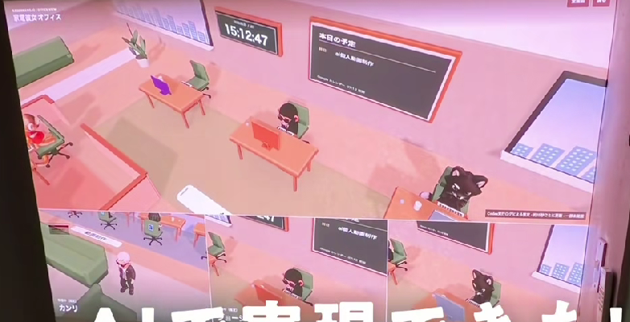
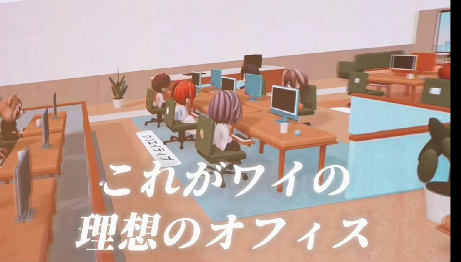
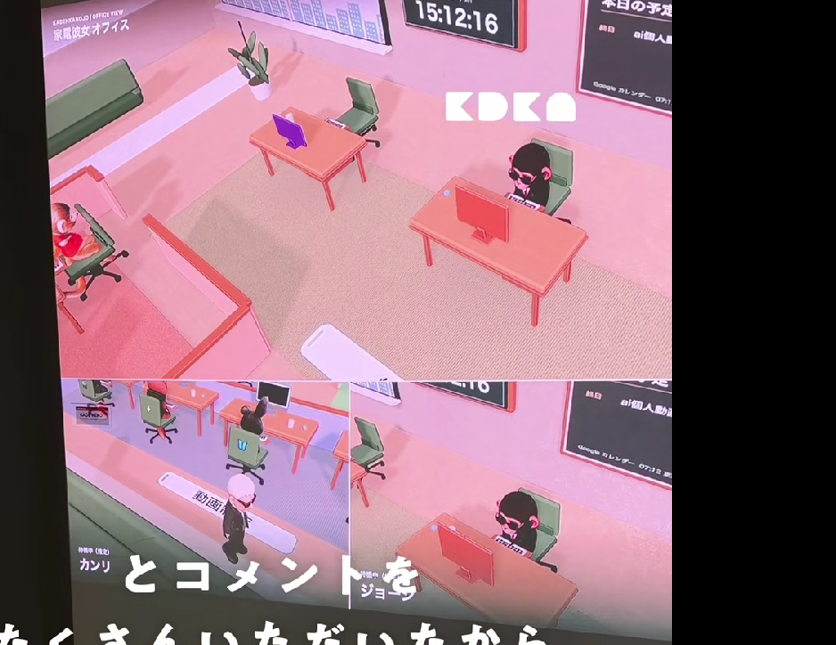
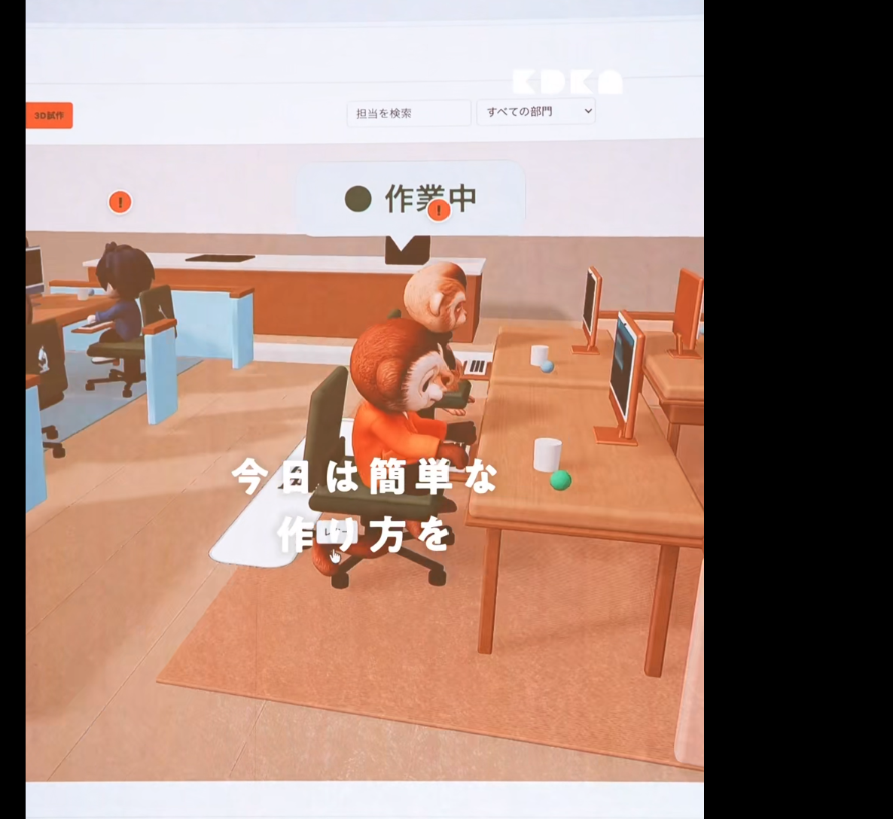

# Referensi video kantor AI — catatan sumber

Tanggal: 11 Oktober 2026. Pendamping [PRD induk](../PRD.md), bukan PRD terpisah.

Pemilik mengirim enam screenshot dan ringkasan untuk melengkapi `office-visual-reference.mp4`. Keenam gambar telah ditinjau secara visual. MP4 penuh dan audio belum ditinjau langsung. Nomor frame mengikuti urutan lampiran, bukan urutan waktu yang diverifikasi. Ringkasan berikut dirapikan dari keterangan pemilik; bukan transkrip atau terjemahan audio yang diperiksa sendiri.

## Ringkasan dan timeline dari pemilik

Video sekitar 1 menit 22 detik, berbahasa Jepang, menampilkan kantor virtual 3D/isometrik dengan AI sebagai karakter karyawan. Kantor dapat dipantau melalui browser; pengguna memberi tugas, melihat status/riwayat, membagi peran, serta menyesuaikan ruangan dan karakter.

| Waktu menurut pemilik | Isi menurut pemilik |
| --- | --- |
| 00:00–00:08 | Perkenalan kantor virtual AI yang dikaitkan dengan Mac mini dan Codex. |
| 00:08–00:20 | Tampilan kantor melalui komputer dan smartphone. |
| 00:20–00:32 | Kantor isometrik, karakter, meja kerja dan contoh agent menjalankan tugas. |
| 00:32–00:44 | Demonstrasi pemberian pekerjaan melalui aplikasi. |
| 00:44–00:52 | Panel riwayat pekerjaan untuk memantau aktivitas AI. |
| 00:52–01:04 | ChatGPT/Codex serta pembagian peran atau departemen. |
| 01:04–01:12 | Contoh email, progres spreadsheet dan beberapa tugas. |
| 01:12–01:22 | Pembuatan ruangan 3D serta penyesuaian karakter. |

Pemilik membandingkan konsep video dengan Kael: Kael menambahkan manager khusus per divisi, briefing/meeting, pemeriksaan manager, approval Founder, antrean, revisi, koordinasi antardivisi serta aturan perilaku karakter. Demonstrasi visual tidak cukup untuk membuktikan semua agent bekerja otomatis atau semua fitur sudah berfungsi.

## Observasi screenshot dan penerapannya

| Gambar | Yang terlihat langsung | Penerapan di Kael |
| --- | --- | --- |
| 01 | Meja terpisah, kursi hijau, karakter, tanaman, jendela, jam digital dan papan dinding; warna dominan pink; bagian bawah berupa potongan tampilan lain. | Furnitur dan orientasi ruang sebagai referensi; palet akhir mengikuti identitas Kael. Papan/jam tidak membuktikan integrasi kalender. |
| 02 | Kelompok meja dengan beberapa karakter chibi, monitor, kursi, karpet biru, partisi rendah dan sofa di belakang. | Kelompok meja divisi dengan koridor terbuka; proporsi karakter tetap memakai turnaround Kael. |
| 03 | Pandangan sudut tinggi atas beberapa meja, kursi kosong/terisi, karpet, sofa, tanaman, jam dan papan; bagian bawah menampilkan sudut lain. | Pandangan keseluruhan dan fokus karakter. Screenshot gabungan tidak membuktikan aplikasi memiliki mode layar terbagi. |
| 04 | Balon status di atas karakter, ikon tanda seru, kolom pencarian dan dropdown departemen; beberapa karakter duduk di meja. | F26 dan D12: pencarian/filter serta status dengan alasan nyata. Makna pasti tanda seru pada aplikasi sumber belum diketahui. |
| 05 | Lima kartu karakter bernama dalam satu kelompok, dengan variasi rambut, pakaian dan kacamata. | D13: pilihan tampilan karakter anggota; bukan kewajiban memakai lima karakter atau menyalin kostumnya. |
| 06 | Pandangan keseluruhan kantor terbuka, kelompok meja di tengah, partisi rendah, jalur di sekelilingnya, sofa, tanaman, jendela dan banyak penanda di atas karakter. | D05/D08/D11: komposisi kantor yang terbaca dari jauh, jalur terbuka, overview dan fokus agent. Jumlah meja/agent tidak dijadikan batas produk. |

Screenshot mendukung konsep visual, bukan pembuktian fungsi. Akses smartphone, pemberian tugas, panel riwayat, email, spreadsheet, serta proses pembuatan ruangan dijelaskan oleh pemilik tetapi tidak seluruh alurnya terlihat pada enam gambar ini. Kemampuan Kael tetap ditentukan oleh implementasi dan pengujian sendiri.

## Galeri sumber

### 01 — meja, papan dinding dan jam

Sumber: `codex-clipboard-6f060465-f470-40ad-9446-18c0885fe09c.png`.

### 02 — kelompok meja divisi

Sumber: `codex-clipboard-fe0b3b83-73fa-47db-93d0-40c5e1a8b623.png`.

### 03 — sudut pandang kantor

Sumber: `codex-clipboard-a4bc8143-bff9-4343-abe9-381e2e3c097e.png`.

### 04 — status agent dan kontrol pencarian

Sumber: `codex-clipboard-91d4528b-fc3b-4c6e-a95d-09c5db1f135c.png`.

### 05 — kartu karakter

Sumber: `codex-clipboard-ccd156b3-7644-4bcc-bd73-267b09b5a8b3.png`.

### 06 — keseluruhan kantor

Sumber: `codex-clipboard-e7d82f0c-dba8-421b-ade8-cde7bf75f7ad.png`.

